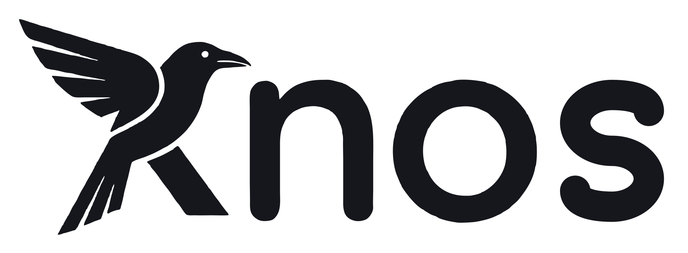

<h1>
  <picture>
    <source media="(prefers-color-scheme: dark)" srcset="https://raw.githubusercontent.com/drexthealpha/Knos/v0.4.1/web/brand/wordmark-dark.svg">
    <source media="(prefers-color-scheme: light)" srcset="https://raw.githubusercontent.com/drexthealpha/Knos/v0.4.1/web/brand/wordmark-light.svg">
    
  </picture>
</h1>

Knos locks a test before any work starts, and test money moves to the agent that did the work only if that test passes.

The problem: research takes about 17 years to reach people ([Morris, Wooding and Grant, 2011](https://doi.org/10.1258/jrsm.2011.110180)),
and checking that a result really works is one slow, costly step on that road.

| You judge for | The same loop, used for | Read | Try it live |
|---|---|---|---|
| From NEAR HACKATHON | a research paper's claim, its test locked on NEAR | [Knos on NEAR](#from-near-hackathon) | https://drexthealpha.github.io/Knos/ |
| From the InterSystems contest | a test result's criteria, checked in IRIS | [Knos on IRIS](iris/README.md) | [the video](https://raw.githubusercontent.com/drexthealpha/Knos/main/iris/media/knos-iris.mp4) or one command on your machine (the online demo is offline during voting) |
| From Colosseum | a pull request's checks, paid on Solana | [The ten-second check](#from-colosseum) | https://drexthealpha.github.io/Knos/check/ |

Test money only: test USDC on NEAR testnet and Solana devnet. No customers yet.

<!-- entry:near -->
## From NEAR HACKATHON

A visitor enters a paper's link and asks Knos to check its claim. NEAR locks the claim's test by its sha256 in a jobs
contract before any agent starts, and refuses any agent step over its spending cap.

The check runs with test money held with the job: the jobs contract sends 9 parts to the agent whose code passed the
locked test and keeps 1 part in 10 for Knos's account. The visitor gets a Yes or No with the code, and a receipt on NEAR testnet.

Agent A runs either its fixed program or code a private model on NEAR AI Cloud wrote, its attestation checked. Most
checks on 14 Nov ran the fixed program; the receipt and the release transaction say which (`model_verified`, or
"fixed rule, no model signature"). A model call reviews the code and may only reject it; a cached review says so.

### Judge it in 2 minutes

1. Open https://drexthealpha.github.io/Knos/ and press **Sample question** - see "Yes, the claim holds" and "Checked by
   a test set before any work started."; How it works holds test_hll.py and its job. The test file's sha256 is one
   tap on: press **The claim** and see "The test
   file's sha256, its fingerprint".
2. Open **How it works**, press **Run the check yourself**, then **Run the check with 10 test dollars** - see "1. The test is locked", "2. Two agents ran
   the paper’s result against the locked test", "3. The spending cap blocked an over-budget step" with NEAR's refusal,
   then "4. Answer: Yes, the claim holds": 15 to 80 s when a job is ready (checks on 14 Nov), 1 to 2 min when one is not. The check
   uses test money only. To see every step and the receipt without running one, open
   [one finished check](https://drexthealpha.github.io/Knos/prove/receipt/) (job-1114145004, 14 Nov), saved as the page showed it.
3. In step 2, see "Agent A's code was written by" with the model and its call id, or "Agent A's code: a fixed program"
   and why. Then see "Receipt for proof job-..." with "9.00 to the agent whose code passed, 1.00 to Knos's test account" and "The
   jobs contract held it with the job", each transaction read from NEAR's RPC in your browser, with no explorer and no
   bot check ([the saved check's release](https://drexthealpha.github.io/Knos/tx/?h=CZPCygBuzzpqXm3SuDAdXUhFCwKjCjzmZBjp7yRor6DH):
   "9.00 test USDC from jobs.knos-swarm-1105.testnet to agent-a2..." and "1.00 test USDC from jobs.knos-swarm-1105.testnet to knos-payer-1102.testnet").
   From a terminal, `curl -s https://archival-rpc.testnet.near.org -H 'Content-Type: application/json' -d '{"jsonrpc":"2.0","id":1,"method":"tx","params":["CZPCygBuzzpqXm3SuDAdXUhFCwKjCjzmZBjp7yRor6DH","live.knos-swarm-1105.testnet"]}'`
   shows the same transaction.
   After a live run (the saved page does not have it), press **Check the same claim again** - see "Free: Yes".
4. Optional, about 2 minutes more, from a clone (`git clone https://github.com/drexthealpha/Knos && cd Knos`). On Windows, use Git Bash and write
   `py -3` where the commands say `python3`:

   ```bash
   sha256sum near/agents/job/test_jump.py
   curl -s https://rpc.testnet.fastnear.com -H 'Content-Type: application/json' -d '{"jsonrpc":"2.0","id":1,"method":"query","params":{"request_type":"call_function","finality":"final","account_id":"jobs.knos-swarm-1105.testnet","method_name":"get_job","args_base64":"eyJpZCI6ImpvYi0xMTEyMDUzMjM5In0="}}' | python3 -c 'import json,sys; j=json.loads(bytes(json.load(sys.stdin)["result"]["result"])); print(j["criteria_hash"], j["state"])'
   d=$(mktemp -d) && cp near/agents/job/test_jump.py $d/ && cp near/agents/solutions/jump_a.py $d/solution.py && (cd $d && python3 test_jump.py)
   ```

   - see the hash `ffa9d064744e7ea0cc326039f55a979a588e2c1cdb3f59368ff4a99c986057cb` beside the file's name, then
     `ffa9d064744e7ea0cc326039f55a979a588e2c1cdb3f59368ff4a99c986057cb Paid` (the hash NEAR locked for
     job-1112053239), then `Passed: 9.2% of 100,000 keys moved going from 10 to 11 buckets (the ideal: 9.1%), all to
     the new one, the fullest bucket 1.5% over the mean, nothing stored.`

Video, 51 s: one real check on the live site on 14 Nov (job-1114200906), where the private model on NEAR AI Cloud wrote agent A's code and the jobs contract paid 9.00 and 1.00: [near/web/knos-near.mp4](near/web/knos-near.mp4) (the 12 Nov cut: [knos-near-2026-11-12.mp4](near/web/knos-near-2026-11-12.mp4)). An agent runs the same flow in
one call:

```bash
curl -X POST https://knos.onrender.com/api/near/claim/flow -H "Content-Type: application/json" -d '{"url": "https://doi.org/10.46298/dmtcs.3545", "amount": 10}'
```

It answers with `verdict`, `code`, `cap`, `paid`, `settled` and `receipt`.

### What NEAR does here

Each NEAR claim with its code, its test and its testnet transaction: [near/CLAIMS.md](near/CLAIMS.md).

| NEAR feature | In Knos | Where |
|---|---|---|
| Contracts | the jobs contract locks each test's sha256, holds the test money with the job and, after the checker's signed pass, sends 9 parts to the agent and keeps 1 part in 10 for Knos's account, in one transaction; after the deadline it refunds the account that put the money in ([one refund](https://drexthealpha.github.io/Knos/tx/?h=GdtVSaPqybHgAgDj7NkjymbAtwD3pQZ5vkeCVQKVxik9), [refused before its deadline](https://drexthealpha.github.io/Knos/tx/?h=6NeMksB6nBmaUMSNmbyYMxFdWRtwXDj6TncUWwrFN67q)); `get_totals` and `get_agent_record` count it all (a check with another amount than the default 10 test USDC is sent by Knos's own test account that sends the test money, through the claim market) | `near/contract/`, `near/market/`; accounts in [docs/reference/NEAR.md](docs/reference/NEAR.md) |
| Agent spending rules | an agent's budget in the jobs contract refuses a spend over its cap, over its daily cap, to a payee off its allow-list, or while an owner has paused the contract, and holds a spend over its hold line until the approver releases it; each is on chain with the contract's own answer, and a solution the AI reviewer rejected for a hard-coded answer is recorded there too (`record_rejection` takes the payer's or an owner's word: it records what the reviewer said, it does not check it) | [the saved check](https://drexthealpha.github.io/Knos/prove/receipt/#rules), the receipt's "spending cap" step |
| Private inference | NEAR AI Cloud writes and reviews agent A's code; its attestation and each answer's signature are verified, and before it pays the jobs contract recovers NEAR AI's signer with `ecrecover` and logs `model_verified` ([one release](https://drexthealpha.github.io/Knos/tx/?h=4a6KCPier4TtoSGbezHe2wLchx1dwhKSyfGmnJmS9BRD)); a check on agent A's fixed program logs "fixed rule, no model signature". The TEE attestation is checked off chain, by Knos's server; the contract checks only that the signer is one an owner added | `near/contract/src/jobs.rs`, `apps/wanted/knos_wanted/near_attest.py` |
| Who decides a pass | Knos's checker runs the locked test off chain; the jobs contract pays only on a release token signed by the checker's key, which 2 of the 3 owners set. The checker and all 3 owner accounts are Knos's own, as is the test account that sends the test money | `near/contract/src/jobs.rs` (`release_job`), `near/agents/checker.py` |
| Chain Signatures | a separate payout path, not part of the check flow: `knos-pay-1103.testnet`'s `sign_payout` had NEAR's MPC signer sign a Solana devnet payout on 3 Nov ([tx 4eJPkBn5…](https://drexthealpha.github.io/Knos/tx/?h=4eJPkBn5jiAoGGBayYKVmreHcL5nqFCLhnRD1Rw4kKUR)) | [docs/reference/NEAR.md](docs/reference/NEAR.md) |

Keys, as NEAR testnet's `view_access_key_list` shows them: the jobs and claim market contracts hold none (deleted
14 Nov, linked in [docs/reference/NEAR.md](docs/reference/NEAR.md)).

Agent-a, agent-b and agent-b2 hold keys allowed only
`take`, `submit` and `spend`; agent-a2's one key may call any jobs method and has no full-access key to narrow it; the
account live.knos-swarm-1105 (Knos's own test account that sends the test money) and the fee account knos-payer-1102 hold
full-access keys, so Knos's server can sign from them.

Tokens: checks settle in `knos-usdc-1102.testnet`, Knos's own test USDC; the claim markets of the wallet test use Circle's
testnet USDC, which the jobs contract also takes (`get_totals` counts each token); no check has settled in it yet. NEAR
Intents appears only as a dry 1Click quote, with no money moved.

### The diff, disclosure and libraries

- **The diff.** The tag `pre-hackathon` (31 Oct 2026) is a commit from before the first line of `near/`; the tag
  `hackathon-submission` is the submitted commit. Everything built in the window:
  https://github.com/drexthealpha/Knos/compare/pre-hackathon...hackathon-submission. The diff also holds work for the
  other contests; the entry is only the NEAR work: `near/`, the `near_*.py` files of `apps/wanted/knos_wanted/`, the
  pages under `web/` that call them, and their tests.
- **Tracks.** The entry was submitted with four: Agent Economy (`agents`), Swarms (`swarms`), AI Security & Defense
  (`security`) and Privacy & Private AI (`privacy`).
- **Built before, on another chain.** The pull request check and the Solana devnet programs are the same Knos, built
  before the window for Colosseum (tag v0.3.28); they are not part of this NEAR entry.
- **AI-written code.** Claude Code wrote most of the code; the founder set each task and reviewed each change. In a check,
  agent A's code is written by DeepSeek V4.1 Flash on NEAR AI Cloud when the model's code passes; otherwise agent A
  runs its fixed program, and the receipt says which.
- **Libraries.** `near-sdk` and `near-contract-standards` 5.30.0, `base64` 0.22, `serde` 1, `serde_json` 1; tests
  only: `near-sandbox` 0.4.0, `near-api` 0.8.0, `tokio` 1, `rsa` 0.9, `sha2` 0.10, `rand` 0.8; Python: `cryptography`,
  `certifi`, `dcap-qvl` 0.7.1 and `eth-account` 0.14.0 (the attestation and signature checks), `numpy` 2.3.4 (the space,
  simulation and hardware claims' tests); the site: GSAP 3.12.5 from cdnjs. Tools: Rust, `cargo-near` 0.22.0, near-cli-rs. The full table: [docs/reference/NEAR.md](https://github.com/drexthealpha/Knos/blob/main/docs/reference/NEAR.md#disclosure).

Everything else (every claim and how to check it, the accounts on NEAR testnet, the tests and attacks, running it
yourself): [docs/reference/NEAR.md](docs/reference/NEAR.md).
<!-- /entry:near -->

<!-- entry:iris -->
## From the InterSystems contest

An InterSystems IRIS production pays each step of lab work only when its test passed: an AI Hub agent reads the result,
a rule decides, and above $50 a person approves.

- **The online demo is offline during voting.** It ran in a GitHub codespace, whose free hours ran out on 14 Nov at
  about 21:20 UTC. Watch the video, or run Knos with one command on your machine (below).
- Video: 43 s, a narrated live run on 13 Nov 2026 from the online demo, downloadable with no login: [knos-iris.mp4](https://raw.githubusercontent.com/drexthealpha/Knos/main/iris/media/knos-iris.mp4).
- Community idea: it implements [DPI-I-689](https://ideas.intersystems.com/ideas/DPI-I-689), each decision step an
  interoperability message.
- [Judge it in 2 minutes](#judge-it-in-2-minutes-on-iris): with the video, no login and no key.

### Judge it in 2 minutes on IRIS

The online demo is offline during voting, so these steps use the video; the next section runs it on your machine.

1. Open [knos-iris.mp4](https://raw.githubusercontent.com/drexthealpha/Knos/main/iris/media/knos-iris.mp4) (43 s) - see
   the production running in the IRIS portal and one sample decided by the AI Hub agent on NEAR AI Cloud.
2. Watch on - see that decision's trace, then the same session in Visual Trace.

### Run it on your machine (about 6 minutes)

You need Docker with about 4 GB free; the first build takes about 4 minutes, as in CI. This one-command edition is the
public IRIS for Health Community image (2026.2), which has no AI Hub: its samples replay the AI Hub agent's answers
recorded in the online demo, and the rules referee decides anything else.

1. Run:

   ```sh
   git clone https://github.com/drexthealpha/Knos && cd Knos/iris
   docker compose -f docker-compose.public.yml up -d --build && bash scripts/ready.sh
   ```

   - see `READY: open http://localhost:52773/knos/ and press a sample button`. [CI runs it from a fresh checkout](https://github.com/drexthealpha/Knos/actions/workflows/iris-public.yml).
2. Open http://localhost:52773/knos/ and press **A passing test, $20** - see it marked paid: "Paid in play money".
3. Open http://localhost:52773/csp/sys/UtilHome.csp, sign in as `_SYSTEM` with `knos-public-demo`, then Interoperability >
   Production - see `Knos.Iris.Production` and each decision's Visual Trace.

**The contest entry: build 154 with AI Hub.** With the image file from the
[AI Hub Early Access portal](https://evaluation.intersystems.com/Eval/early-access/AIHub) (an InterSystems login):
`bash scripts/load-image.sh <the tar>`, `bash scripts/env-secrets.sh && docker compose up -d --build`, then
`bash scripts/ready.sh`. There the AI Hub agent can decide on a model.

The live run of 12 Nov, the contest task part by part, the bonuses and troubleshooting:
[docs/reference/IRIS.md](docs/reference/IRIS.md).

**Why a payout step in a lab workflow.** A lab funds outside work in steps, so the last step of the decision is to pay
the one whose test passed. In replay mode PAY runs a devnet simulation of that payout: it proves the gate reached PAY
and the payout path ran end to end, and no money moves.

**Why I built this.** A solo founder, building Knos since 1 Sep 2026. IRIS and its Docker build would not fit on an 8 GB laptop, so every IRIS build and test moved to one GitHub
Codespace ([the problems I hit](https://github.com/drexthealpha/Knos/blob/main/docs/reference/IRIS.md#problems-i-hit-and-how-i-fixed-them)).
<!-- /entry:iris -->

<!-- entry:colosseum -->
## From Colosseum

The Colosseum entry is tag v0.3.28 (built 14 Sep to 12 Oct 2026): it pays AI coding agents only when your own checks
pass.

In that entry you posted a task, a price and your tests on a GitHub issue; the money waited in a Solana program, and
when the pull request was merged the program checked GitHub's signature on the checks before it paid. Solana devnet,
test USDC.

### Judge it in 2 minutes

1. Open https://drexthealpha.github.io/Knos/check/ - see "The ten-second check" and "Built 14 Sep to 12 Oct 2026 for
   Colosseum (tag v0.3.28)".
2. Paste `https://github.com/drexthealpha/knos-playground/pull/35` into **Pull request** and press **Check** - see
   "Claims nothing about tests; every check passed."
3. Press the link "4PovnMjD...2zcDxt" on that page - see a payment of 0.25 test units on Solana devnet, 2 Oct 2026, by
   program 9UzPF...AdfDi, which the explorer lists as "Unknown Program": the first deployment of Knos's payment program.

The code as entered: https://github.com/drexthealpha/Knos/tree/v0.3.28. More: [docs/reference/COLOSSEUM.md](docs/reference/COLOSSEUM.md).

<!-- /entry:colosseum -->

## Use Knos where you already are

Add Knos to a chat or coding assistant that takes connectors, with one command:

```
claude mcp add --transport http knos https://knos.onrender.com/mcp
```

It gives two tools: `tools` lists what Knos can do, and `run` runs one. A worked example, the front door's sample battery test checked against its limit without the connector:

```
curl -s https://raw.githubusercontent.com/drexthealpha/Knos/main/near/agents/job/data/limit/sample.csv | jq -Rs '{id: "limit-check", table: ., column: "capacity_ah", rule: "above", limit: 1.4}' | curl -s -X POST https://knos.onrender.com/api/run -H "Content-Type: application/json" -d @-
```

The answer's `result` is `Failed at row 136: 1.399 is not above 1.4. Rows: 135 passed, 33 failed, 0 unmeasurable.` Its `link` opens the result. Through the connector, `run` with the same `id`, `table`, `column`, `rule` and `limit` returns the same answer.

## More

[Why](docs/WHY.md) Knos exists. The full reference: [docs/reference/NEAR.md](docs/reference/NEAR.md), [docs/reference/IRIS.md](docs/reference/IRIS.md) and
[docs/reference/COLOSSEUM.md](docs/reference/COLOSSEUM.md). MIT licence. Built by drexthealpha, a
solo founder.

<!-- mcp-name: io.github.drexthealpha/knos -->
