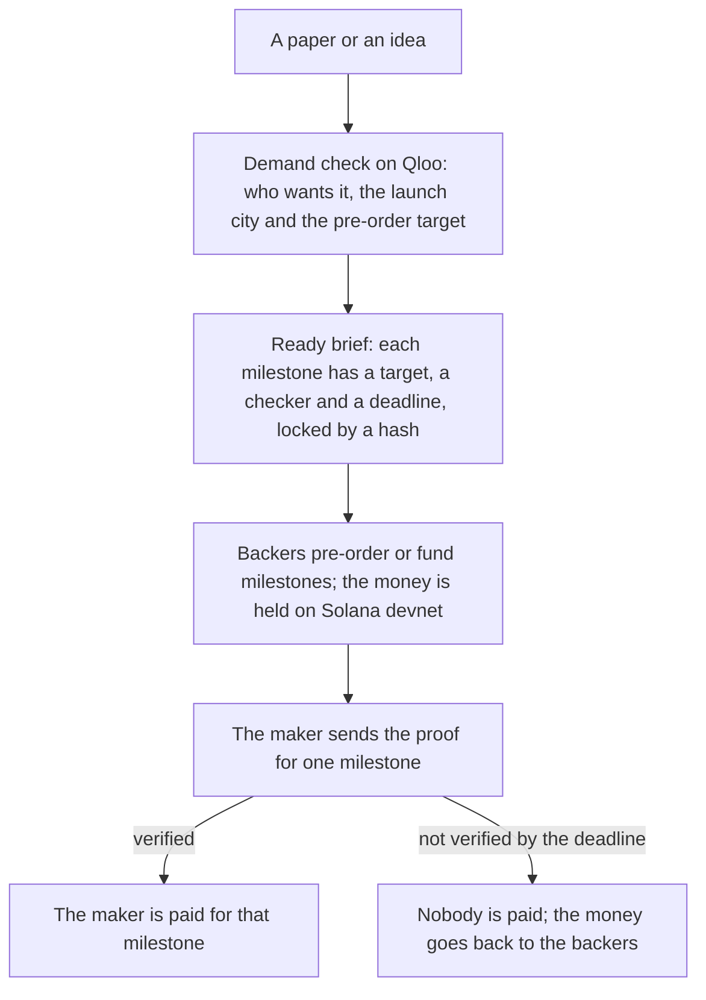
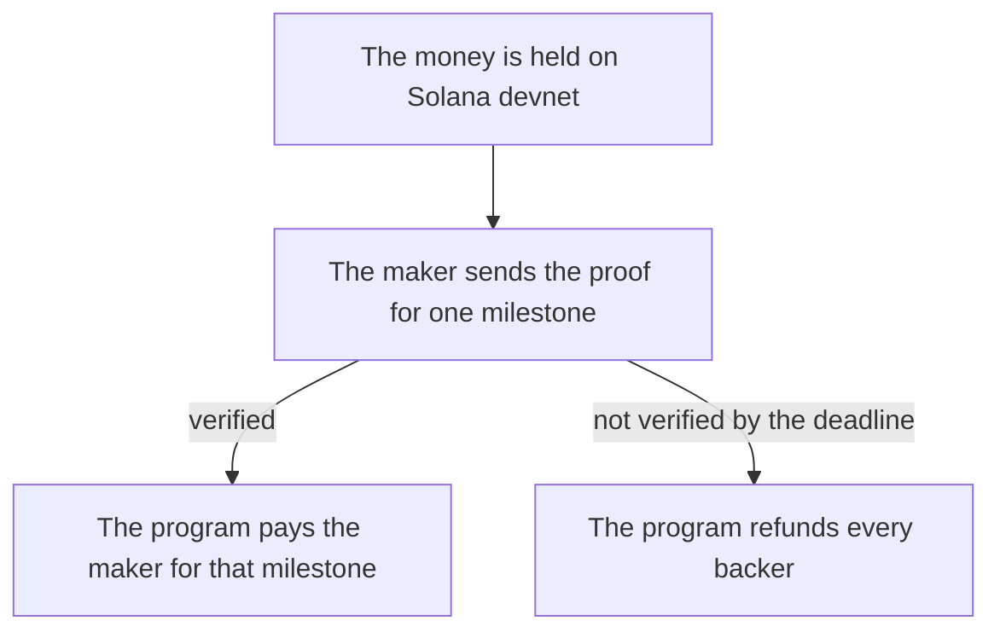

<h1>
  <picture>
    <source media="(prefers-color-scheme: dark)" srcset="https://raw.githubusercontent.com/drexthealpha/Knos/v0.4.0/web/brand/wordmark-dark.svg">
    <source media="(prefers-color-scheme: light)" srcset="https://raw.githubusercontent.com/drexthealpha/Knos/v0.4.0/web/brand/wordmark-light.svg">
    
  </picture>
</h1>

**Knos carries research across the valley of death: see who wants it and where, then get paid only on proof.**

A demand check on Qloo sets the terms, and the money waits on Solana until the proof passes.

Ready briefs: 2.08x fewer output tokens, 70% vs 5% passed ([measured](https://github.com/drexthealpha/Knos/blob/main/docs/idt/summary.json)).

Devnet, test money, no customers yet.

[Check demand](https://drexthealpha.github.io/Knos/#demand) · [Check every claim yourself](docs/reference/MANIFEST.md)

## How it works



*No money locks on a vague brief. Each step is paid only when its proof is verified.*

1. **Check demand.** A [demand check](docs/reference/DEMAND_CHECK.md) asks [Qloo](docs/WORDS.md#qloo) who would buy the product and where. Qloo's heatmap names the launch city.
2. **Ready brief.** That city and the pre-order target become the terms of a [Ready brief](docs/WORDS.md#ready-brief). Each [milestone](docs/WORDS.md#milestone) has a target, a checker and a deadline. A [criteria hash](docs/WORDS.md#criteria-hash) locks them. If the city falls short by the first deadline, every pre-order is refunded.
3. **Money held.** [Pre-orders](docs/WORDS.md#pre-order) and milestone funding wait in a program on [Solana](docs/WORDS.md#solana), not with Knos.
4. **Paid on proof.** The maker sends the proof. When it is verified, the program pays for that milestone. Example: an agent was paid [5 test units for verified work](https://explorer.solana.com/tx/53pd6Rfdtcj34rHUtV7UnCQyfFRVXe5Vot2ujFCXR6dcrHeziwQRyry2ekeph5iHKX9L7ALc3W4GjhVSN5LLMGw7?cluster=devnet) on devnet. [The newest payout](https://knos.onrender.com/api/agent/payout/latest), read from chain, says what released it.

Add Knos to Claude Code with one command: `claude mcp add --transport http knos https://knos.onrender.com/mcp`

**Open call:** have research waiting for a market? [Cross it on Knos](https://knos.onrender.com/invite): the page counts every crossing and pre-order by people outside Knos, live.

## Paid on proof

The proof is checked before any money moves. A milestone names its checker in the brief. The proof can be:

- a lab result or a public evidence page, read by the milestone's checker;
- checks that GitHub signs, verified on chain;
- the same verdict signed by two of three [referees](docs/WORDS.md#referee);
- a verdict from [IRIS](https://github.com/drexthealpha/Knos/tree/main/iris) inside a lab's own walls. Its agent can only say no or ask a person.



*Nothing is paid on a promise. A missed deadline sends the money back.*

## Try it in ten seconds

Open [the demand check](https://drexthealpha.github.io/Knos/) in your browser. Type what you are about to build, or press one of the samples. Qloo's taste data says who wants it and where to launch it. The whole crossing runs in [the app](https://knos.onrender.com/app/), with nothing to install and no sign-up.

## Why nobody can fudge the count

The terms of a brief are locked by a [hash](docs/WORDS.md#hash) before any money moves. A changed target or deadline gives a different hash. So a change cannot hide.

The money waits in a program on [Solana](docs/WORDS.md#solana), not with Knos. That program pays only on a verified proof. At the deadline it refunds the backers instead.

**Neither the maker nor Knos can move the money alone.**

Today one person can still change that program, after a public wait ([who holds the keys](docs/TRUST.md)).

Today Knos earns its fee only when work is accepted. When you get a refund, the fee goes back to you. So Knos gains when work passes, and it is not yet fully neutral ([what is enforced and what is a promise](docs/reference/CHARTER.md)).

## Is it real?

It runs on test money only: [test USDC](docs/WORDS.md#test-usdc) on Solana's practice network, [devnet](docs/WORDS.md#devnet).

There are no customers yet. Nobody has bought anything ([what is not real yet](docs/reference/DISCLOSURE.md)).

One person holds every key today. Any change to the programs waits in public for 8 days first ([who holds the keys](docs/TRUST.md)).

<!-- bench:today -->
| What | Today | Read from |
|---|---|---|
| This copy | Release 0.4.0, October 2026. A copy naming an older release, or another product, is out of date | [CHANGELOG.md](CHANGELOG.md); the newest: [PyPI](https://pypi.org/project/knos/) |
| Reproduced by someone else | 0 of 267 | [docs/reference/CAPABILITIES.md](docs/reference/CAPABILITIES.md), the rows "reproduced by someone else" |
| Exercised at the public devnet program ids | 26 of 267: GitHub token verification, funding by one comment, funding from a wallet, pay on merge, refund at the deadline, pause, work orders, an order paying up to four payees, orders judged by the buyer's black-box tests, auto-accepted orders, a holdback released after its warranty, top-ups, single-use tokens, one counted evaluation, a counted batch of evaluations, the seller's own count, a payee's passkey wallet, a passkey funder, the passkey relay, the site's Buy page, an x402 order, the upgrade gate, strict JSON in the verifier, an outcome that is not code, ES256 tokens in one transaction, the presentation grace | [docs/reference/CAPABILITIES.md](docs/reference/CAPABILITIES.md), the rows "exercised on devnet" |
| Deployed at the public devnet program ids, no transaction recorded | 3 of 267: GitLab token verification, the key guardian, holding pay for a payee with no wallet | [docs/reference/CAPABILITIES.md](docs/reference/CAPABILITIES.md), the rows "deployed on devnet" |
| Tested here only | 234 of 267, each with the test its row names | [docs/reference/CAPABILITIES.md](docs/reference/CAPABILITIES.md), the rows "tested locally" |
| Written, not tested | 4 of 267 | [docs/reference/CAPABILITIES.md](docs/reference/CAPABILITIES.md), the rows "implemented" |
| Outside funders | 0 | [docs/NUMBERS.md](docs/NUMBERS.md), row 1 |
| Outside repositories | 0 | [docs/NUMBERS.md](docs/NUMBERS.md), row 2 |
| Outside payees | 1, on tasks Knos funded itself | [docs/NUMBERS.md](docs/NUMBERS.md), row 3 |
| Payments between unrelated accounts | 3, on tasks Knos funded itself | [docs/NUMBERS.md](docs/NUMBERS.md), row 4 |
| Buyer interviews held | 0 | [docs/NUMBERS.md](docs/NUMBERS.md), row 5 |
| Letters of intent | 0 | [docs/NUMBERS.md](docs/NUMBERS.md), row 6 |
| Reproductions signed by GitHub | 0 | [docs/NUMBERS.md](docs/NUMBERS.md), row 7 |
| Outside programs reading the verifier | 0 | [docs/NUMBERS.md](docs/NUMBERS.md), row 8 |
| Shadow counts published | 0 | [docs/NUMBERS.md](docs/NUMBERS.md), row 9 |
| Paying customers | 0 | [docs/reference/DISCLOSURE.md](docs/reference/DISCLOSURE.md) |
| Revenue | 0; test USDC is not money | [docs/PRICING.md](docs/PRICING.md) |
| Outside security review | none | [docs/reference/ASSURANCE.md](docs/reference/ASSURANCE.md) |
| Key holders | one person holds every key; an upgrade waits 8 days in public | [docs/reference/GOVERNANCE.md](docs/reference/GOVERNANCE.md) |
| Network and money | Solana devnet, test USDC; mainnet is not touched | [docs/reference/SECURITY.md](docs/reference/SECURITY.md) |
<!-- /bench:today -->

## From a terminal

```sh
knos demand "a vegan ramen food truck" --place London     # Qloo's demand check: who, where, price tier
knos idea get arxiv:<id> --out idea.json                  # a paper as one claim record
knos idea wanted idea.json                                # demand evidence and the stage plan; sends nothing
knos idea commit idea.json --units <n> --price <n>        # lock the stages on devnet, one order a stage
knos idea check idea.json <oracle>                        # is one stage met right now?
knos idea release <commitment> <stage> --sig <verdict>    # pay a met stage on the referees' signed verdicts
knos idea refund <commitment> <stage> --wallet <keypair>  # refund a missed stage; anyone may send it
```

Install with `pip install knos`. The app answers the same steps over HTTP: `POST /api/check` (the demand check), `POST /api/ready` (the Ready brief) and `POST /api/preorder` (a pre-order on devnet). Run `knos idea --help` for every option.

## Check every claim yourself

Start at [the release page](docs/reference/MANIFEST.md): the code, how it is built, what runs on devnet, the payments and the fees.

One payment from start to end, on 9 Oct 2026 with Knos 0.3.23, in a repository Knos owns, with test USDC (one step fixed by hand): [funded](https://explorer.solana.com/tx/3UaY22WKexigMpkVhibfeMdNgBiyybWm2Z4LuLskKGbNUDXV34yYWyH42atxFjELbrqSgoVs6TwpFzSQwhfXqzgM?cluster=devnet) · [wrong work refused](https://github.com/drexthealpha/knos-witness/actions/runs/37890511112/job/113690226126) · [paid](https://explorer.solana.com/tx/2PtmKUrQHKPARZE4nr35Te559NGQSG7tSHUfwzcKCAjL7gzvQ76fNTVLMWvq8mcZLxd27tbyTe31mCk2PxEGfAqa?cluster=devnet) (on verified proof) · [replay paid nothing more](https://github.com/drexthealpha/knos-witness/pull/10#issuecomment-6075196710) · [the record](https://github.com/drexthealpha/Knos/blob/main/evidence/knos-witness-acaa854d/witness.json).

Rebuild knos_oidc and knos_pay, the programs that check the proof and pay, and compare: the hash devnet runs equals the verified build hash recorded for each ([PROVENANCE](docs/reference/PROVENANCE.md)). Read on 27 Oct 2026.

```sh
solana-verify get-program-hash -u devnet FkwZdsYCmzicJMtHLTkPK76bYNVG4WNwkWJBiVWNtF3W   # knos_oidc: a2df952d262c48edacf2f594a01321e805c28f1dc523cb6efa75f2c45f34e632
solana-verify get-program-hash -u devnet 5y7iWJ1VAMJjnnWbbdo2a2PsWJEwTExSNpzrvQSEnS8k   # knos_pay: 8b3c044024eac6e00cf10930c325465d5682c3fb7273fe2f0d59c6e01f99867c
```

## Words

Qloo, Ready brief, milestone and more, each in one plain line: [docs/WORDS.md](docs/WORDS.md).

## Questions

### What is Knos?

Knos takes research from a paper to a product people want. It pays each step only on verified proof.

### How does Knos pay an AI agent?

You post the task, your [checks](docs/WORDS.md#checks-ci) and the pay before work starts. When the checks pass and you [merge](docs/WORDS.md#merge), a [program](docs/WORDS.md#program) pays the agent.

### Does Knos use real money?

No. It runs on [devnet](docs/WORDS.md#devnet), Solana's practice network, with [test USDC](docs/WORDS.md#test-usdc) worth nothing.

### What does Knos cost?

Ten demand checks a month are free; releases will cost companies 1%. Today devnet charges 0.30%, at least 0.05 [test USDC](docs/WORDS.md#test-usdc).

### Who holds the money?

A program on [Solana](docs/WORDS.md#solana) holds it, not Knos. Today one person can change that program, after a public wait.

### Can the buyer refuse to pay?

Not once the checks pass and the work is merged. Before that, the buyer still chooses whether to merge.

### Who keeps the count of accepted work?

Neither side alone. A program checks GitHub's [signature](docs/WORDS.md#signed) of which workflow ran, on which commit.

### How do I try Knos?

Open [the front door](https://drexthealpha.github.io/Knos/) and type the product you want to build. It says who wants it and where, with no sign-up.


## Read more

- [Get started](docs/START.md): check demand, write a Ready brief, then hold the money and pay on proof.

- [Pricing](docs/PRICING.md): what Knos costs. Demand checks are free, 10 a month. The maker keeps 100%; the company pays the 1% release fee and the payment costs on top. Nobody is charged today.

- [Trust](docs/TRUST.md): who holds the keys, and what is tested.

- [The story](docs/STORY.md): one crossing, step by step, each with its evidence.

- [Every other document](docs/README.md): the map of the documents.

---

Contact: open an issue, or report a security problem privately: [SECURITY.md](SECURITY.md).

Below: tables that scripts write from the code and the chain, and the licence. Nobody types them by hand.

<!-- programs:start -->
| program | address | on devnet, as [`docs/capabilities.json`](docs/capabilities.json) records it |
|---|---|---|
| `knos-oidc`, the verifier | `FkwZdsYCmzicJMtHLTkPK76bYNVG4WNwkWJBiVWNtF3W` | runs `2.2` |
| `knos-pay`, the payment program | `5y7iWJ1VAMJjnnWbbdo2a2PsWJEwTExSNpzrvQSEnS8k` | runs `2.2` |
| `knos-meter`, the count | `FUMKkcE95x2kZUj1zZTCbgcYBmJ3WXPHL8pyA8J6anX` | runs `1.1` |
| `knos-passkey`, a wallet from a passkey | `FQPX9i5kQxLYKZyyPgM2fVK9am3w1LSk1Cuoer1sSY85` | runs `1.1` |
<!-- programs:end -->

<!-- authorities:start -->
Every program the app or this site uses, and who can upgrade it, read from devnet on 2026-10-26 ([`scripts/program_authorities.py`](https://github.com/drexthealpha/Knos/blob/main/scripts/program_authorities.py)):

| program | address | used for | upgrade authority |
|---|---|---|---|
| knos-pay 0.3.34: the app's live program (0.3.34) | `FaMHCjzyUexFncZrmNyFQNz3gBdsLbhTLke7QBFykJY4` | every pre-order, milestone payout and agent payout of the app | `CKCrTBN542pVhizxuSPVg8tvdnPooNxt9B7o97VuTjz2`, the Squads vault (an upgrade waits out its 8-day time lock) |
| knos-oidc 2.2: the verifier of GitHub's signed checks | `FkwZdsYCmzicJMtHLTkPK76bYNVG4WNwkWJBiVWNtF3W` | pay on merge, the site's signature line | `CKCrTBN542pVhizxuSPVg8tvdnPooNxt9B7o97VuTjz2`, the Squads vault (an upgrade waits out its 8-day time lock) |
| knos-pay 2.2: the payment program | `5y7iWJ1VAMJjnnWbbdo2a2PsWJEwTExSNpzrvQSEnS8k` | pay on merge, the site's work orders | `CKCrTBN542pVhizxuSPVg8tvdnPooNxt9B7o97VuTjz2`, the Squads vault (an upgrade waits out its 8-day time lock) |
| knos-meter: the count | `FUMKkcE95x2kZUj1zZTCbgcYBmJ3WXPHL8pyA8J6anX` | the meter on the site | `CKCrTBN542pVhizxuSPVg8tvdnPooNxt9B7o97VuTjz2`, the Squads vault (an upgrade waits out its 8-day time lock) |
| knos-passkey: a wallet from a passkey | `FQPX9i5kQxLYKZyyPgM2fVK9am3w1LSk1Cuoer1sSY85` | passkey wallets in the app | `CKCrTBN542pVhizxuSPVg8tvdnPooNxt9B7o97VuTjz2`, the Squads vault (an upgrade waits out its 8-day time lock) |
| knos-hook: the transfer hook | `AFQFtodihz5jAHpVBUk87AkH8FJsQdmHt8Z5NKLWRj1T` | the app's Token-2022 project credits | `CKCrTBN542pVhizxuSPVg8tvdnPooNxt9B7o97VuTjz2`, the Squads vault (an upgrade waits out its 8-day time lock) |
| knos-oidc, first deployment | `vpWym9azbPU5f2PH2a6n8c4RfmsyUeW2dMuWr1DSHcE` | the site's history of the first deployment | none: nobody can change it |
| knos-pay, first deployment | `9UzPFbh2A4e4sEPgngKG523FfYLnQ3qPfFVfFTTAdfDi` | the site's history of the first deployment | none: nobody can change it |
| SPL Record (Solana) | `recr1L3PCGKLbckBqMNcJhuuyU1zgo8nBhfLVsJNwr5` | the app's chain-state records | `7VaWK6qq7WLBiMQ8TTAGwrFJfAekAwra4UPKr4S5UNjB`, one key |
| SPL Memo (Solana) | `MemoSq4gqABAXKb96qnH8TysNcWxMyWCqXgDLGmfcHr` | the app's fee estimate and its notes on chain | none: not an upgradeable program |
| Token-2022 (Solana) | `TokenzQdBNbLqP5VEhdkAS6EPFLC1PHnBqCXEpPxuEb` | the app's project credits | `3URRPr96EV2wuNRgQKwQpuZitHHsVyDUen1eRSvEun9G`, one key |
| Squads multisig | `SQDS4ep65T869zMMBKyuUq6aD6EgTu8psMjkvj52pCf` | the upgrade and guardian vaults | `HM5y4mz3Bt9JY9mr1hkyhnvqxSH4H2u2451j7Hc2dtvK`, one key |
<!-- authorities:end -->

This page names no time for an upgrade, so it stays true before and after one. To see whether a change to the
programs is waiting, done or withdrawn, run `knos status`, or read the site's banner or its
[upgrade record](https://drexthealpha.github.io/Knos/upgrades.json) ([`web/upgrades.json`](web/upgrades.json) is the
copy kept here).

The first set of programs ([`programs`](programs)) has no upgrade authority, so nobody can change it.
It stays as a record, and no new task is funded there.

<!-- capabilities:start -->
**Reproduced by someone else:** none recorded yet. **Exercised on devnet:** `verify_github`, `fund_by_comment`, `fund_from_wallet`, `pay_on_merge` and more, each named in the table. **Deployed on devnet:** `verify_gitlab`, `key_guardian`, `hold_and_bind`. Everything else is tested locally, implemented or not built: [the table with the evidence](docs/reference/CAPABILITIES.md) has one row for each capability, from [`docs/capabilities.json`](docs/capabilities.json). Only runs at the public program ids count here. Each capability's row also notes, with its transaction, any earlier trial run at separate test addresses (Knos 0.3.14).
<!-- capabilities:end -->

MIT licence, all of it. Built by drexthealpha. Everything Knos remembers is kept by the [Sibyl](https://sibyllabs.org) memory engine.
<!-- mcp-name: io.github.drexthealpha/knos -->
