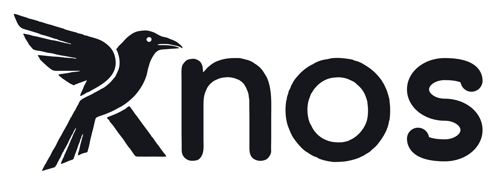

<h1>
  <picture>
    <source media="(prefers-color-scheme: dark)" srcset="https://raw.githubusercontent.com/drexthealpha/Knos/v0.4.1/web/brand/wordmark-dark.svg">
    <source media="(prefers-color-scheme: light)" srcset="https://raw.githubusercontent.com/drexthealpha/Knos/v0.4.1/web/brand/wordmark-light.svg">
    
  </picture>
</h1>

Knos locks a test before any work starts, an agent does the work, and money moves only if the test passes.

The problem: research takes about 17 years to reach people ([Morris, Wooding and Grant, 2011](https://doi.org/10.1258/jrsm.2011.110180)),
and checking that a result really works is one slow, costly step on that road.

| You judge for | The same loop, used for | Read | Try it live |
|---|---|---|---|
| From NEAR HACKATHON | a research paper's claim, its test locked on NEAR | [Knos on NEAR](#from-near-hackathon) | https://drexthealpha.github.io/Knos/ |
| From the InterSystems contest | a test result's criteria, checked in IRIS | [Knos on IRIS](iris/README.md) | [the online demo](https://glowing-xylophone-x5vxgjgjgv9399xq-52773.app.github.dev/knos/) (up at any hour until voting ends), or on your machine |
| From Colosseum | a pull request's checks, paid on Solana | [The ten-second check](#from-colosseum) | https://drexthealpha.github.io/Knos/check/ |

Test money only: test USDC on NEAR testnet and Solana devnet. No customers yet.

<!-- entry:near -->
## From NEAR HACKATHON

A buyer pastes a paper's link and orders a proof of its claim. NEAR locks the claim's test by its sha256 in a jobs
contract before any agent starts, refuses any agent step over its spending cap, and pays only the agent whose code
passes. The buyer gets a Yes or No, the code and a receipt on NEAR testnet.

Agent A's code is written by a private model on NEAR AI Cloud, its attestation checked (a cached answer for the same
claim and test is reused and says so, with its call id); a second model call reviews it and may only reject it.

### Judge it in 2 minutes

1. Open https://drexthealpha.github.io/Knos/ and press **Try: HyperLogLog** - see "Yes, the claim holds", the claim,
   its locked test with its sha256 and its proof (job-...).
2. Press **Prove it yourself**, then **Prove it with 10 test USDC** - see "1. The test is locked", "2. Two agents ran
   the paper's result against the locked test", "3. The spending cap blocked an over-budget step" with NEAR's refusal,
   then "4. Answer: Yes, the claim holds": about 15 to 35 s when a job is ready, 1 to 2 min when one is not. The order
   uses test money only. To see every step and the receipt without ordering, open
   [one finished order](https://drexthealpha.github.io/Knos/prove/receipt/) (job-1114145004, 14 Nov), saved as the page showed it.
3. In step 2, see "Agent A's code was written by" with the model and its call id, or "Agent A's code: a fixed program"
   and why. Then see "Receipt for proof job-..." with "9.00 test USDC to the agent, 1.00 test USDC to Knos" and "The
   jobs contract held it with the job", linked on the NEAR explorer ([the saved order's release](https://testnet.nearblocks.io/txns/CZPCygBuzzpqXm3SuDAdXUhFCwKjCjzmZBjp7yRor6DH),
   where both transfers come from `jobs.knos-swarm-1105.testnet`; if the explorer asks for a bot check,
   `curl -s https://rpc.testnet.near.org -H 'Content-Type: application/json' -d '{"jsonrpc":"2.0","id":1,"method":"tx","params":["CZPCygBuzzpqXm3SuDAdXUhFCwKjCjzmZBjp7yRor6DH","live.knos-swarm-1105.testnet"]}'`
   shows the same transaction).
   Press **Prove the same claim again** - see "Free: Yes".
4. From a clone (`git clone https://github.com/drexthealpha/Knos && cd Knos`). On Windows, use Git Bash and write
   `py -3` where the commands say `python3`:

   ```bash
   sha256sum near/agents/job/test_jump.py
   curl -s https://rpc.testnet.fastnear.com -H 'Content-Type: application/json' -d '{"jsonrpc":"2.0","id":1,"method":"query","params":{"request_type":"call_function","finality":"final","account_id":"jobs.knos-swarm-1105.testnet","method_name":"get_job","args_base64":"eyJpZCI6ImpvYi0xMTEyMDUzMjM5In0="}}' | python3 -c 'import json,sys; j=json.loads(bytes(json.load(sys.stdin)["result"]["result"])); print(j["criteria_hash"], j["state"])'
   d=$(mktemp -d) && cp near/agents/job/test_jump.py $d/ && cp near/agents/solutions/jump_a.py $d/solution.py && (cd $d && python3 test_jump.py)
   ```

   - see the hash `ffa9d064744e7ea0cc326039f55a979a588e2c1cdb3f59368ff4a99c986057cb` beside the file's name, then
     `ffa9d064744e7ea0cc326039f55a979a588e2c1cdb3f59368ff4a99c986057cb Paid` (the hash NEAR locked for
     job-1112053239), then `Passed: 9.2% of 100,000 keys moved going from 10 to 11 buckets (the ideal: 9.1%), all to
     the new one, the fullest bucket 1.5% over the mean, nothing stored.`

Video, recorded from the live pages: [near/web/knos-near.mp4](near/web/knos-near.mp4). An agent runs the same flow in
one call:

```bash
curl -X POST https://knos.onrender.com/api/near/claim/flow -H "Content-Type: application/json" -d '{"url": "https://doi.org/10.46298/dmtcs.3545", "amount": 10}'
```

It answers with `verdict`, `code`, `cap`, `paid`, `settled` and `receipt`.

### What NEAR does here

| NEAR feature | In Knos | Where |
|---|---|---|
| Contracts | the jobs contract locks each test's sha256, holds the buyer's price with the job and, after the checker's signed pass, pays 9 parts to the agent and 1 to Knos itself, in one transaction; after the deadline it refunds the buyer; `get_totals` and `get_agent_record` count it all (an order at another price than the default 10 test USDC is sent by the buyer test account through the claim market) | `near/contract/`, `near/market/`; accounts in [docs/reference/NEAR.md](docs/reference/NEAR.md) |
| Agent spending rules | an agent's budget in the jobs contract refuses a spend over its cap, over its daily cap, to a payee off its allow-list, or while an owner has paused the contract, and holds a spend over its hold line until the approver releases it; each is on chain with the contract's own answer, and a solution the AI reviewer rejected for a hard-coded answer is recorded there too | [the saved order](https://drexthealpha.github.io/Knos/prove/receipt/#rules), the receipt's "spending cap" step |
| Private inference | NEAR AI Cloud writes and reviews agent A's code; its attestation and each answer's signature are verified, and before it pays the jobs contract recovers NEAR AI's signer with `ecrecover` and logs `model_verified` ([one release](https://testnet.nearblocks.io/txns/4a6KCPier4TtoSGbezHe2wLchx1dwhKSyfGmnJmS9BRD)); an order on agent A's fixed program logs "fixed rule, no model signature" | `near/contract/src/jobs.rs`, `apps/wanted/knos_wanted/near_attest.py` |
| Who decides a pass | Knos's checker runs the locked test off chain; the jobs contract pays only on a release token signed by the checker's key, which 2 of the 3 owners set | `near/contract/src/jobs.rs` (`release_job`), `near/agents/checker.py` |
| Chain Signatures | a separate payout path, not part of the order flow: `knos-pay-1103.testnet`'s `sign_payout` had NEAR's MPC signer sign a Solana devnet payout on 3 Nov ([tx 4eJPkBn5…](https://testnet.nearblocks.io/txns/4eJPkBn5jiAoGGBayYKVmreHcL5nqFCLhnRD1Rw4kKUR)) | [docs/reference/NEAR.md](docs/reference/NEAR.md) |

Keys, as NEAR testnet's `view_access_key_list` shows them: the jobs and claim market contracts hold none (deleted
14 Nov, linked in [docs/reference/NEAR.md](docs/reference/NEAR.md)).

Agent-a, agent-b and agent-b2 hold keys allowed only
`take`, `submit` and `spend`; agent-a2's one key may call any jobs method and has no full-access key to narrow it; the
buyer test account live.knos-swarm-1105 and the fee account knos-payer-1102 hold full-access keys, to sign as the buyer.

Tokens: orders settle in `knos-usdc-1102.testnet`, Knos's own test USDC; the claim markets of the wallet test use Circle's
testnet USDC, which the jobs contract also takes (`get_totals` counts each token); no order has settled in it yet. NEAR
Intents appears only as a dry 1Click quote, with no money moved.

### The diff, disclosure and libraries

- **The diff.** The tag `pre-hackathon` (31 Oct 2026) is the commit before the first line of `near/`; the tag
  `hackathon-submission` is the submitted commit. Everything built in the window:
  https://github.com/drexthealpha/Knos/compare/pre-hackathon...hackathon-submission. The diff also holds work for the
  other contests; the entry is only the NEAR work: `near/`, the `near_*.py` files of `apps/wanted/knos_wanted/`, the
  pages under `web/` that call them, and their tests.
- **Tracks.** Agent Economy (`agents`), AI Security & Defense (`security`), Privacy & Private AI (`privacy`).
- **Built before, on another chain.** Knos's pull request check and its programs on Solana devnet were built before the
  window for Colosseum (tag v0.3.28). They are not part of this entry.
- **AI-written code.** Claude Code wrote most of the code; the founder set each task and reviewed each change. Agent A's
  claim code in each order is written by DeepSeek V4.1 Flash on NEAR AI Cloud.
- **Libraries.** `near-sdk` and `near-contract-standards` 5.30.0, `base64` 0.22, `serde` 1, `serde_json` 1; tests
  only: `near-sandbox` 0.4.0, `near-api` 0.8.0, `tokio` 1, `rsa` 0.9, `sha2` 0.10, `rand` 0.8; Python: `cryptography`,
  `certifi`, `dcap-qvl` 0.7.1 and `eth-account` 0.14.0 (the attestation and signature checks), `numpy` 2.3.4 (the space,
  simulation and hardware claims' tests); the site: GSAP 3.12.5 from cdnjs. Tools: Rust, `cargo-near` 0.22.0, near-cli-rs. The full table: [docs/reference/NEAR.md](https://github.com/drexthealpha/Knos/blob/main/docs/reference/NEAR.md#disclosure).

Everything else (every claim and how to check it, the accounts on NEAR testnet, the tests and attacks, running it
yourself): [docs/reference/NEAR.md](docs/reference/NEAR.md).
<!-- /entry:near -->

<!-- entry:iris -->
## From the InterSystems contest

An InterSystems IRIS production pays each step of lab work only when its test passed: an AI Hub agent reads the result,
a rule decides, and above $50 a person approves.

- Online demo: https://glowing-xylophone-x5vxgjgjgv9399xq-52773.app.github.dev/knos/ (online without a break until 05:00 UTC on 16 Nov, when voting ends).
  GitHub shows a notice first; press Continue. Then press **A passing test, $20**: the AI Hub agent decides on NEAR AI
  Cloud (build 154), at most 10 model calls an hour per visitor.
- Video: 43 s, a live run on 13 Nov 2026 from the online demo: [knos-iris.mp4](https://raw.githubusercontent.com/drexthealpha/Knos/main/iris/media/knos-iris.mp4).
- Community idea: it implements [DPI-I-689](https://ideas.intersystems.com/ideas/DPI-I-689), each decision step an
  interoperability message.
- [Judge it in 2 minutes](#judge-it-in-2-minutes-on-iris): one command, no InterSystems login, no key.

### Judge it in 2 minutes on IRIS

You need Docker with about 4 GB free. The first build takes about 4 minutes (as in CI); the online demo above needs no
build. This one-command edition does not run the AI Hub agent (its image has no AI Hub): the rules referee decides.
Built and tested on build 154.

1. Run:

   ```sh
   git clone https://github.com/drexthealpha/Knos && cd Knos/iris
   docker compose -f docker-compose.public.yml up -d --build && bash scripts/ready.sh
   ```

   - see `READY: open http://localhost:52773/knos/ and press a sample button`. This is the public IRIS for Health
     Community image (2026.2) in replay mode; [CI runs it from a fresh checkout](https://github.com/drexthealpha/Knos/actions/workflows/iris-public.yml).
2. Open http://localhost:52773/knos/ and press **A passing test, $20** - see it marked paid: "Paid in play money".
3. Press **A passing test, $120: a person must say yes** - see it wait for a person; press **Approve** - see it paid
   in play money.
4. Open http://localhost:52773/csp/sys/UtilHome.csp, sign in as `_SYSTEM` with `knos-public-demo`, then Interoperability >
   Production - see `Knos.Iris.Production` and each decision's Visual Trace.

**The contest entry: build 154 with AI Hub.** With the image file from the
[AI Hub Early Access portal](https://evaluation.intersystems.com/Eval/early-access/AIHub) (an InterSystems login):
`bash scripts/load-image.sh <the tar>`, `bash scripts/env-secrets.sh && docker compose up -d --build`, then
`bash scripts/ready.sh`. There the AI Hub agent can decide on a model.

The live run of 12 Nov, the contest task part by part, the bonuses and troubleshooting:
[docs/reference/IRIS.md](docs/reference/IRIS.md).

**Why a payout step in a lab workflow.** A lab funds outside work in steps, so the last step of the decision is to pay
the one whose test passed. In replay mode PAY runs a devnet simulation of that payout: it proves the gate reached PAY
and the payout path ran end to end, and no money moves.

**Why I built this.** A solo founder in Lagos, building Knos since 1 Sep 2026. IRIS, Docker and the build would not fit on an 8 GB laptop, so every IRIS build and test moved to one GitHub
Codespace ([the problems I hit](https://github.com/drexthealpha/Knos/blob/main/docs/reference/IRIS.md#problems-i-hit-and-how-i-fixed-them)).
<!-- /entry:iris -->

<!-- entry:colosseum -->
## From Colosseum

The Colosseum entry is tag v0.3.28 (built 14 Sep to 12 Oct 2026): it pays AI coding agents only when your own checks
pass.

You post a task, a price and your tests on a GitHub issue; the money waits in a Solana program, and when the pull
request is merged the program checks GitHub's signature on the checks before it pays. Solana devnet, test USDC.

### Judge it in 2 minutes

1. Open https://drexthealpha.github.io/Knos/check/ - see "The ten-second check" and "Built 14 Sep to 12 Oct 2026 for
   Colosseum (tag v0.3.28)".
2. Paste `https://github.com/drexthealpha/knos-playground/pull/35` into **Pull request** and press **Check** - see
   "Claims nothing about tests; every check passed."
3. Press the link "4PovnMjD...2zcDxt" on that page - see a payment of 0.25 test units on Solana devnet, 2 Oct 2026, by
   program 9UzPF...AdfDi, which the explorer lists as "Unknown Program": the first deployment of Knos's payment program.

The code as entered: https://github.com/drexthealpha/Knos/tree/v0.3.28. More: [docs/reference/COLOSSEUM.md](docs/reference/COLOSSEUM.md).

<!-- /entry:colosseum -->

## More

[Why](docs/WHY.md) Knos exists. The full reference: [docs/reference/NEAR.md](docs/reference/NEAR.md), [docs/reference/IRIS.md](docs/reference/IRIS.md) and
[docs/reference/COLOSSEUM.md](docs/reference/COLOSSEUM.md). MIT licence. Built by drexthealpha, a
solo founder.
