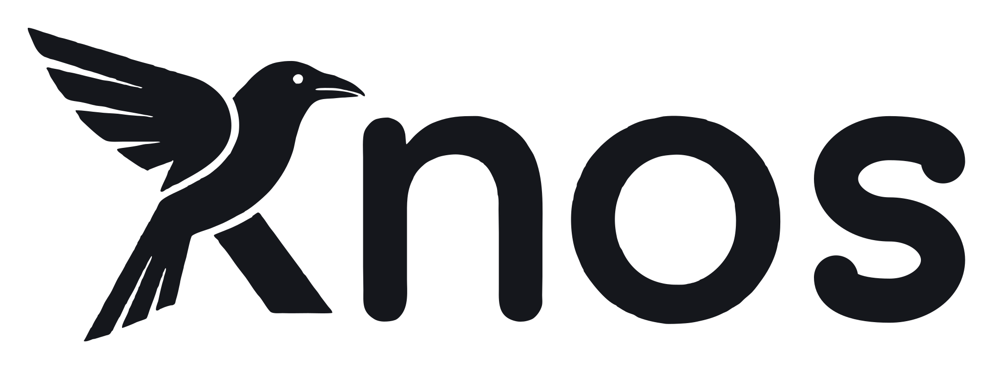

<!-- Written by scripts/bump_version.py from README.md, with links pinned to the tag: edit README.md. -->
<h1>
  <picture>
    <source media="(prefers-color-scheme: dark)" srcset="https://raw.githubusercontent.com/drexthealpha/Knos/v0.4.1/web/brand/wordmark-dark.svg">
    <source media="(prefers-color-scheme: light)" srcset="https://raw.githubusercontent.com/drexthealpha/Knos/v0.4.1/web/brand/wordmark-light.svg">
    
  </picture>
</h1>

Knos turns any research into a product billions of people use, in days, not years.

Knos carries research across the valley of death, toward Kardashev II and III.

## How it works today

Paste a paper link and ask "Will it work?". Knos posts the paper's claim on NEAR with a test locked before any agent starts, agents run against that test, and you get a Yes or No, the verified code to download and a receipt on NEAR testnet for the test USDC you put behind the claim.

Inside a lab's own data system, InterSystems IRIS runs the same proof check. Test money only. Try it on one page: https://drexthealpha.github.io/Knos/ ([Do this, see that](https://github.com/drexthealpha/Knos/blob/v0.4.1/README.md#do-this-see-that)).

<!-- entry:criteria -->
## The five judged criteria

| Criterion | What Knos has | Link |
|---|---|---|
| Complexity | 22 enabled production items | [iris/src/Knos/Iris/Production.cls L8-L55](https://github.com/drexthealpha/Knos/blob/main/iris/src/Knos/Iris/Production.cls#L8-L55) |
| Clarity of Instructions | 6 install commands (the contest rules require these commands) | [README.md L218-L221](https://github.com/drexthealpha/Knos/blob/main/README.md?plain=1#L218-L221) |
| Developer Experience | 6 commands from git clone to working check | [README.md L218-L221](https://github.com/drexthealpha/Knos/blob/main/README.md?plain=1#L218-L221) |
| Applicability | 5 example stories | [README.md L32-L36](https://github.com/drexthealpha/Knos/blob/main/README.md?plain=1#L32-L36) |
| Usability | 1 page a visitor can use with no sign-in | [index.html](https://drexthealpha.github.io/Knos/index.html) |

### Who Knos is for

- A lab could use Knos when a discovery it made stalls before anyone turns it into a product. https://hms.harvard.edu/news/new-direction-academic-science-aims-bridge-valley-death
- A hospital lab could use Knos when it must show that a new test meets its performance specifications before it reports patient results. https://www.cms.hhs.gov/clia/downloads/6064bk.pdf
- A startup could use Knos when it is about to build a product nobody needs, the reason founders most often give for a failed startup. https://www.digitalocean.com/resources/articles/top-reasons-startups-fail-and-how-to-avoid-them
- A company could use Knos when an AI coding agent sends pull requests that do not pass the project's own checks. https://arxiv.org/abs/2601.15195
- A funder could use Knos when it releases money only as research milestones are met and needs evidence that each one was. https://arpa-h.gov/news-and-events/arpa-h-101-lifecycle-arpa-h-program

### Production items

- `ProofIn` (`Knos.Iris.BS.ProofIn`)
- `BriefIn` (`Knos.Iris.BS.BriefIn`)
- `GitHubCheckRunPoller` (`Knos.Iris.BS.CheckRunPoller`)
- `HL7LabIn` (`Knos.Iris.BS.LabFile`)
- `ProofDecision` (`Knos.Iris.BP.ProofDecision`)
- `BriefLock` (`Knos.Iris.BO.BriefLock`)
- `Referee` (`Knos.Iris.BO.Referee`)
- `PayoutApprovers` (`EnsLib.Workflow.Operation`)
- `SolanaRead` (`Knos.Iris.BO.SolanaRead`)
- `SolanaSubmit` (`EnsLib.PEX.BusinessOperation`)
- `TraceSink` (`Knos.Iris.BO.TraceSink`)
- `Ens.Alert` (`Knos.Iris.BO.Alert`)
- `FHIRLabIn` (`Knos.Iris.BS.FhirFile`)
- `DeadlineWatch` (`Knos.Iris.BS.DeadlineWatch`)
- `DailyDigest` (`Knos.Iris.BS.DailyDigest`)
- `SpendCapWatch` (`Knos.Iris.BS.SpendCapWatch`)
- `ApproverReminder` (`Knos.Iris.BS.ApproverReminder`)
- `DecisionRouter` (`EnsLib.MsgRouter.RoutingEngine`)
- `ReceiptFile` (`Knos.Iris.BO.ReceiptFile`)
- `DecisionFHIR` (`Knos.Iris.BO.FhirTask`)
- `ResultHL7Out` (`EnsLib.HL7.Operation.FileOperation`)
- `DigestFile` (`EnsLib.File.PassthroughOperation`)

## Bonuses

| Bonus | Official points | Proof |
|---|---|---|
| B1 Questionnaire | 1 | answered 7 Nov (private form) |
| B2 Production Extension (PEX) | 3 | [iris/java/src/main/java/knos/iris/pex/SolanaSubmitOperation.java L20](https://github.com/drexthealpha/Knos/blob/main/iris/java/src/main/java/knos/iris/pex/SolanaSubmitOperation.java#L20) |
| B3 Workflow Engine | 2 | [iris/src/Knos/Iris/Production.cls L19](https://github.com/drexthealpha/Knos/blob/main/iris/src/Knos/Iris/Production.cls#L19) |
| B4 Custom Adapter | 2 | [iris/src/Knos/Iris/Adapter/CheckRunInbound.cls L5](https://github.com/drexthealpha/Knos/blob/main/iris/src/Knos/Iris/Adapter/CheckRunInbound.cls#L5) |
| B5 Find a bug in AI Hub | 2 (max 3) | https://github.com/intersystems-community/ai-hub-eap-bugreports/issues/20 ; https://github.com/intersystems-community/ai-hub-eap-bugreports/issues/21 |
| B6 Embedded Python | 3 | [iris/src/Knos/Iris/Py/Ready.cls L4](https://github.com/drexthealpha/Knos/blob/main/iris/src/Knos/Iris/Py/Ready.cls#L4) |
| B7 IRIS Vector Search usage | 2 | [iris/src/Knos/Iris/Data/Criterion.cls L7](https://github.com/drexthealpha/Knos/blob/main/iris/src/Knos/Iris/Data/Criterion.cls#L7) |
| B8 Docker container usage | 2 | [iris/docker-compose.yml L4](https://github.com/drexthealpha/Knos/blob/main/iris/docker-compose.yml#L4) |
| B9 ZPM Package deployment | 2 | https://openexchange.intersystems.com/package/Knos |
| B10 Online Demo | 2 | not hosted |
| B11 Implement InterSystems Community Idea | 4 | https://ideas.intersystems.com/ideas/DPI-I-689 |
| B12 Find a bug in Embedded Python | 2 (max 3) | https://github.com/intersystems-community/python-bugreports/issues/30 ; https://github.com/intersystems-community/python-bugreports/issues/31 |
| B13 First Article on Developer Community | 2 | https://community.intersystems.com/post/what-one-ai-decision-costs-iris-tokens-and-dollars-traced-call |
| B14 Second Article on DC | 1 | https://community.intersystems.com/post/ai-can-only-say-no-inside-intersystems-iris |
| B15 Video | 3 | https://github.com/drexthealpha/Knos/raw/main/iris/media/knos-iris.mp4 |
<!-- /entry:criteria -->

[Watch the 62-second video](https://drexthealpha.github.io/Knos/#iris) · [An AI that can only say no, inside InterSystems IRIS](https://community.intersystems.com/post/ai-can-only-say-no-inside-intersystems-iris) · [What one AI decision costs in IRIS: tokens and dollars, traced per call](https://community.intersystems.com/post/what-one-ai-decision-costs-iris-tokens-and-dollars-traced-call) · [Install steps below](https://github.com/drexthealpha/Knos/blob/v0.4.1/README.md#run-it-on-iris) · [Try it live in your browser](https://drexthealpha.github.io/Knos/#near)

## How it works



*Money moves only when a step passes its test.*

1. **Is it wanted?** Knos [checks who would buy it](https://github.com/drexthealpha/Knos/blob/v0.4.1/docs/reference/DEMAND_CHECK.md) and in which city, before any work is paid.
2. **Write the deal.** Each step of the work gets a goal and a deadline, plus the test that decides it. They are sealed with a fingerprint, so nobody can change them later.
3. **Hold the money.** Backers' money waits in a program on [Solana](https://github.com/drexthealpha/Knos/blob/v0.4.1/docs/WORDS.md#solana), a public ledger, not with Knos.
4. **Pass the test.** The maker sends proof. When the test passes, that step is paid. If nothing passes by the deadline, the backers get their money back. Example: [a real payment of 5 test units for checked work](https://explorer.solana.com/tx/53pd6Rfdtcj34rHUtV7UnCQyfFRVXe5Vot2ujFCXR6dcrHeziwQRyry2ekeph5iHKX9L7ALc3W4GjhVSN5LLMGw7?cluster=devnet).

Add Knos to Claude Code with one command: `claude mcp add --transport http knos https://knos.onrender.com/mcp`

**Open call:** have research waiting for a market? [Cross it on Knos](https://knos.onrender.com/invite): the page counts every crossing and pre-order by people outside Knos, live.

## Paid on proof

The proof is checked before any money moves. A milestone names its checker in the brief. The proof can be:

- a lab result or a public evidence page, read by the milestone's checker;
- checks that GitHub signs, verified on chain;
- the same verdict signed by two of three [referees](https://github.com/drexthealpha/Knos/blob/v0.4.1/docs/WORDS.md#referee);
- a verdict from [IRIS](https://github.com/drexthealpha/Knos/tree/main/iris) inside a lab's own walls. Its agent can only say no or ask a person.



*Nothing is paid on a promise. A missed deadline sends the money back.*

## Try it in ten seconds

Open [the one page](https://drexthealpha.github.io/Knos/), keep the sample paper link and press **Will it work?**, then
prove it with the test USDC you choose. Nothing to install and no sign-up ([Do this, see that](https://github.com/drexthealpha/Knos/blob/v0.4.1/README.md#do-this-see-that)). The
same account and records also open in [the app](https://knos.onrender.com/app/).

## Why nobody can fudge the count

The terms of a brief are locked by a [hash](https://github.com/drexthealpha/Knos/blob/v0.4.1/docs/WORDS.md#hash) before any money moves. A changed target or deadline gives a different hash. So a change cannot hide.

The money waits in a program on [Solana](https://github.com/drexthealpha/Knos/blob/v0.4.1/docs/WORDS.md#solana), not with Knos. That program pays only on a verified proof. At the deadline it refunds the backers instead.

**Neither the maker nor Knos can move the money alone.**

Today one person can still change that program, after a public wait ([who holds the keys](https://github.com/drexthealpha/Knos/blob/v0.4.1/docs/TRUST.md)).

Today Knos earns its fee only when work is accepted. When you get a refund, the fee goes back to you. So Knos gains when work passes, and it is not yet fully neutral ([what is enforced and what is a promise](https://github.com/drexthealpha/Knos/blob/v0.4.1/docs/reference/CHARTER.md)).

## Is it real?

It runs on test money only: [test USDC](https://github.com/drexthealpha/Knos/blob/v0.4.1/docs/WORDS.md#test-usdc) on Solana's practice network, [devnet](https://github.com/drexthealpha/Knos/blob/v0.4.1/docs/WORDS.md#devnet).

There are no customers yet. Nobody has bought anything ([what is not real yet](https://github.com/drexthealpha/Knos/blob/v0.4.1/docs/reference/DISCLOSURE.md)).

One person holds every key today. Any change to the programs waits in public for 8 days first ([who holds the keys](https://github.com/drexthealpha/Knos/blob/v0.4.1/docs/TRUST.md)).

<!-- bench:today -->
| What | Today | Read from |
|---|---|---|
| This copy | Release 0.4.1, November 2026. A copy naming an older release, or another product, is out of date | [CHANGELOG.md](https://github.com/drexthealpha/Knos/blob/v0.4.1/CHANGELOG.md); the newest: [PyPI](https://pypi.org/project/knos/) |
| Reproduced by someone else | 0 of 267 | [docs/reference/CAPABILITIES.md](https://github.com/drexthealpha/Knos/blob/v0.4.1/docs/reference/CAPABILITIES.md), the rows "reproduced by someone else" |
| Exercised at the public devnet program ids | 26 of 267: GitHub token verification, funding by one comment, funding from a wallet, pay on merge, refund at the deadline, pause, work orders, an order paying up to four payees, orders checked by the buyer's black-box tests, auto-accepted orders, a holdback released after its warranty, top-ups, single-use tokens, one counted evaluation, a counted batch of evaluations, the seller's own count, a payee's passkey wallet, a passkey funder, the passkey relay, the site's Buy page, an x402 order, the upgrade gate, strict JSON in the verifier, an outcome that is not code, ES256 tokens in one transaction, the presentation grace | [docs/reference/CAPABILITIES.md](https://github.com/drexthealpha/Knos/blob/v0.4.1/docs/reference/CAPABILITIES.md), the rows "exercised on devnet" |
| Deployed at the public devnet program ids, no transaction recorded | 3 of 267: GitLab token verification, the key guardian, holding pay for a payee with no wallet | [docs/reference/CAPABILITIES.md](https://github.com/drexthealpha/Knos/blob/v0.4.1/docs/reference/CAPABILITIES.md), the rows "deployed on devnet" |
| Tested here only | 233 of 267, each with the test its row names | [docs/reference/CAPABILITIES.md](https://github.com/drexthealpha/Knos/blob/v0.4.1/docs/reference/CAPABILITIES.md), the rows "tested locally" |
| Written, not tested | 5 of 267 | [docs/reference/CAPABILITIES.md](https://github.com/drexthealpha/Knos/blob/v0.4.1/docs/reference/CAPABILITIES.md), the rows "implemented" |
| Outside funders | 0 | [docs/NUMBERS.md](https://github.com/drexthealpha/Knos/blob/v0.4.1/docs/NUMBERS.md), row 1 |
| Outside repositories | 0 | [docs/NUMBERS.md](https://github.com/drexthealpha/Knos/blob/v0.4.1/docs/NUMBERS.md), row 2 |
| Outside payees | 1, on tasks Knos funded itself | [docs/NUMBERS.md](https://github.com/drexthealpha/Knos/blob/v0.4.1/docs/NUMBERS.md), row 3 |
| Payments between unrelated accounts | 3, on tasks Knos funded itself | [docs/NUMBERS.md](https://github.com/drexthealpha/Knos/blob/v0.4.1/docs/NUMBERS.md), row 4 |
| Buyer interviews held | 0 | [docs/NUMBERS.md](https://github.com/drexthealpha/Knos/blob/v0.4.1/docs/NUMBERS.md), row 5 |
| Letters of intent | 0 | [docs/NUMBERS.md](https://github.com/drexthealpha/Knos/blob/v0.4.1/docs/NUMBERS.md), row 6 |
| Reproductions signed by GitHub | 0 | [docs/NUMBERS.md](https://github.com/drexthealpha/Knos/blob/v0.4.1/docs/NUMBERS.md), row 7 |
| Outside programs reading the verifier | 0 | [docs/NUMBERS.md](https://github.com/drexthealpha/Knos/blob/v0.4.1/docs/NUMBERS.md), row 8 |
| Shadow counts published | 0 | [docs/NUMBERS.md](https://github.com/drexthealpha/Knos/blob/v0.4.1/docs/NUMBERS.md), row 9 |
| Paying customers | 0 | [docs/reference/DISCLOSURE.md](https://github.com/drexthealpha/Knos/blob/v0.4.1/docs/reference/DISCLOSURE.md) |
| Revenue | 0; test USDC is not money | [docs/PRICING.md](https://github.com/drexthealpha/Knos/blob/v0.4.1/docs/PRICING.md) |
| Outside security review | none | [docs/reference/ASSURANCE.md](https://github.com/drexthealpha/Knos/blob/v0.4.1/docs/reference/ASSURANCE.md) |
| Key holders | one person holds every key; an upgrade waits 8 days in public | [docs/reference/GOVERNANCE.md](https://github.com/drexthealpha/Knos/blob/v0.4.1/docs/reference/GOVERNANCE.md) |
| Network and money | Solana devnet, test USDC; mainnet is not touched | [docs/reference/SECURITY.md](https://github.com/drexthealpha/Knos/blob/v0.4.1/docs/reference/SECURITY.md) |
<!-- /bench:today -->

<!-- entry:iris -->
## Run it on IRIS

Inside InterSystems IRIS, the production checks each research step's test result before that step is paid. An AI agent reads the test result and a rule decides; above $50 a person must also say yes.
Every amount is test money.

**One story.** A hospital lab funds a startup to build the online shop for its test kits. Step one pays $120 when the
shop's checkout answers in under 300 ms, measured by the startup's own GitHub test. The test passes. The AI agent in
IRIS reads the result and says yes.

It is over $50, so the lab's approver presses Approve, and the step is paid in play
money. A failing test pays nothing.

Built and tested on the version of IRIS with AI built in (AI Hub build 154, irishealth-community 2026.3.0AI.154.0).

| What | Where |
|---|---|
| Video | [62 seconds, plays in your browser](https://drexthealpha.github.io/Knos/iris/): one decision, from a test result to a person pressing Approve (the file: [iris/media/knos-iris.mp4](https://github.com/drexthealpha/Knos/blob/v0.4.1/iris/media/knos-iris.mp4)) |
| Idea | every step of the AI's decision kept as a message you can open in IRIS, built here (community idea [DPI-I-689](https://ideas.intersystems.com/ideas/DPI-I-689)) |
| Code | [iris/](https://github.com/drexthealpha/Knos/tree/main/iris); the IPM package is `module.xml` at the repository root |
| Online demo | not hosted: the built-in demo runs on your own machine after the quick start, with no key and no sign-in |

### The contest task, part by part

| The task asks for | The feature doing it | How to see it |
|---|---|---|
| An Interoperability workflow | `Knos.Iris.Production`, 22 items. Services: `ProofIn`, `BriefIn`, `GitHubCheckRunPoller` (custom inbound adapter), `HL7LabIn` (HL7 ORU files), `FHIRLabIn` (FHIR Observation files), `DeadlineWatch` (not paid at the deadline), `DailyDigest` (the day's decisions and model cost), `SpendCapWatch` (alert before the model cap), `ApproverReminder` (payouts left waiting). Processes: `ProofDecision` (BPL), `DecisionRouter` (routing rule). Operations: `BriefLock`, `Referee` (the AI Hub agent), `PayoutApprovers` (Workflow), `SolanaRead` (custom outbound adapter), `SolanaSubmit` (Java PEX), `TraceSink`, `Ens.Alert`, `ReceiptFile` (a JSON receipt per decision), `DecisionFHIR` (a FHIR R4 Task per decision), `ResultHL7Out` (the decision back to the lab as HL7), `DigestFile` | Interoperability > Production |
| An AI Hub agent | operation `Referee` running `Knos.Iris.AI.LocalReferee` on `qwen2.5:1.5b-instruct` in the compose file's `ollama` service with `KNOS_AI_MODE=local`, no key; in replay mode (the default) the rules referee decides, with no model | the Verdict message of each decision |
| A decision-making task | the agent answers met, not met or insufficient; code checks that answer, then `Knos.Iris.Rule.PayoutGate` says PAY, HUMAN, REFUND_AT_DEADLINE or REJECT | the Decision message |
| A person where it matters | IRIS Workflow, role `PayoutApprovers`, for a met decision above 50 USDC | the inbox on `/knos/` or Interoperability > Workflow Inbox |
| Every step traceable | each model call, tool call, rule and approval is a `Knos.Iris.Msg.Span` in the decision's own session | Visual Trace |

### What is new, and why

- **The trace is the production's own message log.** Every step of the agent's decision is an interoperability
  message, kept in a Langfuse-style SQL table. A lab cannot send its data to an outside tracing service; IRIS already
  keeps an audited record of every message, so the trace stays inside the lab's own IRIS.
- **An agent that can only say no.** A lab cannot let a model pay anyone. So the agent has no tool that moves money: it
  may only say met, not met or insufficient. Code checks that answer, and a person approves anything large.
- **Vector Search keeps the agent honest.** The proof's two nearest criteria come from IRIS Vector Search
  (snowflake-arctic-embed-s, run in Embedded Python). A verdict that cites a criterion outside those two is capped at
  0.6 confidence and goes to a person.
- **The brief is locked by a hash.** The brief is hashed with Knos's own `knos.ready.criteria_hash`, run in Embedded
  Python from the same `src/knos` that the Knos app uses. Proof against a changed brief is refused before any model is
  asked.

### Quick start

You need Docker with about 4 GB free, and the image file `irishealth-community-2026.3.0AI.154.0-docker.tar.gz` (x64)
from the [AI Hub Early Access portal](https://evaluation.intersystems.com/Eval/early-access/AIHub) (an InterSystems
login). Four commands:

```sh
git clone https://github.com/drexthealpha/Knos && cd Knos/iris
bash scripts/load-image.sh ~/Downloads/irishealth-community-2026.3.0AI.154.0-docker.tar.gz
bash scripts/env-secrets.sh && docker compose up -d --build
bash scripts/ready.sh
```

`ready.sh` is the readiness check: it waits for IRIS and prints `READY: open http://localhost:52773/knos/ ...`. Open
that page and press **A passing test, $20**: the decision appears in a few seconds. **A passing test, $120** waits for a
person: press **Approve**. The default is replay mode: no key and no sign-in. It downloads no model.

What the commands do: `load-image.sh` runs `docker load -i <the tar>`, then retags the image to the name the Dockerfile
builds on:
`docker tag docker.iscinternal.com/docker-intersystems/intersystems/irishealth-community:2026.3.0AI.154.0 irishealth-community:2026.3.0AI.154.0`.
Neither image, nor any image built on it, is pushed to a registry. `env-secrets.sh` makes `.env` from `.env.example`
with random secrets (never commit `.env`). The first build takes about 3 minutes on 4 cores.

### Troubleshooting

| What you see | What to do |
|---|---|
| `ready.sh`: the knos-iris container is not running | in `iris/`: `docker compose up -d --build`, then `bash scripts/ready.sh` |
| `docker compose`: pull access denied for irishealth-community | the image is not loaded or not retagged: `bash scripts/load-image.sh <the tar>` |
| `docker compose`: set IRIS_PASSWORD in iris/.env | `bash scripts/env-secrets.sh` fills the three secrets |
| `ready.sh`: IRIS refused the password | `bash scripts/env-secrets.sh`, then `docker compose up -d`: the password is set at every start |
| `ready.sh` waits 5 minutes with no answer | `docker compose logs iris --tail 40`; give Docker at least 4 GB of memory |
| the page asks for a user and password | the agent is not in replay mode: sign in as `_SYSTEM` with the `IRIS_PASSWORD` line of `.env` |
| `docker compose`: `required` is not allowed | update Docker Compose to version 2.20 or later |

### The model (LLM provider) and its key

The default needs nothing: in replay mode (`KNOS_AI_MODE=replay`) the rules referee decides, with no model.

For the AI Hub agent on a local open model, set `KNOS_AI_MODE=local` in `.env` and start with
`docker compose --profile local up -d --build`: it pulls `qwen2.5:1.5b-instruct` (about 1 GB) into the `ollama`
service and asks it through AI Hub's `openai` provider, with no key and no account. For a cloud model set
`KNOS_AI_MODE=live`, `KNOS_LLM_PROVIDER` and its key in `.env`:

| Provider | `KNOS_LLM_PROVIDER` | Key variable in `.env` |
|---|---|---|
| Anthropic | `anthropic` | `ANTHROPIC_API_KEY` |
| OpenAI | `openai` | `OPENAI_API_KEY` |
| Google Gemini | `gemini` | `GEMINI_API_KEY` |
| AWS Bedrock | `bedrock` | `AWS_ACCESS_KEY_ID`, `AWS_SECRET_ACCESS_KEY`, `AWS_REGION` |

A spend cap is checked before any paid call: at most `KNOS_LLM_MAX_CALLS` calls (default 30) and `KNOS_LLM_MAX_USD`
dollars (default 2.00).

### See that it works

1. `bash scripts/ready.sh` prints `READY: open http://localhost:52773/knos/ and press a sample button`.
2. On that page: **A passing test, $20** is paid in play money, **A failing test, $20** is not paid, and **A passing
   test, $120** waits under "Waiting for a person" until you press **Approve**.
3. From a terminal: `bash scripts/smoke.sh` sends one decision on public data and prints
   `decision: {"decision":"met","gate":"PAY",...}` and a Visual Trace link. `AMOUNT_USDC=80 bash scripts/smoke.sh`
   sends one above 50 USDC: it waits for a person in the inbox on `/knos/` (or Interoperability > Workflow Inbox).
   After **Approve**, its Visual Trace link shows the proof, the agent's verdict, the rule, the approval and the devnet
   simulation, in order.
4. Each decision also leaves files for the lab's own systems: `docker exec knos-iris ls /home/irisowner/knos/outbox/receipts /home/irisowner/knos/outbox/fhir /home/irisowner/knos/outbox/hl7`
   lists, for each decision, a receipt, a task record and a lab result in the formats hospital systems read (JSON, FHIR R4 Task, HL7 ORU).

Every test in one command, with no key: `bash scripts/test-all.sh` (the build, the decisions, one trace through all six
parts, the bonus checks and the page).

### What it decides

An InterSystems IRIS for Health production decides whether submitted proof meets a hash-locked Knos Ready brief: a
GitHub check run, a lab result (a FHIR Observation or an HL7 ORU^R01) or a Knos referee verdict. The three public
inputs `scripts/smoke.sh` uses are in `data/public/SOURCES.md`: a Synthea FHIR Observation, an HL7 ORU^R01 lab message
and a real GitHub check run.

### How it works

- **Proof comes in through custom adapters.** A check run arrives by webhook at `/api/knos/webhook` (signed with
  `KNOS_WEBHOOK_SECRET`), by `/api/knos/proof`, or as a file the inbound adapter `Knos.Iris.Adapter.CheckRunInbound`
  picks up. A lab result arrives as a FHIR Observation, or as an HL7 ORU^R01 file in `inbox/oru/`.
- **The agent answers a decision contract.** `Knos.Iris.AI.Verdict` checks every answer. The rules referee, which
  reads only structured fields, can only make an answer stricter, and the trace says so.
- **Rule, Workflow, then the chain.** `Knos.Iris.Rule.PayoutGate` turns the decision into PAY, HUMAN,
  REFUND_AT_DEADLINE or REJECT. HUMAN goes to a person. PAY runs a devnet simulation through the Java PEX operation.



*Proof arrives one of three ways; one process checks, asks the agent, gates, asks a person, then simulates.*

### Requirements

Measured in a 4-core, 16 GB GitHub Codespace with `mem_limit: 3g`: build 160 s from the loaded image, health 7 to 9 s
after the container starts, peak 1,660 MiB in `docker stats`. On a 7.8 GB laptop the container peaked at 1,188 MiB.
FHIR is off by default (`KNOS_FHIR=0`); `KNOS_FHIR=1` loads R4 and needs about 2 GB more.

### The image used

`irishealth-community:2026.3.0AI.154.0` (InterSystems IRIS for Health, AI Hub build 154,
`IRIS for UNIX (Ubuntu Server LTS for x86-64 Containers) 2026.3.0AI (Build 154U)`), from the InterSystems file
`irishealth-community-2026.3.0AI.154.0-docker.tar.gz` (x64). `iris/Dockerfile` builds on it in stages: a builder stage
runs `iris.script`, the final stage copies in only the databases the install changed.

### LLM provider and key

`KNOS_AI_MODE=replay` (the default) asks no model and says "rules referee (no model key set)". `KNOS_AI_MODE=local` needs no key either: measured on 5 Nov 2026 on 4 cores, 7 to 18 s a decision, about 670
tokens. `KNOS_AI_MODE=live` uses the provider and key from the table above.

No paid model call has been made for this
project.

| | Rules referee | AI Hub agent |
|---|---|---|
| Decides from | structured fields only (a check run's name and conclusion, an Observation's code and value) | the brief and the proof, in its question |
| Needs | nothing | the local model (no key), or needs a model key in live mode |
| Low confidence | | capped at 0.6 when the cited criterion is not in the top 2 by Vector Search, which sends the case to a person |
| Trace | one span per decision | one span per model or tool call |

### Start

With IPM on any IRIS for Health instance: `zpm "install knos-iris"` or, from a clone,
`zpm "load <clone>/iris -v"` in a namespace with interoperability on. `module.xml` asks for IRIS 2026.3 or later with
interoperability enabled.

### Check that it works

```sh
set -a; . ./.env; set +a
curl -s -u "_SYSTEM:$IRIS_PASSWORD" localhost:52773/api/knos/health
```

The health route answers `{"production":"Running","agent":"local","fhir":"off","java":"ok","vector":"ok",...}`.

### Walkthrough of the three inputs

- **Check run.** Point a GitHub webhook (check runs) at `/api/knos/webhook`, or drop a file in
  `/home/irisowner/knos/inbox/checkruns/` for `Knos.Iris.Adapter.CheckRunInbound`. Unsigned webhooks get 401.
- **Lab result.** POST a FHIR Observation (`"kind":"observation"`) to `/api/knos/proof`, or drop an HL7 ORU^R01 named
  `<briefId>.hl7` in `inbox/oru/`. OBX-3 and OBX-5 become the Observation's code and value.
- **Referee verdict.** POST a signed Knos referee verdict (`"kind":"verdict"`, as in `fixtures/verdicts/passed.json`).

### The Workflow approval

A met decision above `KNOS_PAYOUT_THRESHOLD_USDC` (default 50) goes to the role `PayoutApprovers`. Approve or Reject in
the inbox on `/knos/` or in Interoperability > Workflow Inbox. With no answer, the milestone stays held for two days.
Each AI Hub feature the agent uses answers live at `GET /api/knos/aihub/<feature>`: `skill`, `policy`, `mcp`, `rag`,
`stats` and `workflow`.

### Solana devnet

On PAY, IRIS builds Knos's payout instruction and the Java PEX operation simulates it on devnet
(`simulateTransaction`): a simulation, not a payment. **IRIS never releases money alone.** The custom outbound adapter
`Knos.Iris.Adapter.SolanaRpcOutbound` does the reads.

### The trace

Each decision's session in Visual Trace holds the Proof, the agent's Verdict, the Span messages and the Decision.
`GET /api/knos/traces/<session>` returns them as JSON; the table `Knos_Iris_Data.Span` has the same rows;
`iris/docs/trace-schema.md` maps them to Langfuse's trace fields.

| Langfuse | Here |
|---|---|
| Trace, observations, parent links | the session, `Knos.Iris.Msg.Span` messages with `ParentId` |
| Generation with model, tokens, cost | the `llm` span, from AI Hub's usage |
| Trace viewer | Visual Trace |
| Query and export | `Knos_Iris_Data.Span` in SQL, and `GET /api/knos/traces/<session>` |
| Data location | inside the lab's own IRIS |
| Prompt management | none here; prompts live in the code |

Try it: `bash scripts/smoke.sh` prints a `visual trace:` link whose number is the session, then
`SELECT Name, Kind, Model, Tokens, Ms FROM Knos_Iris_Data.Span WHERE SessionId = <session>` gives every step.

### Where each part lives

| Part | Where it lives | How to see it |
|---|---|---|
| Java PEX | `iris/java/src/main/java/knos/iris/pex/SolanaSubmitOperation.java`, item SolanaSubmit | its messages in Visual Trace; the video |
| Workflow | item PayoutApprovers, `iris/src/Knos/Iris/BP/ProofDecision.cls` | Workflow Inbox; the video |
| Custom adapters | `iris/src/Knos/Iris/Adapter/CheckRunInbound.cls`, `iris/src/Knos/Iris/Adapter/SolanaRpcOutbound.cls` | items GitHubCheckRunPoller, SolanaRead; the video |
| Embedded Python | `iris/src/Knos/Iris/Py/Ready.cls`, `iris/src/Knos/Iris/Py/Embed.cls`, `iris/python/knos_iris/` | the brief hash; the video |
| Vector Search | `iris/src/Knos/Iris/Data/Criterion.cls` (`VECTOR(DOUBLE,384)`) | the health route's `vector`; the video |
| Docker | `iris/Dockerfile`, `iris/docker-compose.yml` | `docker compose up`; the video |
| IPM | `module.xml` | `zpm "load <clone>/iris"` |
| LLM trace as interop messages | `iris/src/Knos/Iris/Msg/Span.cls` | Visual Trace |

### Platform findings

Four reproduce on a clean build 154 container, each with its own `run.sh`:

- [`iris/bugs/1`](https://github.com/drexthealpha/Knos/tree/v0.4.1/iris/bugs/1): Embedded Python returns a Python int above 2^63 - 1 to ObjectScript as -1, with no error. Filed: [python-bugreports#30](https://github.com/intersystems-community/python-bugreports/issues/30).
- [`iris/bugs/2`](https://github.com/drexthealpha/Knos/tree/v0.4.1/iris/bugs/2): AI Hub's `%AI.ToolMgr.ExecuteTool` runs a tool when a required argument is missing or of
  the wrong type. Filed: [ai-hub-eap-bugreports#20](https://github.com/intersystems-community/ai-hub-eap-bugreports/issues/20).
- [`iris/bugs/3`](https://github.com/drexthealpha/Knos/tree/v0.4.1/iris/bugs/3): AI Hub's `%AI.RAG.VectorStore.IRIS` makes its table in SQLUser whatever its `Schema`
  says. Filed: [ai-hub-eap-bugreports#21](https://github.com/intersystems-community/ai-hub-eap-bugreports/issues/21).
- [`iris/bugs/4`](https://github.com/drexthealpha/Knos/tree/v0.4.1/iris/bugs/4): Embedded Python's `iris.sql.exec` with an int past 64 bits fails with a `SystemError`
  that names neither the parameter nor its value. Filed: [python-bugreports#31](https://github.com/intersystems-community/python-bugreports/issues/31).

### Problems I hit, and how I fixed them

- **My 8 GB laptop stalled for two days.** IRIS, Docker and the build would not fit, so every IRIS build and test moved
  to one GitHub Codespace, and the compose file caps IRIS at 3 GB.
- **The small model looked the brief up by the wrong key and gave up.** With tools it fetched the wrong record, so the
  local agent now gets the brief and the proof in its question, and code checks its answer.
- **The IPM install failed with ERROR #5289** because a ToolSet compiled before its tools. A `DependsOn` fixed the
  compile order; the install then passed on build 154.
- **The first build with FHIR ran past 1,800 s.** FHIR is now off by default and loads only R4 when asked.
- **A merge at start took 17 minutes at full CPU.** The memory settings are now set once, the same at build and at
  run, so a start merges nothing.
- **A fresh codespace broke every non-root build step** ("libc.so.6: Permission denied"). Its `/tmp` default ACL was
  the cause; `scripts/codespace-setup.sh` drops it.

### Tests

`python iris/tests/test_iris_decision.py` runs the core decisions against a running instance: a passing check run, a
failing one, an altered brief, injection text in the proof and an ORU whose value misses. `python
iris/tests/test_iris_one_trace.py` sends one check run through the whole production and checks that its one session
holds every part.

`python iris/tests/test_iris_docs.py readme` checks that every file this section names exists.

### Architecture

The diagram under "How it works" above is the production; `iris/src/Knos/Iris/Production.cls` lists every item.

### Known limitations

- PAY is a devnet simulation of the payout, not a payment; nothing in iris/ sends money.
- The link from IRIS's decision to the referee panel's 2 of 3 signatures is not built yet.
- Solana devnet only, with test money.

### How it fits Knos

This folder is the IRIS side of the one Knos product: the proof check that runs inside a lab's own data system. The Knos code is imported, not forked: the image runs the repository's `src/knos`.

### Team

Zulqarnain Abubakar, Developer Community profile: https://community.intersystems.com/user/zulqarnain-abubakar

### License

MIT, the repository's own [LICENSE](https://github.com/drexthealpha/Knos/blob/v0.4.1/LICENSE).

<!-- /entry:iris -->

<!-- entry:near -->
## Knos on NEAR

**Why does good research take 17 years to reach people?** "It is frequently stated that it takes an average of 17
years for research evidence to reach clinical practice" ([Morris, Wooding and Grant, 2011](https://doi.org/10.1258/jrsm.2011.110180)).
Knos's answer: checking that a result really works is slow and costly, so nobody builds on it until it has been checked.

**What checking costs.** Today, checking one paper by hand costs $330 to $763
([Colliard and others, 2023](https://labordynamicsinstitute.github.io/crress-book/sessions/6/perignon)). Knos: under a
minute, for the test USDC the buyer puts behind the claim. Each order posts this claim on NEAR afresh, with the test USDC you choose, and pays for its own first proof. Proving that order again is free and public.

**Who it is for.** An R&D lead at a big company holding a paper, who needs to know whether its claim holds before
building on it. On one screen they paste the link, ask "Will it work?", order the proof and download the verified code.

**What NEAR does here.** The proof is a job whose test is locked by its sha256 in the NEAR jobs contract before any
agent starts. The contract pays only the agent whose code passes, and refuses any agent step over its spending cap.

The claim's record on NEAR settles from that job once the answer is in, and the test USDC the buyer put behind the claim moves on
NEAR testnet. A second proof of the same claim reuses the verified result, free, instead of paying agents again.

The sample paper is HyperLogLog ([Flajolet, Fusy, Gandouet and Meunier, 2007](https://doi.org/10.46298/dmtcs.3545)). Its
abstract says, word for word: "For instance, the new algorithm makes it possible to estimate cardinalities well beyond
10^9 with a typical accuracy of 2% while using a memory of only 1.5 kilobytes."

Its locked test is `near/agents/job/test_hll.py`: count 30,000 visitors within 10% in at most 1,536 bytes. It runs in
under 1 s. Agent A packs 2,048 registers of 5 bits, as the paper's 1.5 kilobytes do, and passes; agent B keeps every
visitor and fails on memory.



*One job, two agents: only the output that passes the locked test is paid.*

### Do this, see that

On the public page (no install, no sign-in, no wallet, test money only):

1. Open https://drexthealpha.github.io/Knos/ - see "Why does good research take 17 years to reach people?" with its
   answer, "Today: checking one paper by hand costs $330 to $763. Knos: under a minute, for the test USDC you put behind the claim.", the box holding the
   HyperLogLog DOI and the button "Will it work?".
2. Click "Will it work?" - see, 1 to 4 s later, "Prove this claim now", the price ("Price: the test USDC you choose (1 to 100), paid only after the answer. Proving this order again: free."), the one rule ("Each order posts this claim on NEAR afresh, with the test USDC you choose, and pays for its own first proof. Proving that order again is free and public."), the box "Test USDC you put behind this claim:" holding 10
   and the button "Prove it with 10 test USDC", then the paper's claim word for word and its plain-words page.
3. Type an amount (1 to 100) or keep 10, and click "Prove it with N test USDC" (N the amount) - see a clock, "1. The test is locked", "2. Two agents ran the paper's result against the locked test" with "Agent A: Passed: 30,000 visitors counted within 1.2%, in 1,364 bytes" and "Agent B: Failed: it keeps
   529,075 bytes", then "3. The spending cap blocked an over-budget step" with a link to NEAR's refusal.
4. About 4 to 15 s after ordering when a job is ready (up to 90 s more while the next one is readied) - see "4. Answer: Yes, the claim holds", the paper's "2% typical error, 1.5 kilobytes of
   memory" beside "1.2% error on 30,000 visitors, 1,364 bytes of memory", and "5. You got" with "Download the verified
   code (visitor_counter.py)". Then "Try it now": click "Count them with your code" - see that code count 100,000
   visitors on the server: how many it counted, how far off and in how many bytes.
5. Then "6. Paying and recording on NEAR", about 10 to 45 s on the test network, and "Receipt for proof job-...: paid and
   recorded on NEAR testnet in" those seconds: "You put behind the claim 10.00 test USDC", "Agent A's share
   0.20 test USDC, 1 part in 49" and "Knos's fee 9.80 test USDC, the other 48 parts", each transfer with its link, "The claim's record on NEAR: updated to holds." and "What each step
   cost", every step's network fee with its record.
6. Click "Prove the same claim again" - see "Free: Yes, in" a few seconds, from the stored verified result, with
   how many seconds sooner, "no test USDC moved" and a link to the first proof.
7. Below the run - see "Live from NEAR testnet:" paid first proofs, test dollars settled and lost, read from NEAR's public record
   (in full every 10 minutes by GitHub Actions, plus the server's own confirmed payments since): each paid first proof is one fee from the buyer's test account to Knos's, and the dollars settled are those fees plus agent A's shares.

The same run, recorded from the public page: [near/web/knos-near.mp4](https://github.com/drexthealpha/Knos/blob/v0.4.1/near/web/knos-near.mp4) (54.3 s), with
screenshots [first screen](https://raw.githubusercontent.com/drexthealpha/Knos/v0.4.1/near/web/knos-near-1-first.png), [the claim](https://raw.githubusercontent.com/drexthealpha/Knos/v0.4.1/near/web/knos-near-2-claim.png) and
[what you got](https://raw.githubusercontent.com/drexthealpha/Knos/v0.4.1/near/web/knos-near-3-got.png).

### One call for agents

An agent can run the whole flow with one HTTP call: look up the paper, prove the claim, pay, update the record.

`curl -X POST https://knos.onrender.com/api/near/claim/flow -H "Content-Type: application/json" -d '{"url": "https://doi.org/10.46298/dmtcs.3545", "amount": 10}'`

- see a JSON answer with `"verdict"` (`"holds": true`, the paper's number and the measured one), `"code"` (the link to the
  verified code), `"cap"` (the refused over-budget step), `"paid": true`, `"settled": true` (false, with `"why_not_settled"`, if a step failed) and `"receipt"` (the payments and each
  step's fee). It runs on testnet: the agent call allows four calls every 10 minutes from one address; the page's own proofs have their own limit, six every 10 minutes.

### Locally

With Python 3.10+, from the repository's root, no key and nothing sent:

1. Run the locked test on agent A's code:
   `mkdir ta && cp near/agents/job/test_hll.py ta/ && python -c "import sys; sys.path.insert(0, 'near/agents'); import pass_agent; open('ta/solution.py', 'w').write(pass_agent.SOLUTION)" && cd ta && python test_hll.py`
   - see, in about 1 s, "Passed: 30,000 visitors counted within 1.2%, in 1,364 bytes (the paper: 1.5 kilobytes)."
2. From the root again, the same on agent B's code:
   `mkdir tb && cp near/agents/job/test_hll.py tb/ && python -c "import sys; sys.path.insert(0, 'near/agents'); import fail_agent; open('tb/solution.py', 'w').write(fail_agent.SOLUTION)" && cd tb && python test_hll.py`
   - see "Failed: it keeps 529,075 bytes, over the paper's 1.5 kilobytes (1,536 bytes)." and exit code 1.

With a NEAR testnet account of your own, near-cli-rs, Rust and cargo-near on Linux or WSL (these send testnet
transactions):

3. Run `python near/scripts/try_testnet.py <you>.testnet` - see your own copy of both contracts release on a signed token
   and refund after the deadline ([Try it on testnet](https://github.com/drexthealpha/Knos/blob/v0.4.1/README.md#try-it-on-testnet)).
4. Run `bash near/scripts/verify.sh` - see the contract's sandbox tests and attacks pass ([Tests](https://github.com/drexthealpha/Knos/blob/v0.4.1/README.md#tests-on-near)).

### Safety, price and what is hard to copy

**Safety.** The signing keys live only in the hosted server's secret store, never in the page or the repository. The
paper link is the only data a buyer sends. Every push runs the full test suite on GitHub
([tests.yml](https://github.com/drexthealpha/Knos/actions/workflows/tests.yml)), and the page shows its latest finished run, read from GitHub. Knos has no token.

**Private AI.** The plain-words page is written by qwen2.5:1.5b-instruct in GitHub Actions. Running it on NEAR AI Cloud
inside a TEE, with its attestation linked, needs a NEAR AI key on the server: BLOCKED, no key is set yet.

**Price.** No fixed price. Each order posts this claim on NEAR afresh, with the test USDC you choose, and pays for its own first proof. Proving that order again is free and public. Of what moves, agent A gets 1 part in 49 and Knos's fee the
other 48. Nobody has paid real money for one yet.

**Hard to copy.** Every verified result is kept and reused, so each proof makes the next one cheaper. Knos has scored
12,010 companies to find the 38 that both reinvest and build frontier technology: its first buyers.

**Outside contributors.** Two GitHub accounts outside the team have done paid work for Knos. `jaystay-bot` wrote
[#32](https://github.com/drexthealpha/Knos/pull/32), [#33](https://github.com/drexthealpha/Knos/pull/33) and
[#34](https://github.com/drexthealpha/Knos/pull/34), merged on 3 Oct 2026 and paid 48.75 test USDC in all.

`xiasan1992` wrote [#40](https://github.com/drexthealpha/Knos/pull/40),
[#41](https://github.com/drexthealpha/Knos/pull/41) and [#43](https://github.com/drexthealpha/Knos/pull/43), merged on 4
Oct 2026; their 37.00 test USDC in bounties waits for them until they link a wallet.

### Accounts and records on NEAR testnet

| Account | What it does | Record |
|---|---|---|
| `jobs.knos-swarm-1105.testnet` | the jobs contract: holds a job's bid against its test's sha256, pays only a passing agent | [explorer](https://testnet.nearblocks.io/address/jobs.knos-swarm-1105.testnet) |
| `market.knos-swarm-1105.testnet` | each claim's record: it settles Yes or No only from the proof's job, never by vote | [explorer](https://testnet.nearblocks.io/address/market.knos-swarm-1105.testnet) |
| `agent-a.knos-swarm-1105.testnet`, `agent-b.knos-swarm-1105.testnet` | the two agents, each with a key that can only call the jobs contract | [A](https://testnet.nearblocks.io/address/agent-a.knos-swarm-1105.testnet), [B](https://testnet.nearblocks.io/address/agent-b.knos-swarm-1105.testnet) |
| `live.knos-swarm-1105.testnet` | the hosted app's capped account: posts each job, opens its record and pays as the buyer's test account (test money, 20 runs a day) | [explorer](https://testnet.nearblocks.io/address/live.knos-swarm-1105.testnet) |
| `knos-usdc-1102.testnet` | the test dollar (NEP-141, 6 decimals) | [explorer](https://testnet.nearblocks.io/address/knos-usdc-1102.testnet) |
| `knos-payer-1102.testnet` | Knos's own test account, where Knos's fee from each first proof arrives and is kept | [explorer](https://testnet.nearblocks.io/address/knos-payer-1102.testnet) |

The agent is paid by a plain NEP-141 transfer. Paying it through x402 is blocked: the testnet facilitator asks for an
API key on its verify and settle calls, and Knos has none yet.

**Libraries.** They are listed under [Disclosure](https://github.com/drexthealpha/Knos/blob/v0.4.1/README.md#disclosure). The hosted runner adds Python's standard library and
`cryptography`, and the page loads GSAP 3.12.5 from cdnjs.

**AI-written code.** Most of the code was written with Claude Code; the founder set each task and reviewed each change.
The product page's words are written by qwen2.5:1.5b-instruct, never by hand: when its answers break the limits, the page
says so and shows no text.

**What was built in the window.** Everything under `near/` and the hosted runner `apps/wanted/knos_wanted/near_live.py`:
the diff from the tag `pre-hackathon` (31 Oct 2026) is
https://github.com/drexthealpha/Knos/compare/pre-hackathon...hackathon-submission (`near/` did not exist at the
first tag; `hackathon-submission` is the submitted commit).

**Built before, on another chain (Q-002).** Knos existed before this window on Solana devnet: the programs in
`programs-v2/` and the Python package `knos` in `src/knos/` that drives them. Only the NEAR work above is the entry.
The NEAR contract can pay a milestone out on Solana devnet through NEAR Chain Signatures
([Paid on Solana by Chain Signatures](https://github.com/drexthealpha/Knos/blob/v0.4.1/README.md#paid-on-solana-by-chain-signatures)).

**Own older code and libraries (Q-005).** The hosted runner reuses the older app server in `apps/wanted/` (routes, rate
limits) and its Render deploy. The libraries are listed under [Disclosure](https://github.com/drexthealpha/Knos/blob/v0.4.1/README.md#disclosure). Most of the code was written with Claude Code.

**Tracks it fits.** Agent Economy (`agents`): agents with their own sub-accounts whose keys can only call the jobs
contract, under a spend cap. AI Swarms (`swarms`): two agents on one job, paid by the result of a locked test.

**The test is locked before money is held and checked before money moves: nobody is paid on a claim.** (Demand is checked first, by Qloo, on the [site](https://drexthealpha.github.io/Knos/).)

**A company pays a lab or a developer only when GitHub's signed run proves the milestone.** The money waits in a NEAR contract; after the deadline with no proof, the company gets it back. The payout is paid on NEAR, or on Solana through NEAR Chain Signatures: the contract checks the transfer and has the MPC network sign it.

Spending limits cap what an agent may spend. The contract releases test tokens only for work that is proven done.

| What | How |
|---|---|
| **Held until it passes** | A funder sends a test token (NEP-141) with `ft_transfer_call`; the contract holds it against a criteria hash and a deadline. |
| **Proof is a signed CI run** | A GitHub Actions OIDC token, checked in the contract: RS256 in pure Rust, issuer, audience = this contract, repository, workflow, commit and a one-time `jti`. Paid on a real one: [run 41651312325](https://github.com/drexthealpha/Knos/actions/runs/41651312325), release [`82N9tRK8…`](https://explorer.testnet.near.org/transactions/82N9tRK8BvB4FpA9yUJb6L6q5FTwT3J1MCzQzN2fWWqj). |
| **Refund** | After the deadline, the money goes back to the funder. Fee: 0. |
| **Keys** | GitHub's signing keys are set by 2 of 3 owners (`scripts/github_keys.py`). |
| **Network** | NEAR testnet only. Test money. |

### Run one now

Open [drexthealpha.github.io/Knos/](https://drexthealpha.github.io/Knos/#near), keep the sample link and click
**Will it work?**, then **Prove it with 10 test USDC**. You see the answer beside the paper's own number, the
verified code to download, the receipt and the claim's record updated, within seconds.

The two agents are fixed programs, not AI models. To answer in seconds, Knos keeps a job ready: posted against its
locked test, with both agents' code already run and submitted. The spending cap step runs live when you order: NEAR
refuses agent B's over-budget spend there and then. Your payment and the record's update follow.

It runs on Knos's own capped test account (`live.knos-swarm-1105.testnet`, test tokens only): 20 runs a day, six every
10 minutes from one address; past a cap the page says the next proof is being readied.

### Work in the window

Every change since the work began: [pre-hackathon...main](https://github.com/drexthealpha/Knos/compare/pre-hackathon...main)
(the tag `pre-hackathon` is the commit before the first line of `near/`).

No Rust is needed to check or deploy the contract: `near/wasm/` holds the built files and `near/wasm/SHA256SUMS` their
hashes. `cd near/wasm && sha256sum -c SHA256SUMS` prints `knos_near.wasm: OK`, `knos_mock_usdc.wasm: OK` and `knos_market.wasm: OK`
(`a5fc5861…`, 280,651 bytes, is the jobs contract deployed at `jobs.knos-swarm-1105.testnet`). Building them again and
every test: `bash near/scripts/verify.sh` (Rust with `wasm32-unknown-unknown` and `cargo-near` 0.22.0).

### Try it on testnet

Your own copy of the contract, then a release and a refund. About 4 minutes after step 2. You need Python 3.10+ with `cryptography`, and [near-cli-rs](https://github.com/near/near-cli-rs/releases) 0.30.1.

1. Make a testnet account: `near account create-account sponsor-by-faucet-service <you>.testnet autogenerate-new-keypair save-to-legacy-keychain network-config testnet create`. You see "New account <you.testnet> created successfully." and its transaction.
2. Run `python near/scripts/try_testnet.py <you>.testnet`. You see six sub-accounts made and the two contracts deployed from `near/wasm/` (sha256 in `near/wasm/SHA256SUMS`).
3. The script sets a test signing key by 2 of 3 owners, funds `m1` and releases it on a signed token. You see "release m1 on a signed token: done" with its transaction.
4. It sends the same token again. You see it refused.
5. It funds `m2` with a 1-minute deadline, waits, and refunds it. You see "m1: Released" and "m2: Refunded".

The page in `web/` runs the same flow from a browser (`python near/web/serve.py`, checked by `web/test-flow.mjs`), but on the maintainer's test accounts (`knos-*-1102.testnet`, `knos-pay2-1102`), whose keys only that machine holds; it does not use your account yet. `web/story/` takes a milestone apart as you scroll.

### A job two agents try

Post a job with a locked test and a bid; two agents take it; the checker runs the locked test on each output, and only
the agent whose output passes is paid. You need Python 3.10+ with `cryptography` and near-cli-rs 0.30.1; it runs on the
maintainer's test accounts, whose keys only that machine holds (as the page in `web/` does).

1. Run `NEAR_CLI=<near> python near/web/serve.py` and open `http://127.0.0.1:8790/`. You see "Paid only when the test passes" and a **Post a job** button.
2. Click **Post a job**. You see "Paid: Agent A 1000, Agent B 0 test units." and the job's six transactions.
3. Click **Try both** under Guardrails. You see two lines starting "refused", each with its transaction: a payment over agent B's cap, and a release with no passing proof.
4. Open `http://127.0.0.1:8790/embed.html` from another page or origin and click **Pay with any wallet**. You see a NEAR Intents 1Click quote for paying 1 USDC from Base (dry: nothing is spent), then a second click pays the bid on testnet.

The rules are in [`near/agents/RULES.md`](https://github.com/drexthealpha/Knos/blob/v0.4.1/near/agents/RULES.md): the job's test is locked by its sha256 at funding, each agent is a
sub-account of `knos-swarm-1105.testnet` that signs with a function-call key allowed only `take`, `submit` and `spend` on
the jobs contract (its full-access key deleted), and the checker's key is set by 2 of the 3 owners.

`web/test-job.mjs`
walks these four steps in a fresh browser. One run, 5 Nov 2026:

| Step | Transaction |
|---|---|
| Job posted: 1000 test units against the locked test `0b0f037d…` | [`7VS43unm…`](https://explorer.testnet.near.org/transactions/7VS43unmH6GMv36GNBivvcNB8Bxv2CRKFvHKiLcbu7qu) |
| Agent A takes it, submits its output | [`GzghavUR…`](https://explorer.testnet.near.org/transactions/GzghavURW39UivrETnWFxeunAwEv5Cpm5tKUmhejBQyT), [`oXq8gV4u…`](https://explorer.testnet.near.org/transactions/oXq8gV4u6desS1GuJdK1ZCiTKo4QNAumEQTnTC69A8v) |
| Agent B takes it, submits its output | [`FmSfyLQ4…`](https://explorer.testnet.near.org/transactions/FmSfyLQ4tu2kc4C9rWgjEP1kAo5788EufnVUWeLsJfNt), [`9CYdyki2…`](https://explorer.testnet.near.org/transactions/9CYdyki2gTVnfr31Ufjirs6j99jdjYU8Zk4yseKsef9z) |
| The checker: A 5 of 5 cases pass; B fails; the bid paid to A, 25.4 s after the check began | [`5caS1jXH…`](https://explorer.testnet.near.org/transactions/5caS1jXHAj7FbUZRMQog7nqgaBk4baDBkvBEYAQjbnpH) |
| Agent B pays 2 on a cap of 1: "over the spend cap: 0 spent, 2 asked, cap 1" | [`FdJPJf7R…`](https://explorer.testnet.near.org/transactions/FdJPJf7RLdErvMBdeUkeUWdhqw4VGNEKtw5aVD4VnK4y) |
| Agent B takes an open job's bid with a token it signed itself: "the token's signature does not verify" | [`E5GUcVks…`](https://explorer.testnet.near.org/transactions/E5GUcVks55r9Rn4b1HJBJagDB1bFbL8YMj41UFHFeHan) |
| The embedded button pays a bid on testnet after its 1Click quote | [`32suEFMY…`](https://explorer.testnet.near.org/transactions/32suEFMYv7JEzfGLH9vNdpHs81BmVfHzbW7oMPMShxKX) |

Agent A was paid 1000; agent B was paid 0. NEAR Intents has no testnet, so the 1Click call is a dry quote only, with 0
spent on mainnet. The checker runs an agent's output in a subprocess with a 20 s limit and no environment; it is a
test-money demo, not a sandbox for hostile code.

### The claim market

Each claim has a yes/no market in test tokens: will its locked check pass? The contract is
[`near/market/src/lib.rs`](https://github.com/drexthealpha/Knos/blob/v0.4.1/near/market/src/lib.rs), deployed at `market.knos-swarm-1105.testnet` (wasm `wasm/knos_market.wasm`).

- **Price, no order book.** With few traders on testnet an order book sits empty, so the price comes from an automated
  market maker, Hanson's logarithmic market scoring rule (LMSR). Knos seeds each market with liquidity
  b = 100 test tokens, so there is always a live price. An order book can be added once volume exists.
- **The formula** (token units, 6 decimals; q_yes and q_no are the shares sold on each side):
  - cost: C(q_yes, q_no) = b · ln(e^(q_yes/b) + e^(q_no/b))
  - price of Yes: e^(q_yes/b) / (e^(q_yes/b) + e^(q_no/b)), shown in cents ("Yes 62c"); No is 100c minus Yes
  - a buy of Yes for c tokens: q_yes' = b · ln(e^(c/b) · (e^(q_yes/b) + e^(q_no/b)) − e^(q_no/b)); the buyer gets
    q_yes' − q_yes shares (rounded down), each paying 1 token if Yes wins
  - Knos's worst-case loss per market is its seed, b · ln 2, about 69.31 test tokens.
- **Settled only by the locked check, never by vote.** Each market follows one milestone of `knos-pay-1103.testnet`:
  its criteria hash is locked at funding and only the named GitHub Actions workflow's own OIDC token can release it.
  `resolve` reads that milestone: Released settles Yes, Refunded (the deadline passed with no passing run) settles No.
  `vote` and `set_test` are refused, always. `redeem` pays each winning share.
- **The first claim**: [`near/claims/Split.lean`](https://github.com/drexthealpha/Knos/blob/v0.4.1/near/claims/Split.lean), "splitting a bid between two helpers never pays out
  more than the bid". Its check is [`lean-claim.yml`](https://github.com/drexthealpha/Knos/blob/v0.4.1/.github/workflows/lean-claim.yml): the proof must compile
  with Lean 4.15.0, then the run's token releases the milestone whose criteria hash is the file's sha256.

### Tests on NEAR

Every push that changes `near/` runs them on GitHub: [the `near-tests` runs](https://github.com/drexthealpha/Knos/actions/workflows/near-tests.yml).
Open the newest run, then its `verify` job: the step `near/scripts/verify.sh` ends with the line below. With Rust
(the `wasm32-unknown-unknown` target and `cargo-near` 0.22.0) the same on your machine:

```bash
bash near/scripts/verify.sh
```

It prints `208/208 tests passed (146 of them attacks)`, the contract's unit tests and then the sandbox flow, and fails when that print is not this line.

Each attack changes one thing and must be refused with the contract's own reason. The thing changed is one of these: the token's issuer, audience, expiry, repository, workflow, commit, header, form or signature; the funding message; the key set.

Or it is a second payment, an early refund or a release after the refund; for a job, a token for another output, job, test or payee, a checker key against a GitHub token and back, an agent that never took the job, a spend over the cap.

`verify.sh` builds both contracts to wasm and runs them on a local near-sandbox node: fund, release, replay, forgery and refund.

Measured: the release receipt burns 7.33 Tgas (11.68 Tgas for the whole transaction) in the latest verify.sh run (5 Nov 2026, a fresh clone); the replayed and the forged token are refused; after the deadline the payer gets the money back and a later release is refused.

### On testnet

| What | Where |
|---|---|
| Contract | [`knos-pay-1103.testnet`](https://explorer.testnet.near.org/accounts/knos-pay-1103.testnet), first deployed in tx [`6Uoen72K…`](https://explorer.testnet.near.org/transactions/6Uoen72KUZnDy1PCknZx5iEQNzfWY2hGgyGmgTdpjAfp); this build since 3 Nov 2026, tx [`AcFJP4Ch…`](https://explorer.testnet.near.org/transactions/AcFJP4ChbxF4Vuwx6qAdHNuugbHgcVNuVcprnzpx1Mfk), code hash `4ZwgX56fbcChxPwP6nu5oJJ8vWYtB2Az9y4jF2K6KcfR` |
| Test token | [`knos-usdc-1102.testnet`](https://explorer.testnet.near.org/accounts/knos-usdc-1102.testnet) (NEP-141, this repo's `mock-usdc`), tx [`D4PoD9do…`](https://explorer.testnet.near.org/transactions/D4PoD9doUA5Lo7wxWRSQEvnpFPcmHXuqitqnXgYoa8sG) |
| Owners | `knos-own1-1102`, `knos-own2-1102`, `knos-own3-1102` (.testnet): any 2 set GitHub's signing keys |
| Wasm | `wasm/knos_near.wasm`, 280,651 bytes, sha256 `a5fc586102b9c1b8e68011c8e263563f2b87de113413ff04d5dcfb84321ac50e`, code hash `CAwSqmYHJ7FnW88ivkm9zxczyKstJrGSkmU1pXzyMQ3X`: the jobs contract [`jobs.knos-swarm-1105.testnet`](https://explorer.testnet.near.org/accounts/jobs.knos-swarm-1105.testnet), deployed in [`GGLvdmu5…`](https://explorer.testnet.near.org/transactions/GGLvdmu5ZQvKQVZYT19AYPJRL91GkkozDVkHCNZPPXWt). `knos-pay-1103` runs the build before the jobs: 223,557 bytes, sha256 `3503799e…` (the code hash above) |

Read the rules from the chain:

```bash
near contract call-function as-read-only knos-pay-1103.testnet get_rules json-args '{}' network-config testnet now
```

### Paid on Solana by Chain Signatures

`sign_payout` takes the unsigned Solana message for a released milestone. The contract accepts only one SPL `TransferChecked` of exactly the milestone's amount, in the mint and to the token account locked at funding, then asks `v1.signer-prod.testnet` (path `knos-solana-1`, Ed25519) to sign it. A relayer adds the signature and broadcasts; no Solana key is held anywhere.

The payout moves tokens held since funding. At funding the funder moves the amount from its own Solana token account into one owned by the contract's derived address; the payout is the transfer of exactly those tokens, and nothing is minted on the way.

A milestone released for a Solana payee with no payout signature by its deadline is refunded like an unreleased one, so it never stays locked; once its payout is signed, it is not.

`scripts/solana_payout.py run` does both on [`knos-pay-1103.testnet`](https://explorer.testnet.near.org/accounts/knos-pay-1103.testnet) (code sha256 `3503799e…`), derived Solana address `DUxGyghGoZNZu85zVJXHLAgsrA3rBt3eVDSGmhk8bzBi`, on 3 Nov 2026:

| Step | Transaction |
|---|---|
| The funder's 1,000,000 test units moved into the derived address's account, held there | [`5zf4swfJ…`](https://explorer.solana.com/tx/5zf4swfJNBMv7JBvMpvQC7nHxL6SU93GRLZ1Vj7DRv8GqZWztYwywnPqxFUT3sYKHRCjZ8aJgy1stLvWa9Wdj8oo?cluster=devnet) |
| Milestone funded for the Solana payee | [`EWepDj2u…`](https://explorer.testnet.near.org/transactions/EWepDj2uQ3gESJrrgyKMmbZgjj9iHr9raCwa8RSSpMAD) |
| Released on a token | [`EVaDjqNV…`](https://explorer.testnet.near.org/transactions/EVaDjqNVUBqVypESpGCFwsbDv2eFBJxd8JZjNmP25wTb) |
| Transfer of the held units checked, signed by the MPC network | [`4eJPkBn5…`](https://explorer.testnet.near.org/transactions/4eJPkBn5jiAoGGBayYKVmreHcL5nqFCLhnRD1Rw4kKUR) |
| The 1,000,000 held units paid on Solana devnet (held account: 1,000,000 before, 0 after) | [`e4e19KWt…`](https://explorer.solana.com/tx/e4e19KWtALEZ5mBHiBjpH5YKuzyHf4bVJyCqDYfcE1UY3smbhkbADxEogho2Sy9DhhqPdWyJCxgTEjMSrjrtMrJ?cluster=devnet) |
| A second milestone released, never signed: refund before the deadline refused | [`Ce2p5iEP…`](https://explorer.testnet.near.org/transactions/Ce2p5iEPxLCAVRKLxTNC37uMb1kLFamLMquFWKhPSsoZ) |
| The same milestone refunded after its deadline: the payer's 1,000,000 test units back | [`A67yep8D…`](https://explorer.testnet.near.org/transactions/A67yep8D8g55KxLjySFUqsDLn7J9AdLFEqvidpaHFmVB) |

Not built: when a released Solana milestone is refunded on NEAR, the tokens already held by the derived address stay there; a signed transfer back to the funder is not written yet.

### The payee needs no NEAR for gas

`relayer/relay.py` is a NEP-366 relayer that pays only for calls to one Knos contract (`knos-pay2-1102.testnet` in the test). `scripts/test_gasless.py` has the payee sign a release as a delegate action; the relayer sends it ([`4XpFZwBM…`](https://explorer.testnet.near.org/transactions/4XpFZwBMGtkPWzCdkwLZkDtB95EPiAWUz7orAPRsyAJG)) and the payee's NEAR balance is the same to the yoctoNEAR.

Every other call the test sends is refused, the token contract's `ft_transfer` among them, and the test prints each with the relayer's reason (the relayer also writes them to its local `relay.log`, not kept in the repository).

### An agent that checks who it pays

`agent/guard.py` answers allow, warn or block for a receiver, from chain: no such account or on the shared blocklist (`agent/blocklist.json`, each entry with its evidence) is a block; a contract, an account under 7 days old or code changed in the last day is a warning that a person resolves.

`scripts/test_agent_guard.py` gives the agent a key that can call only `release`, `refund` and `sign_payout` here, then a task with an injected instruction to pay two other accounts: both are refused, and the chain refuses the key on the token contract.

### A locked eval

`eval/attempts.json` holds 60 attempts, 30 honest and 30 cheating, each with a green CI run; its sha256 (`eval/attempts.sha256`) was committed before the first run. `cargo test locked_eval -- --nocapture` sends each through the contract, prints the counts with 95% Wilson intervals, and asserts them: every cheating attempt refused, every honest one paid, and plain CI pass/fail paying every cheat.

Read it for what it is. Each cheat is one of the four things the contract checks (a run from another branch or a pull request, another repository, a replayed token, altered criteria), and each carries a green CI run by construction, so the result shows that those checks run on every attempt.

It does not measure cheats the contract does not look for: tests edited and merged to main are outside what it can see.

### Attacks on testnet

36 attacks and 4 controls, each a real transaction on the contract above. The first 37 rows were sent by `scripts/attack_testnet.py`, with tokens signed by an RSA-2048 test key that two owners set as kid `knos-test`, standing in for GitHub's key, so each row changes one thing.

The last 3 were sent by `.github/workflows/near-release.yml` ([run 41651312325](https://github.com/drexthealpha/Knos/actions/runs/41651312325)) with that run's own GitHub token, kid `38826b17-6a30-5f9b-b169-8beb8202f723`.

| Attack | Expected | Actual | Reason | Testnet tx |
|---|---|---|---|---|
| one owner alone sets a key | not applied | done | proposed knos-test: waiting for a second owner | [`13QkRje9…`](https://explorer.testnet.near.org/transactions/13QkRje9gXLXmVcquyaMTpvCT6C1p6XLbJ3AC3iUyUt5) |
| the same owner twice | not applied | done | proposed knos-test: waiting for a second owner | [`5Hq9vePk…`](https://explorer.testnet.near.org/transactions/5Hq9vePkiaqrwVL7n6GH8Lcusk9TT654SJkrPryp8afz) |
| a second owner, same key (control) | key set | done | key knos-test set by 2 owners | [`8buBe2cH…`](https://explorer.testnet.near.org/transactions/8buBe2cHnNnN6VKm1QBdVUmLh6sQw3AzQc8CxzsovkkV) |
| a key change by a non-owner | refused | refused | only an owner changes the key set | [`FZWCRz4N…`](https://explorer.testnet.near.org/transactions/FZWCRz4NxD9RfAkr4jwmUWx15v2VTmuXZG6TxLQhp6Sm) |
| a 1024-bit key | refused | refused | n must be a 2048-bit RSA modulus | [`C4dSb9TZ…`](https://explorer.testnet.near.org/transactions/C4dSb9TZh526xBkRSdkAdsHJXMzegTgKTsBRdXDKyWDn) |
| an honest release (control) | paid | done | a11030449-1: Released | [`J9wcy43C…`](https://explorer.testnet.near.org/transactions/J9wcy43Cmrm2hFtTzar9AtVuZVvG7AN8SB7FFptnahjn) |
| the same token again (replay) | refused | refused | this token was already used | [`5N969ghk…`](https://explorer.testnet.near.org/transactions/5N969ghkXCb7FuLZH2cfGF12V2M3sXNF7wpjc2p54pe) |
| a second payment of a paid milestone | refused | refused | the milestone is not funded and open | [`NyiJNrBJ…`](https://explorer.testnet.near.org/transactions/NyiJNrBJ5M6gQyFoNKUG5X69mZaa8hVzLgWdiv4kfPk) |
| a token from another repository | refused | refused | the token comes from another repository | [`DdPbefRQ…`](https://explorer.testnet.near.org/transactions/DdPbefRQCu7BUkktvp4k8dmf2Cm5QPTxcn2jHqSpqGvh) |
| a token from another workflow | refused | refused | the token comes from another workflow | [`88r79JUm…`](https://explorer.testnet.near.org/transactions/88r79JUmEFA5dFkNwWCqhTqtAbgZJcFxH2LnLmX7HmvE) |
| a workflow on another branch | refused | refused | the token comes from another workflow | [`GLcpLbnx…`](https://explorer.testnet.near.org/transactions/GLcpLbnxWHaPeVaQpbxKG32BduVW5FaRtVAJzJFggj67) |
| altered criteria | refused | refused | the criteria are not the ones locked at funding | [`35b6Bq2H…`](https://explorer.testnet.near.org/transactions/35b6Bq2HeyX9MZntAHZqndzPfy7ZpjhSoC3KErU9Jr7u) |
| a forged token (unknown key) | refused | refused | the token's key is not in the key set | [`DiSbnkxN…`](https://explorer.testnet.near.org/transactions/DiSbnkxNEFG8nCqcjChGmunEy7ccH5Jvs1upQugL8yLN) |
| a re-signed token (known kid, other key) | refused | refused | the token's signature does not verify | [`CNuKxmNH…`](https://explorer.testnet.near.org/transactions/CNuKxmNHrHHvgBGJXpJWxKAS2BvTY3gk3Vwv4dcEDZDc) |
| claims changed after signing | refused | refused | the token's signature does not verify | [`7ts4yPyb…`](https://explorer.testnet.near.org/transactions/7ts4yPybtMHBeJSXD2BsuUhXnjKHESroG3T8VmwpDonA) |
| a truncated signature | refused | refused | the token's signature does not verify | [`DRHNBrGL…`](https://explorer.testnet.near.org/transactions/DRHNBrGLVwk964VePrupUEvKFrA6vGTVnBkhdcja5uDg) |
| an expired token | refused | refused | the token has expired | [`C5pBDNVL…`](https://explorer.testnet.near.org/transactions/C5pBDNVL7wMDPQm39jdqBSgiNDmupUcNCFLUnjgBiKWu) |
| another audience | refused | refused | the token's audience is not this contract | [`95MRk185…`](https://explorer.testnet.near.org/transactions/95MRk185B74knL43BqeqKK7LPyKms3qdf6SqNeHUL6k9) |
| another issuer | refused | refused | the token is not GitHub's | [`8VQA6SVP…`](https://explorer.testnet.near.org/transactions/8VQA6SVPkwU3bTzmzw1znVXeXBiRpEy7kkFr7P1o2jmm) |
| alg HS256 | refused | refused | the token is not RS256 | [`bb6ZiMAS…`](https://explorer.testnet.near.org/transactions/bb6ZiMASMGwNtWvfA1LEwj4XW8mdfBgVke9hTezHwmJ) |
| alg none, no signature | refused | refused | the token is not RS256 | [`oi7eSCkt…`](https://explorer.testnet.near.org/transactions/oi7eSCktX4rwNffGKUQjvjonctNfPi6xPuhkp2B1kDx) |
| a token naming no commit | refused | refused | the token names no commit | [`36pEPxJe…`](https://explorer.testnet.near.org/transactions/36pEPxJeuj3mHcWQffm51YwGbMJvjXRY5ERmtn3AR529) |
| not a JWT | refused | refused | the token is not header.payload.signature | [`CfpTUhNN…`](https://explorer.testnet.near.org/transactions/CfpTUhNN5cin5rnzQFpfmZkN2VfjV3fSWfQyECaZvx3m) |
| a milestone that does not exist | refused | refused | no such milestone | [`3qJyZWBi…`](https://explorer.testnet.near.org/transactions/3qJyZWBi2okDjdH78ULmuqUKAwwA9TNHnRiE9dvai7Fx) |
| an early refund | refused | refused | the deadline has not passed | [`CdrfBixS…`](https://explorer.testnet.near.org/transactions/CdrfBixSdTQx5C7GbtYuenG7RS3fjCwi7iKjF5Vt13JF) |
| the private callback called from outside | refused | refused | Method on_paid is private | [`7L5b2MNi…`](https://explorer.testnet.near.org/transactions/7L5b2MNik5tmKUuNv2cTvzkjYbq8uPXGYtAD8LG2A5FP) |
| funding the same id twice | refused | refused | a milestone with this id exists | [`FbZib4EA…`](https://explorer.testnet.near.org/transactions/FbZib4EA1tyibRnRwAjdM6Qfw3X8weDuKPFX3L4U27Fs) |
| funding with a past deadline | refused | refused | the deadline is in the past | [`DNm46bgg…`](https://explorer.testnet.near.org/transactions/DNm46bggsBRbTTsekByBXbZNpghesGrmqJ93kwAyFzeQ) |
| funding without a criteria hash | refused | refused | criteria_hash must be 64 hex | [`DVwYdi1S…`](https://explorer.testnet.near.org/transactions/DVwYdi1SUjWrFYytpWZincAmkLJNQuzZ4sqb6ZkpaR4x) |
| funding for an unknown chain | refused | refused | payee_chain | [`3ENxYzgY…`](https://explorer.testnet.near.org/transactions/3ENxYzgY9Df4YWkivvuEvmLhytEit9PjBLowSyXMxp4j) |
| a workflow outside the repository | refused | refused | repository and workflow | [`51m36aiT…`](https://explorer.testnet.near.org/transactions/51m36aiTxVytwLRuRkG7yhtNrJz7BGxqFT4yGbS9eECW) |
| funding in another token | refused | refused | only the configured USDC funds a milestone | [`9RNJwFWj…`](https://explorer.testnet.near.org/transactions/9RNJwFWjBytYYyDqcFFrMsXFWvRs6t1SLPiWAUpJibPw) |
| a token under a removed key | refused | refused | the token's key is not in the key set | [`14NEB4zZ…`](https://explorer.testnet.near.org/transactions/14NEB4zZZ753EMj8jLcaBdQiWKHjugDPigSDxUNzq3Qm) |
| a release after the deadline | refused | refused | the deadline has passed: only a refund is possible | [`AjXQma9b…`](https://explorer.testnet.near.org/transactions/AjXQma9bfPMKcx58cuqK5ReYZpa8HD9RsWyt8EYCsQ4r) |
| a refund after the deadline, sent by anyone (control) | refunded | done | a11030449-9: Refunded | [`EYVQLExx…`](https://explorer.testnet.near.org/transactions/EYVQLExxFvyXTXkk5iri7vaZNt7g82hExRvM8GKRqN5G) |
| a release after the refund | refused | refused | the milestone is not funded and open | [`HRE3ykMo…`](https://explorer.testnet.near.org/transactions/HRE3ykMo1rK6vTY1LxGWjRY87D47eWPqUd8vZDjDndfi) |
| a second refund | refused | refused | the milestone is not funded and open | [`AvcimeGt…`](https://explorer.testnet.near.org/transactions/AvcimeGtYKotYE6nFUtLXqhb3NAXvBUjtTAV68DrA1ai) |
| a real GitHub token from this workflow (control) | paid | done | n1-milestone-11031410: Released, 1,000,000 test units to the payee, 12.13 Tgas | [`82N9tRK8…`](https://explorer.testnet.near.org/transactions/82N9tRK8BvB4FpA9yUJb6L6q5FTwT3J1MCzQzN2fWWqj) |
| the same real token on a second milestone of this workflow | refused | refused | this token was already used | [`HcZ8nBuQ…`](https://explorer.testnet.near.org/transactions/HcZ8nBuQYuYU5LKRVceSfXVdqBnLrj1shyddj3EQBsM2) |
| the same real token on a milestone funded for another workflow | refused | refused | the token comes from another workflow | [`2H16uPeH…`](https://explorer.testnet.near.org/transactions/2H16uPeHibucBssbaEexq9TPyxqWx9hTjHKMRRfmJbfe) |

### Layout

- `contract/`: the contract (`lib.rs`), RS256 (`rsa.rs`), token parsing (`jwt.rs`), the Solana payout check (`solana.rs`), unit tests (`tests.rs`, `tests/`).
- `mock-usdc/`: a NEP-141 test token for the sandbox.
- `sandbox/`: the sandbox test.
- `relayer/`: the gas relayer. `agent/`: the receiver guard. `agents/`: the two agents, the checker, the job's locked test and its rules.
- `web/`: the page and its server (`serve.py`, `jobs_api.py`), the pay button (`pay.js`); `web/story/`: the scroll story. `wasm/`: the built contracts.

Changes since the start of this work: [near-pre...main](https://github.com/drexthealpha/Knos/compare/near-pre...main).

### Disclosure

Who wrote it: Claude Code (Anthropic's coding agent) wrote most of the code in this folder. The founder set each task and reviewed each change before it was merged. Commits carry the founder's account.

No starter template: the first commit of this folder (6413e89) adds each crate as written, with no generated scaffold in the history. The test token in `mock-usdc/` uses the `FungibleToken` implementation from `near-contract-standards`, as its own documentation shows.

The contract's checks are this repository's own code (`contract/src/rsa.rs`, `jwt.rs`, `solana.rs`), with no crypto crate among the contract's dependencies (hashing uses the NEAR runtime's own sha256).

Libraries, at the versions in each `Cargo.toml`:

| Where | Library | Version |
|---|---|---|
| `contract/`, `mock-usdc/` | `near-sdk` | 5.30.0 |
| `contract/`, `mock-usdc/` | `near-contract-standards` | 5.30.0 |
| `contract/`, `sandbox/` | `base64` | 0.22 |
| `contract/` | `serde` | 1 |
| `contract/`, `sandbox/` | `serde_json` | 1 |
| `sandbox/` (tests only) | `near-sandbox` | 0.4.0 |
| `sandbox/` (tests only) | `near-api`, `near-api-types` | 0.8.0 |
| `sandbox/` (tests only) | `tokio` | 1 |
| `sandbox/` (tests only, to sign test tokens) | `rsa` | 0.9 |
| `sandbox/` (tests only) | `sha2` | 0.10 |
| `sandbox/` (tests only) | `rand` | 0.8 |
| `scripts/`, `relayer/`, `agent/` (Python) | `cryptography`, `certifi`; the rest is the standard library | as installed |

Tools: Rust with the `wasm32-unknown-unknown` target and `cargo-near` 0.22.0 (`scripts/codespace-setup.sh`); the testnet steps use [near-cli-rs](https://github.com/near/near-cli-rs). Services: NEAR testnet, NEAR Chain Signatures on testnet, Solana devnet and GitHub Actions' OIDC tokens.

<!-- /entry:near -->

## From a terminal

```sh
knos demand "a vegan ramen food truck" --place London     # Qloo's demand check: who, where, price tier
knos idea get arxiv:<id> --out idea.json                  # a paper as one claim record
knos idea wanted idea.json                                # demand evidence and the stage plan; sends nothing
knos idea commit idea.json --units <n> --price <n>        # lock the stages on devnet, one order a stage
knos idea check idea.json <oracle>                        # is one stage met right now?
knos idea release <commitment> <stage> --sig <verdict>    # pay a met stage on the referees' signed verdicts
knos idea refund <commitment> <stage> --wallet <keypair>  # refund a missed stage; anyone may send it
```

Install with `pip install knos`. The app answers the same steps over HTTP: `POST /api/check` (the demand check), `POST /api/ready` (the Ready brief) and `POST /api/preorder` (a pre-order on devnet). Run `knos idea --help` for every option.

## Check every claim yourself

Start at [the release page](https://github.com/drexthealpha/Knos/blob/v0.4.1/docs/reference/MANIFEST.md): the code, how it is built, what runs on devnet, the payments and the fees.

One payment from start to end, on 9 Oct 2026 with Knos 0.3.23, in a repository Knos owns, with test USDC (one step fixed by hand): [funded](https://explorer.solana.com/tx/3UaY22WKexigMpkVhibfeMdNgBiyybWm2Z4LuLskKGbNUDXV34yYWyH42atxFjELbrqSgoVs6TwpFzSQwhfXqzgM?cluster=devnet) · [wrong work refused](https://github.com/drexthealpha/knos-witness/actions/runs/37890511112/job/113690226126) · [paid](https://explorer.solana.com/tx/2PtmKUrQHKPARZE4nr35Te559NGQSG7tSHUfwzcKCAjL7gzvQ76fNTVLMWvq8mcZLxd27tbyTe31mCk2PxEGfAqa?cluster=devnet) (on verified proof) · [replay paid nothing more](https://github.com/drexthealpha/knos-witness/pull/10#issuecomment-6075196710) · [the record](https://github.com/drexthealpha/Knos/blob/main/evidence/knos-witness-acaa854d/witness.json).

Rebuild knos_oidc and knos_pay, the programs that check the proof and pay, and compare: the hash devnet runs equals the verified build hash recorded for each ([PROVENANCE](https://github.com/drexthealpha/Knos/blob/v0.4.1/docs/reference/PROVENANCE.md)). Read on 27 Oct 2026.

```sh
solana-verify get-program-hash -u devnet FkwZdsYCmzicJMtHLTkPK76bYNVG4WNwkWJBiVWNtF3W   # knos_oidc: a2df952d262c48edacf2f594a01321e805c28f1dc523cb6efa75f2c45f34e632
solana-verify get-program-hash -u devnet 5y7iWJ1VAMJjnnWbbdo2a2PsWJEwTExSNpzrvQSEnS8k   # knos_pay: 8b3c044024eac6e00cf10930c325465d5682c3fb7273fe2f0d59c6e01f99867c
```

## Words

Qloo, Ready brief, milestone and more, each in one plain line: [docs/WORDS.md](https://github.com/drexthealpha/Knos/blob/v0.4.1/docs/WORDS.md).

## Questions

### What is Knos?

Knos takes research from a paper to a product people want.

### How does an AI agent get paid?

You post the task, your [checks](https://github.com/drexthealpha/Knos/blob/v0.4.1/docs/WORDS.md#checks-ci) and the pay before work starts. Once the checks pass and you [accept](https://github.com/drexthealpha/Knos/blob/v0.4.1/docs/WORDS.md#merge), a [program](https://github.com/drexthealpha/Knos/blob/v0.4.1/docs/WORDS.md#program) pays the agent.

### Does Knos use real money?

No. It runs on [devnet](https://github.com/drexthealpha/Knos/blob/v0.4.1/docs/WORDS.md#devnet), Solana's practice network, with [test dollars](https://github.com/drexthealpha/Knos/blob/v0.4.1/docs/WORDS.md#test-usdc) worth nothing.

### What does Knos cost?

On NEAR: the test USDC you choose, paid after the answer. Solana devnet: 0.30%, at least 0.05 [test dollars](https://github.com/drexthealpha/Knos/blob/v0.4.1/docs/WORDS.md#test-usdc); releases later 1%.

### Who holds the money?

A program on [Solana](https://github.com/drexthealpha/Knos/blob/v0.4.1/docs/WORDS.md#solana) holds it, not Knos. Today one person can change that program, after a public wait.

### Can the buyer refuse to pay?

Not once the checks pass and the work is accepted. Before that, the buyer still chooses whether to accept it.

### Who keeps the count of accepted work?

Neither side alone. A program checks a [signed record](https://github.com/drexthealpha/Knos/blob/v0.4.1/docs/WORDS.md#signed) of which checks ran.

### How do I try Knos?

Open [the front door](https://drexthealpha.github.io/Knos/) and type the product you want to build. It says who wants it and where, with no sign-up.


## Read more

- [Get started](https://github.com/drexthealpha/Knos/blob/v0.4.1/docs/START.md): check demand, write a Ready brief, then let each step's test decide it.

- [Pricing](https://github.com/drexthealpha/Knos/blob/v0.4.1/docs/PRICING.md): what Knos costs. Demand checks are free, 10 a month. The maker keeps 100%; the funder pays the payment program's fee on top: 0.30% of each payout, at least 0.05. Nobody is charged today (devnet, test money).

- [Trust](https://github.com/drexthealpha/Knos/blob/v0.4.1/docs/TRUST.md): who holds the keys, and what is tested.

- [The story](https://github.com/drexthealpha/Knos/blob/v0.4.1/docs/STORY.md): one crossing, step by step, each with its evidence.

- [Every other document](https://github.com/drexthealpha/Knos/blob/v0.4.1/docs/README.md): the map of the documents.

---

Contact: open an issue, or report a security problem privately: [SECURITY.md](https://github.com/drexthealpha/Knos/blob/v0.4.1/SECURITY.md).

Below: tables that scripts write from the code and the chain, and the licence. Nobody types them by hand.

<!-- programs:start -->
| program | address | on devnet, as [`docs/capabilities.json`](https://github.com/drexthealpha/Knos/blob/v0.4.1/docs/capabilities.json) records it |
|---|---|---|
| `knos-oidc`, the verifier | `FkwZdsYCmzicJMtHLTkPK76bYNVG4WNwkWJBiVWNtF3W` | runs `2.2` |
| `knos-pay`, the payment program | `5y7iWJ1VAMJjnnWbbdo2a2PsWJEwTExSNpzrvQSEnS8k` | runs `2.2` |
| `knos-meter`, the count | `FUMKkcE95x2kZUj1zZTCbgcYBmJ3WXPHL8pyA8J6anX` | runs `1.1` |
| `knos-passkey`, a wallet from a passkey | `FQPX9i5kQxLYKZyyPgM2fVK9am3w1LSk1Cuoer1sSY85` | runs `1.1` |
<!-- programs:end -->

<!-- authorities:start -->
Every program the app or this site uses, and who can upgrade it, read from devnet on 2026-10-26 ([`scripts/program_authorities.py`](https://github.com/drexthealpha/Knos/blob/main/scripts/program_authorities.py)):

| program | address | used for | upgrade authority |
|---|---|---|---|
| knos-pay 0.3.34: the app's live program (0.3.34) | `FaMHCjzyUexFncZrmNyFQNz3gBdsLbhTLke7QBFykJY4` | every pre-order, milestone payout and agent payout of the app | `CKCrTBN542pVhizxuSPVg8tvdnPooNxt9B7o97VuTjz2`, the Squads vault (an upgrade waits out its 8-day time lock) |
| knos-oidc 2.2: the verifier of GitHub's signed checks | `FkwZdsYCmzicJMtHLTkPK76bYNVG4WNwkWJBiVWNtF3W` | pay on merge, the site's signature line | `CKCrTBN542pVhizxuSPVg8tvdnPooNxt9B7o97VuTjz2`, the Squads vault (an upgrade waits out its 8-day time lock) |
| knos-pay 2.2: the payment program | `5y7iWJ1VAMJjnnWbbdo2a2PsWJEwTExSNpzrvQSEnS8k` | pay on merge, the site's work orders | `CKCrTBN542pVhizxuSPVg8tvdnPooNxt9B7o97VuTjz2`, the Squads vault (an upgrade waits out its 8-day time lock) |
| knos-meter: the count | `FUMKkcE95x2kZUj1zZTCbgcYBmJ3WXPHL8pyA8J6anX` | the meter on the site | `CKCrTBN542pVhizxuSPVg8tvdnPooNxt9B7o97VuTjz2`, the Squads vault (an upgrade waits out its 8-day time lock) |
| knos-passkey: a wallet from a passkey | `FQPX9i5kQxLYKZyyPgM2fVK9am3w1LSk1Cuoer1sSY85` | passkey wallets in the app | `CKCrTBN542pVhizxuSPVg8tvdnPooNxt9B7o97VuTjz2`, the Squads vault (an upgrade waits out its 8-day time lock) |
| knos-hook: the transfer hook | `AFQFtodihz5jAHpVBUk87AkH8FJsQdmHt8Z5NKLWRj1T` | the app's Token-2022 project credits | `CKCrTBN542pVhizxuSPVg8tvdnPooNxt9B7o97VuTjz2`, the Squads vault (an upgrade waits out its 8-day time lock) |
| knos-oidc, first deployment | `vpWym9azbPU5f2PH2a6n8c4RfmsyUeW2dMuWr1DSHcE` | the site's history of the first deployment | none: nobody can change it |
| knos-pay, first deployment | `9UzPFbh2A4e4sEPgngKG523FfYLnQ3qPfFVfFTTAdfDi` | the site's history of the first deployment | none: nobody can change it |
| SPL Record (Solana) | `recr1L3PCGKLbckBqMNcJhuuyU1zgo8nBhfLVsJNwr5` | the app's chain-state records | `7VaWK6qq7WLBiMQ8TTAGwrFJfAekAwra4UPKr4S5UNjB`, one key |
| SPL Memo (Solana) | `MemoSq4gqABAXKb96qnH8TysNcWxMyWCqXgDLGmfcHr` | the app's fee estimate and its notes on chain | none: not an upgradeable program |
| Token-2022 (Solana) | `TokenzQdBNbLqP5VEhdkAS6EPFLC1PHnBqCXEpPxuEb` | the app's project credits | `3URRPr96EV2wuNRgQKwQpuZitHHsVyDUen1eRSvEun9G`, one key |
| Squads multisig | `SQDS4ep65T869zMMBKyuUq6aD6EgTu8psMjkvj52pCf` | the upgrade and guardian vaults | `HM5y4mz3Bt9JY9mr1hkyhnvqxSH4H2u2451j7Hc2dtvK`, one key |
<!-- authorities:end -->

This page names no time for an upgrade, so it stays true before and after one. To see whether a change to the
programs is waiting, done or withdrawn, run `knos status`, or read the site's banner or its
[upgrade record](https://drexthealpha.github.io/Knos/upgrades.json) ([`web/upgrades.json`](https://github.com/drexthealpha/Knos/blob/v0.4.1/web/upgrades.json) is the
copy kept here).

The first set of programs ([`programs`](https://github.com/drexthealpha/Knos/tree/v0.4.1/programs)) has no upgrade authority, so nobody can change it.
It stays as a record, and no new task is funded there.

<!-- capabilities:start -->
**Reproduced by someone else:** none recorded yet. **Exercised on devnet:** `verify_github`, `fund_by_comment`, `fund_from_wallet`, `pay_on_merge` and more, each named in the table. **Deployed on devnet:** `verify_gitlab`, `key_guardian`, `hold_and_bind`. Everything else is tested locally, implemented or not built: [the table with the evidence](https://github.com/drexthealpha/Knos/blob/v0.4.1/docs/reference/CAPABILITIES.md) has one row for each capability, from [`docs/capabilities.json`](https://github.com/drexthealpha/Knos/blob/v0.4.1/docs/capabilities.json). Only runs at the public program ids count here. Each capability's row also notes, with its transaction, any earlier trial run at separate test addresses (Knos 0.3.14).
<!-- capabilities:end -->

MIT licence, all of it. Built by drexthealpha. Everything Knos remembers is kept by the [Sibyl](https://sibyllabs.org) memory engine.
<!-- mcp-name: io.github.drexthealpha/knos -->
