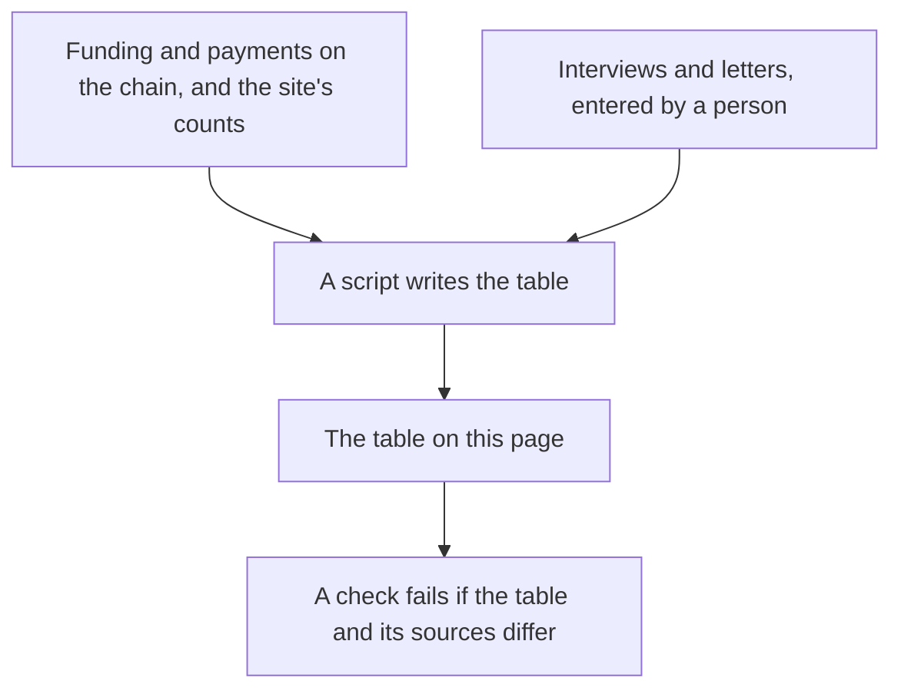

# The numbers, each with its source

**In plain words.** This page first says what would show the counting tool works, before anyone uses it. Then it counts how much people outside Knos have used its earlier work. Each number says where it comes from, so you can check it.

## Three measures, written before anyone uses the tool

Each PASS and STOP line is copied from a rule of the distribution laws, named by file and rule. The law files are in
`v0328/research/LAWS/DISTRIBUTION`, outside this repository. When no rule gives a number, the line says so and names
the files searched.

Only runs on a person's own list count here. Runs on the sample list are a separate demo measure (Daily design,
section 10). The counts are on [the status page](https://drexthealpha.github.io/Knos/status/), read from
[`docs/data/usage.json`](data/usage.json).

### Day-7 return

Of browsers that made a first run on day 0, the share that make a run on day 7.

- PASS: 7% or more. F5.md, finding 6: "Use the share of a sign-up cohort that returns on day 7 as the first go or no-go number, and aim for 7% or more."
- STOP: under 7%. F5.md, finding 6: "do not spend on growth while it is under 7%."

### Active days

The number of days with at least one run in a browser's first 7 days.

- PASS: 3 days or more. F5.md, finding 8: "Define "activated" as active on 3 of the first 7 days".
- STOP: not given in the law. Files searched: D3.md, D8.md, F4.md, F5.md, F8.md, G1.md, G2.md, CHECKED-D1-D4.md, CHECKED-D5-D8.md, CHECKED-F4-F7.md, CHECKED-F8-G3.md.

### Paying share

Of browsers that used up the free runs, the share that pressed "Pay with test money".

- PASS: 3% or more. CHECKED-D9-E2.md, D10 finding 8: "freemium self-serve 3%-5% good, 6%-8% great".
- STOP: not given in the law. Files searched: D10.md, E2.md, F4.md, G1.md, G3.md, CHECKED-D9-E2.md, CHECKED-F4-F7.md.

The law's rate counts paying users among active or registered users. This measure counts them among browsers that
used up the free runs, so the two are not the same base.

## Use of the earlier work

Nine numbers about use by anyone who is not Knos. They are counts, not targets.

*Records and people feed the table; a check fails if it drifts from them.*

## The nine numbers

The table is written by `python scripts/bench_docs.py` from the files it names. Its `--check` fails when the table
differs from them. The release run reads the chain and the site's data again and writes it again.

A number only a person can supply (an interview, a letter) is a constant in `docs/facts.json`. It is changed by hand
when the other party agrees to be counted.

<!-- bench:outside-use -->
| # | number | value | where it is read |
|---|---|---|---|
| 1 | Outside funders: accounts other than Knos's that funded a task with their own tokens | 0 | `docs/bench.json`, `devnet.stats.outside.funders` |
| 2 | Outside repositories: repositories not owned by Knos in which a task was funded | 0 | `docs/bench.json`, `devnet.stats.outsiders` (scripts/outsiders.py, in the site's build) |
| 3 | Outside payees: GitHub accounts other than the funder's that were paid | 1 | `docs/bench.json`, `devnet.stats.outsiders` (scripts/outsiders.py, in the site's build) |
| 4 | Payments between unrelated accounts: payments whose payee is another GitHub account than the funder | 3 | `docs/bench.json`, `release.payments_between_unrelated_accounts`, read from the payment programs' logs |
| 5 | Buyer interviews held | 0 | `docs/facts.json`, `by_hand`: a person changes it; [DISCLOSURE.md](reference/DISCLOSURE.md) says the same |
| 6 | Letters of intent | 0 | `docs/facts.json`, `by_hand`: a person changes it; [DISCLOSURE.md](reference/DISCLOSURE.md) says the same |
| 7 | Reproductions signed by GitHub: files in `reproductions/` from a run in someone else's repository | 0 | the report files of [`reproductions/`](../reproductions/README.md) |
| 8 | Outside programs reading the verifier | 0 | `docs/facts.json`, `by_hand`: a person changes it; [DISCLOSURE.md](reference/DISCLOSURE.md) says the same; the examples in [COMPOSE.md](reference/COMPOSE.md) are Knos's own |
| 9 | Shadow counts published: a neutral count printed beside a supplier's own invoice count, with every mismatch | 0 | `docs/facts.json`, `by_hand`: a person changes it; [DISCLOSURE.md](reference/DISCLOSURE.md) says the same; [SHADOW.md](reference/SHADOW.md) |
<!-- /bench:outside-use -->

## What they show, and what they do not

The outside payee and the three payments between unrelated accounts: one outside contributor wrote three pull
requests that were paid on devnet, in test USDC, for bounties Knos funded on its own repository.

**That is the path working between two accounts. It is not demand, and outside funders is the number that would be.**

What the chain cannot tell apart: an account that is not on the list of Knos's own (`scripts/own_github_ids.json`)
is counted as outside. That shows it is another account.

It does not show the account is independent of Knos, and Knos does not say so.

## The other numbers

The other numbers a field or a script states (tests passing, seconds from merge to payment, tasks paid) are held to
`docs/bench.json` by `python scripts/bench_docs.py --check`.

Which builds are live on the public program ids is in `web/upgrades.json`. The stage of every capability is in
[CAPABILITIES.md](reference/CAPABILITIES.md); no count of capabilities is given here.
