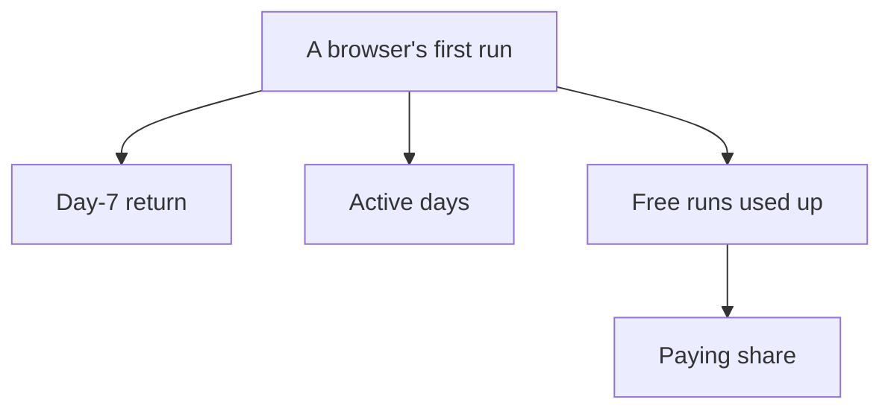

# The numbers, each with its source

**In plain words.** This page says what would show that the tool works, before anyone uses it. It names three measures. Each one has a line to pass and a line to stop, copied from a rule.

## Three measures, written before anyone uses the tool

Each PASS and STOP line is copied from a rule of the distribution laws, named by file and rule. The law files are in
`v0328/research/LAWS/DISTRIBUTION`, outside this repository. When no rule gives a number, the line says so and names
the files searched.

*Two measures follow a browser from its first run. The third starts when its free runs are used up.*

Only runs on a person's own list count here. Runs on the sample list are a separate demo measure (Daily design,
section 10). The counts are on [the status page](https://drexthealpha.github.io/Knos/status/), read from
[`docs/data/usage.json`](data/usage.json).

### Day-7 return

Of browsers that made a first run on day 0, the share that make a run on day 7.

- PASS: 7% or more. F5.md, finding 6: "Use the share of a sign-up cohort that returns on day 7 as the first go or no-go number, and aim for 7% or more."
- STOP: under 7%. F5.md, finding 6: "do not spend on growth while it is under 7%."

### Active days

The number of days with at least one run in a browser's first 7 days.

- PASS: 3 days or more. F5.md, finding 8: "Define "activated" as active on 3 of the first 7 days".
- STOP: not given in the law. Files searched: D3.md, D8.md, F4.md, F5.md, F8.md, G1.md, G2.md, CHECKED-D1-D4.md, CHECKED-D5-D8.md, CHECKED-F4-F7.md, CHECKED-F8-G3.md.

### Paying share

Of browsers that used up the free runs, the share that pressed "Pay with test money".

- PASS: 3% or more. CHECKED-D9-E2.md, D10 finding 8: "freemium self-serve 3%-5% good, 6%-8% great".
- STOP: not given in the law. Files searched: D10.md, E2.md, F4.md, G1.md, G3.md, CHECKED-D9-E2.md, CHECKED-F4-F7.md.

The law's rate counts paying users among active or registered users. This measure counts them among browsers that
used up the free runs, so the two are not the same base.

The counts of use by anyone outside Knos are in [OUTSIDE_USE.md](reference/OUTSIDE_USE.md).
