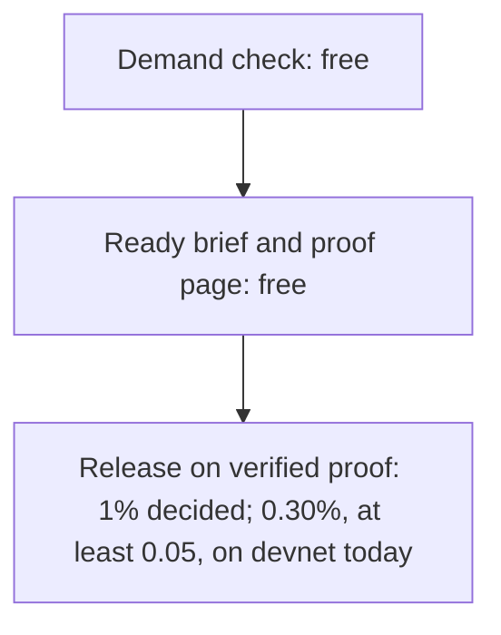

# What Knos costs

**In plain words.** Ten demand checks a month are free, and so are Ready briefs and proof pages. A deep demand check costs 500 USD, and a company pays 1% on money it releases on proof. No company is formed yet, so nobody pays today.

What is held, released and charged now: [the money page](https://knos.onrender.com/money).

## Knos's prices, decided 23 Oct 2026

| What | Price | Who pays | Today |
|---|---|---|---|
| Demand check | 10 a month free | nobody | free; the monthly count is not enforced yet |
| Deep demand check | 500 USD each, by card | the company | not charged: no company is formed yet |
| Ready brief | free | nobody | free |
| Proof page | free | nobody | free |
| Release | 1% of money released on verified proof | the company (the funder), on top | the program charges 0.30% |

Deep checks are charged by card once the company exists. No company is formed yet, so nobody is charged today.

The solver keeps 100% of what they are paid. The company pays the 1% release fee and the payment costs on top of the amount.

Cards cover milestones up to 500 USD. Larger milestones are paid by bank transfer or in USDC.

The 1% is decided, not live. The `knos_pay` program on devnet charges 0.30% today, in test money.

The 1% goes on chain only with a program upgrade, which waits in public first ([Trust](TRUST.md)).

## What the programs charge today

*The check and the brief are free. A fee is charged only when held money is released on proof.*

This part gives the prices the programs on [devnet](WORDS.md#devnet) charge today.

**Every price here is in [test USDC](WORDS.md#test-usdc), so Knos's revenue is zero.**

## The fee when held money is released

The fee is 0.30% of the amount, and never less than 0.05. It has no maximum.

The `knos_pay` program 2.2 charges it on devnet. It has done so since 9 Oct 2026.

The funder pays the fee on top. The maker gets the whole amount. A refund returns the amount and the fee.

Some worked examples, in test USDC:

| Amount | Fee | As a share |
|---|---|---|
| 5 | 0.05 | 1.00% |
| 1,000 | 3.00 | 0.30% |
| 5,000 | 15.00 | 0.30% |

Under 16.67 the floor of 0.05 is more than 0.30%. That is why 5 pays 1.00%.

## Orders funded before 9 Oct 2026

An order funded under the older `knos_pay` 2.1 keeps the fee it was funded with.

That older fee was higher, with a floor of 0.40. It was stored with the order, so it does not change.

`knos status` says which build of the program runs now.

## One rule

**The rule: Knos never charges the party being rated.** The maker is never charged for being checked. The funder pays the fee, or nobody does.

## What devnet can show

Devnet is Knos's test mode. Every fee the program takes there is test money, so revenue is zero. A receipt verifies
from GitHub's signatures with no chain ([RECEIPT.md](reference/RECEIPT.md)), so a record a customer keeps does not
depend on devnet's history.

Until settlement is real, a funder pays a maker through its bank as it does now. Knos has no token and plans
none.

Holding money until the proof passes and paying it out for others may be money transmission. Legal advice is needed
before any real money moves, and none has been taken ([DISCLOSURE.md](reference/DISCLOSURE.md)).

## Where the prices are fixed

The fee is written into the program's code: `FEE_BPS` and `FEE_MIN` in
[`programs-v2/knos_pay/src/lib.rs`](../programs-v2/knos_pay/src/lib.rs).

To change them takes an upgrade of the program, which waits 8 days in public first ([Trust](TRUST.md)).

The site's [price page](https://drexthealpha.github.io/Knos/#pricing) reads the fee from the program itself.

## Read more

- [Start here](START.md): check demand, write a Ready brief, then hold the money and pay on proof.
