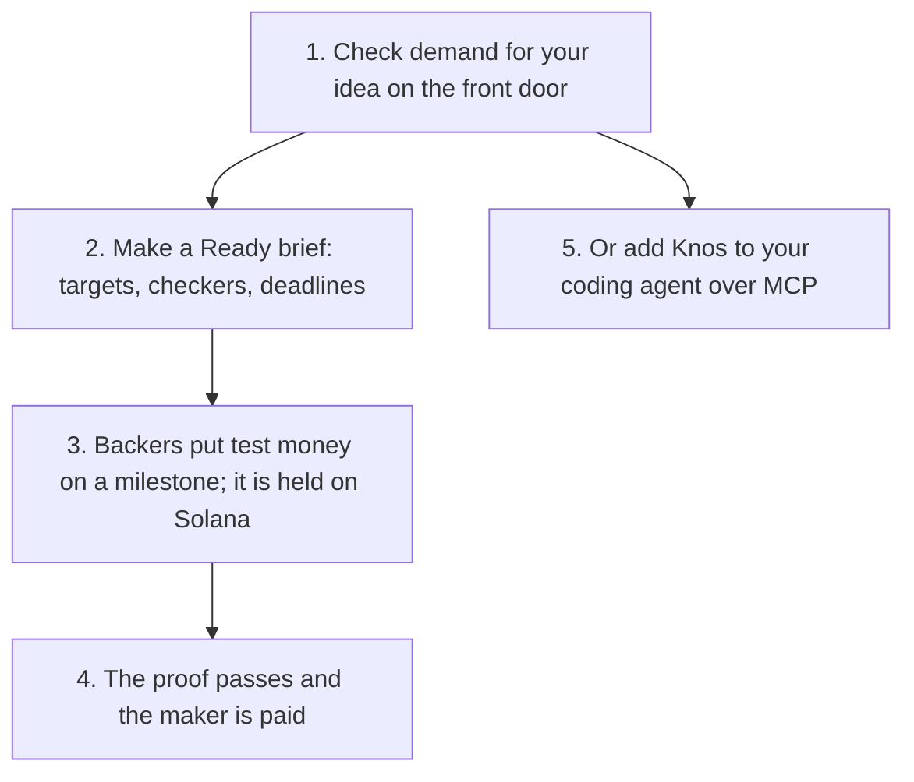

# Start here: Knos in five minutes

**In plain words.** Knos takes research to a product people want. First check demand for your idea, then write a Ready brief in [the app](https://knos.onrender.com/app/). To pay for code the same way, check a pull request, then put test money on a task with one comment.


*Check demand first; money moves only on a Ready brief and a passing proof.*

Everything here runs on [devnet](WORDS.md#devnet), Solana's practice network.

The money is [test USDC](WORDS.md#test-usdc), which is worth nothing. No step needs a sign-up.

## 1. Check demand

Open [the front door](https://drexthealpha.github.io/Knos/). Type what you are about to build, or press one of the
samples. Qloo's taste data says who wants it, where to launch it and at what price.

The [demand check](reference/DEMAND_CHECK.md) says how each answer is made.

## 2. Make a Ready brief

In [the app](https://knos.onrender.com/app/), turn the idea into a brief of milestones. The Ready check reads each
milestone for three fields:

| field | what it holds |
|---|---|
| target | a number with its unit, or a named test |
| checker | the GitHub check that decides it, or who measures it and where |
| deadline | when the proof is due |

A brief with a vague word or a missing field is Not ready, and the check names what is missing. Money locks only on a
Ready brief. Its criteria hash fixes the terms at that moment.

## 3. Back a milestone

Backers pre-order, or put test money on a milestone. The money is held in a program on Solana until the proof passes.

If the launch city falls short of its pre-order target by the first deadline, every pre-order is refunded.

## 4. Check a pull request

[Proof checked inside IRIS for Health](https://github.com/drexthealpha/Knos/tree/main/iris): a lab result or a referee verdict can be the proof as well, decided by an IRIS agent that can only say no or ask a person.

The same held money pays for code. Open [the check](https://drexthealpha.github.io/Knos/check/) in your browser.

Paste the link to an AI agent's [pull request](WORDS.md#pull-request), such as `github.com/owner/repo/pull/123`, and
press **Check**. On [the app's first screen](https://drexthealpha.github.io/Knos/app.html) you can also
press **Try a sample invoice**.

It reads what the pull request says, and the checks GitHub ran on its last commit. **It tells you if a test,
build, lint or type check failed, even when the pull request says the tests pass.**

It asks GitHub only. Nothing is sent to Knos, and it is free. GitHub answers 60 reads an hour per address, and one
check uses three.

From a terminal, the same check is one command:

```bash
uvx knos check owner/repo#123
```

A result can be shared. Its link (`#check=owner/repo/123`) checks the pull request again when it is opened. Nothing is
posted or stored by the site.

## 5. Fund a task with one comment

First, once per repository, add the Knos workflow file with one pull request.

Open [Install with one pull request](https://drexthealpha.github.io/Knos/#install) on the site, type your
repository, and commit the file GitHub fills in. Then merge that pull request.

Now comment on an issue:

```text
/knos fund 20 checks: test
```

That puts 20 test USDC on the issue. The work is paid only if the check named `test` passes.

On devnet a faucet hands out the test USDC, so you need no wallet. Knos replies with the terms it fixed.

`/knos help` lists every command. [What Knos costs](PRICING.md) gives the fee.

To keep the tests hidden from the worker, `knos task post spec.md --tests DIR` seals them by their hash and prints the
funding command. It sends nothing until you add `--send`.

## 6. Get paid

Do the work and open a pull request whose description says `Fixes #<issue>`.

Then say where to be paid, in a comment on your pull request:

```text
/knos address <your Solana address>
```

When your pull request is merged and its checks passed, a [program](WORDS.md#program) on Solana pays you.

From merge to payment took 28 seconds at the median, over 56 payments, measured 10 Oct 2026.

No wallet? The site's [Get paid](https://drexthealpha.github.io/Knos/#claim) section makes one from a
[passkey](WORDS.md#passkey). Without an address the money waits for you, 180 days at most.

## One paid task, link by link

One real run, on 9 Oct 2026, in a repository Knos owns. The comment was `/knos fund 5 checks: none auto`: pay 5 test
USDC when the buyer's own tests pass. One step was fixed by hand.

1. [Funded](https://explorer.solana.com/tx/3UaY22WKexigMpkVhibfeMdNgBiyybWm2Z4LuLskKGbNUDXV34yYWyH42atxFjELbrqSgoVs6TwpFzSQwhfXqzgM?cluster=devnet): 5 test USDC locked in the program.
2. [Wrong work refused](https://github.com/drexthealpha/knos-witness/actions/runs/37890511112/job/113690226126): the tests failed, and nothing was paid.
3. [Paid](https://explorer.solana.com/tx/2PtmKUrQHKPARZE4nr35Te559NGQSG7tSHUfwzcKCAjL7gzvQ76fNTVLMWvq8mcZLxd27tbyTe31mCk2PxEGfAqa?cluster=devnet): the fixed work passed, and the program paid the worker.
4. [Replay paid nothing more](https://github.com/drexthealpha/knos-witness/pull/10#issuecomment-6075196710): asking to be paid again was refused.
5. [The record](https://github.com/drexthealpha/Knos/blob/main/evidence/knos-witness-acaa854d/witness.json): every step above, each with its public link.

To do the same run in a repository of your own, follow [Run it yourself](../examples/witnessed/README.md).

## Two copies of the record, one bill

The buyer and the seller each keep a ledger of the work. Run this in a clone of the repository:

    pip install knos
    knos meter reconcile examples/meter/buyer.jsonl examples/meter/seller.jsonl

The bill counts only what both copies hold alike: 5 pieces, 4 accepted. Both sides get the same `sha256` line, and two
lines name the work they disagree on. [METER.md](reference/METER.md) has more.

## 7. Add Knos to your coding agent

Install the command, then let it set up every agent it finds:

```bash
uv tool install knos && knos init        # or: pipx install knos && knos init
```

On Ubuntu 24.04, Debian 12 and Homebrew's Python a bare `pip install knos` stops with
"externally-managed-environment": install it with uv or pipx as above (or `pip install knos` inside a virtual
environment).

It adds a Stop hook: before your agent may say "done", Knos checks that the tests really passed.

It also adds the MCP server, the tools an agent uses to find paid tasks and check pull requests.

It finds Claude Code, Codex, Cursor and Gemini CLI. `knos init --undo` takes it all out again.

Other agents and editors, one line each, are in [the install guide](reference/INSTALL.md).

## Where next

- [What Knos costs](PRICING.md): demand checks, Ready briefs and proof pages are free; a company pays on releases.
- [Trust](TRUST.md): who holds the keys, and what is tested.
- [The story](STORY.md): one task in seven steps, each with its proof.
- [Check every claim yourself](reference/MANIFEST.md): the release page, with the evidence for each capability.
- [Words](WORDS.md): pull request, devnet, multisig and more, in plain words.
