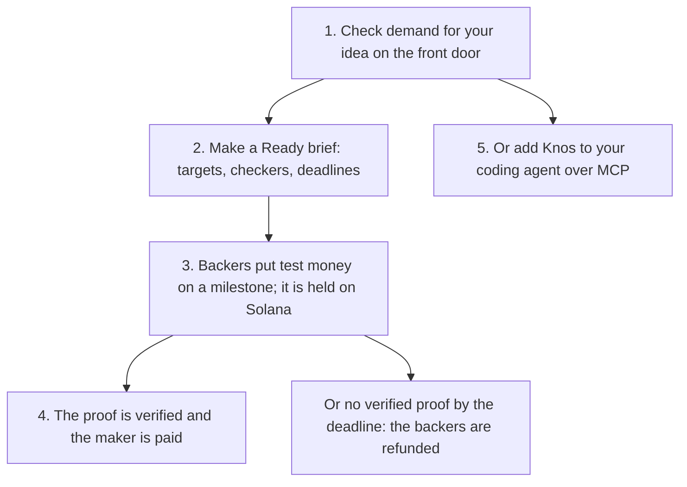

# Start here: Knos in five minutes

**In plain words.** Knos takes research to a product people want. First check demand for your idea, then write a Ready brief in [the app](https://knos.onrender.com/app/). Backers' money is held on Solana, and the maker is paid only when a milestone's proof is verified.


*Check demand first; money moves only on a Ready brief and a passing proof.*

Everything here runs on [devnet](WORDS.md#devnet), Solana's practice network.

The money is [test USDC](WORDS.md#test-usdc), which is worth nothing. No step needs a sign-up.

## 1. Check demand

Open [the front door](https://drexthealpha.github.io/Knos/). Type what you are about to build, or press one of the
samples. Qloo's taste data says who wants it and where to launch it.

The [demand check](reference/DEMAND_CHECK.md) says how each answer is made.

## 2. Make a Ready brief

In [the app](https://knos.onrender.com/app/), turn the idea into a brief of milestones. The Ready check reads each
milestone for three fields:

| field | what it holds |
|---|---|
| target | a number with its unit, or a named test |
| checker | the GitHub check that decides it, or who measures it and where |
| deadline | when the proof is due |

A brief with a vague word or a missing field is Not ready, and the check names what is missing. Money locks only on a
Ready brief. Its criteria hash fixes the terms at that moment.

## 3. Back a milestone

Backers pre-order, or put test money on a milestone. The money is held in a program on Solana until the proof passes.

If the launch city falls short of its pre-order target by the first deadline, every pre-order is refunded.

## 4. Paid on proof

The maker sends the proof for one milestone. The checker the brief named decides it:

- a lab result or a public evidence page, read by the milestone's checker;
- checks that GitHub signs, verified on chain by a [program](WORDS.md#program);
- the same verdict signed by two of three referees;
- [IRIS for Health](https://github.com/drexthealpha/Knos/tree/main/iris), inside a lab's own walls. Its agent can only say no or ask a person.

When the proof is verified, the program pays the maker for that milestone. A second claim with the same proof is
refused. With no verified proof by the deadline, the program refunds the backers.

From a terminal, the same steps are `knos idea` commands:

```bash
pip install knos
knos demand "a vegan ramen food truck" --place London
knos idea get arxiv:<id> --out idea.json
knos idea wanted idea.json
```

`knos idea --help` lists the rest: commit, check, sign, release and refund.

## One paid milestone, link by link

One real run, on 9 Oct 2026, in a repository Knos owns: pay 5 test USDC when the funder's own checks pass. One step was
fixed by hand.

1. [Funded](https://explorer.solana.com/tx/3UaY22WKexigMpkVhibfeMdNgBiyybWm2Z4LuLskKGbNUDXV34yYWyH42atxFjELbrqSgoVs6TwpFzSQwhfXqzgM?cluster=devnet): 5 test USDC locked in the program.
2. [Wrong work refused](https://github.com/drexthealpha/knos-witness/actions/runs/37890511112/job/113690226126): the checks failed, and nothing was paid.
3. [Paid](https://explorer.solana.com/tx/2PtmKUrQHKPARZE4nr35Te559NGQSG7tSHUfwzcKCAjL7gzvQ76fNTVLMWvq8mcZLxd27tbyTe31mCk2PxEGfAqa?cluster=devnet): the fixed work passed, and the program paid the maker.
4. [Replay paid nothing more](https://github.com/drexthealpha/knos-witness/pull/10#issuecomment-6075196710): asking to be paid again was refused.
5. [The record](https://github.com/drexthealpha/Knos/blob/main/evidence/knos-witness-acaa854d/witness.json): every step above, each with its public link.

To do the same run in a repository of your own, follow [Run it yourself](../examples/witnessed/README.md).

## 5. Add Knos to your coding agent

Knos's MCP server is hosted. Add it to Claude Code with one command:

```bash
claude mcp add --transport http knos https://knos.onrender.com/mcp
```

Its tools run the demand check and the crossing for your agent. Other agents and editors, one line each, are in
[the install guide](reference/INSTALL.md).

## Where next

- [What Knos costs](PRICING.md): demand checks, Ready briefs and proof pages are free; a company pays on releases.
- [Trust](TRUST.md): who holds the keys, and what is tested.
- [The story](STORY.md): one crossing, step by step, each with its proof.
- [Check every claim yourself](reference/MANIFEST.md): the release page, with the evidence for each capability.
- [Words](WORDS.md): Qloo, Ready brief, milestone and more, in plain words.
