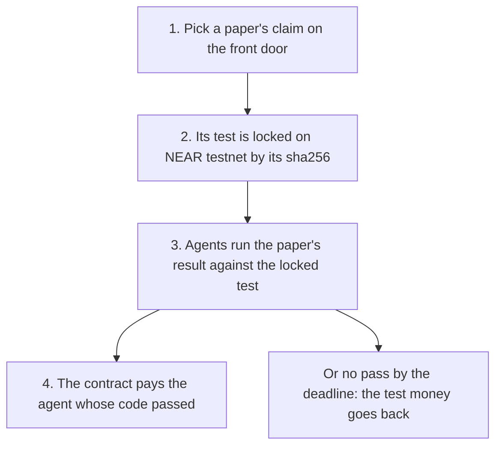

# Start here: Knos in five minutes

**In plain words.** Knos locks a test before any work starts. An agent does the work, and test money moves only if the test passes. You can watch it check a paper's claim on the front door.


*The test is fixed first; test money moves only on a pass.*

Everything here runs on NEAR testnet and on [devnet](WORDS.md#devnet), Solana's practice network.

The money is [test USDC](WORDS.md#test-usdc), which is worth nothing. No step needs a sign-up.

## 1. Check a paper's claim

Open [the front door](https://drexthealpha.github.io/Knos/) and press **Sample question**. See "Yes, the claim
holds", the claim, its locked test with its sha256, and its proof.

## 2. Run the check yourself

Open **How it works** under the answer, press **Run the check yourself**, then the button that runs the check with 10 test USDC. The page shows each step: the
test is locked, two agents run the paper's result against it, and the spending cap blocks an over-budget step.

The jobs contract holds the test money with the job. It sends 9 parts to the agent whose code passed the locked test
and keeps 1 part in 10 for Knos's account.

To see every step without running one, open [one finished check](https://drexthealpha.github.io/Knos/prove/receipt/)
(job-1114145004, 14 Nov 2026), saved as the page showed it. The README's
[NEAR section](../README.md#from-near-hackathon) says how to check its test and its payment from a terminal.

## 3. The same Knos for a pull request

Built earlier for Colosseum (tag v0.3.28): open [the ten-second check](https://drexthealpha.github.io/Knos/check/)
and paste a pull request. There the checks you named are the test, and a program on Solana devnet pays.

One real run of it, on 9 Oct 2026, in a repository Knos owns: pay 5 test USDC when the funder's own checks pass. One
step was fixed by hand.

1. [Funded](https://explorer.solana.com/tx/3UaY22WKexigMpkVhibfeMdNgBiyybWm2Z4LuLskKGbNUDXV34yYWyH42atxFjELbrqSgoVs6TwpFzSQwhfXqzgM?cluster=devnet): 5 test USDC locked in the program.
2. [Wrong work refused](https://github.com/drexthealpha/knos-witness/actions/runs/37890511112/job/113690226126): the checks failed, and nothing was paid.
3. [Paid](https://explorer.solana.com/tx/2PtmKUrQHKPARZE4nr35Te559NGQSG7tSHUfwzcKCAjL7gzvQ76fNTVLMWvq8mcZLxd27tbyTe31mCk2PxEGfAqa?cluster=devnet): the fixed work passed, and the program paid the maker.
4. [Replay paid nothing more](https://github.com/drexthealpha/knos-witness/pull/10#issuecomment-6075196710): asking to be paid again was refused.
5. [The record](https://github.com/drexthealpha/Knos/blob/main/evidence/knos-witness-acaa854d/witness.json): every step above, each with its public link.

To do the same run in a repository of your own, follow [Run it yourself](../examples/witnessed/README.md).

## 4. The same Knos for lab steps

[Knos on IRIS](../iris/README.md) runs inside a lab's own InterSystems IRIS. Each step of lab work is paid in play
money only when its test passed, and above $50 a person approves.

## 5. Add Knos to your coding agent

Knos's MCP server is hosted. Add it to Claude Code with one command:

```bash
claude mcp add --transport http knos https://knos.onrender.com/mcp
```

Other agents and editors, one line each, are in [the install guide](reference/INSTALL.md).

## Before the NEAR entry

Until November 2026 the front door started with a demand check and a Ready brief, and backers put test money on a
milestone. The [demand check](reference/DEMAND_CHECK.md) still works in [the app](https://knos.onrender.com/app/),
and `knos demand` runs it from a terminal.

## Where next

- [What Knos costs](PRICING.md): the fee on each chain.
- [Trust](TRUST.md): who holds the keys, and what is tested.
- [An earlier run](STORY.md): one October run on Solana, step by step, each with its proof.
- [Check every claim yourself](reference/MANIFEST.md): the release page, with the evidence for each capability.
- [Words](WORDS.md): NEAR testnet, devnet, test USDC and more, in plain words.
