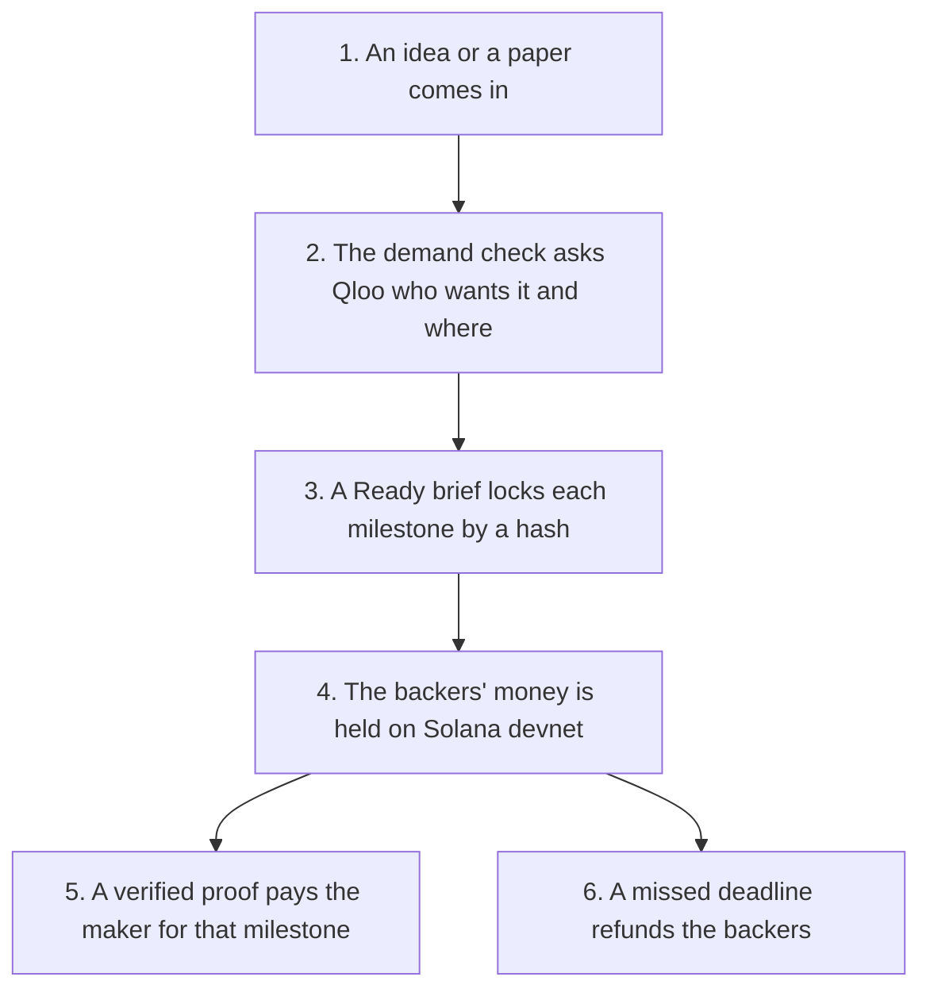

# The story: one crossing, step by step

**In plain words.** A research result often never becomes a product. Knos checks who wants it, holds the backers' money and pays the maker only on proof. This page follows one crossing in [test money](WORDS.md#test-usdc), step by step.

**Knos carries research across the valley of death: see who wants it and where, then get paid only on proof.**

Try it yourself: type an idea [on the site](https://drexthealpha.github.io/Knos/#demand). No install, no sign-up.

## The steps

One idea, start to finish: a registered trial of psilocybin for alcohol use disorder (NCT04718792), run on 15 Oct 2026. Each step has one piece of evidence: a file or a transaction.

*A milestone is paid on verified proof, or refunded at its deadline.*

1. **An idea comes in.** A trial record becomes one claim record.
   Evidence: [Ideas from research sources](reference/IDEAS.md)

2. **The demand check runs.** Qloo says who wants it and where.
   Evidence: [The demand check's rules](reference/DEMAND_CHECK.md)

3. **The Ready brief is locked.** Each stage has a target, a checker and a deadline.
   Evidence: [The Ready check and the criteria hash](../src/knos/ready.py)

4. **The money is held.** A pre-order locks test units on devnet.
   Evidence: [The pre-order transaction (devnet)](https://explorer.solana.com/tx/2yEjidBojssFJp1UFRoBmTtvphbzqAmhRngrDZzgZRHy3u8NfPCArNVEJDYJn4V3nB1UngrAwHLEWmDJPubbmhr9?cluster=devnet)

5. **Paid on proof.** Two of three referees signed PASS, so the program paid 8 test units.
   Evidence: [The second PASS verdict, which released the stage (devnet)](https://explorer.solana.com/tx/3MJ9kGhWwKgkqGHDzeYRA7aycv8knci3oHHbWadvnARC5DVwj2pgbbndpWssuqjvjgKVVMFhELssGvAJ5VpCuuj8?cluster=devnet)

6. **Refunded at the deadline.** No results were posted in time, so the backer was refunded.
   Evidence: [The refund transaction (devnet)](https://explorer.solana.com/tx/5FtL36bLPvQhS7z8h8gq6ZGkiSS5LDkLJWd7gPnwrYdo7GP5q8G7DuqGdCLdysvmfSjoGtERZQCmVo8uA47dFDkg?cluster=devnet)

The demand check of this run was MOCK (no Qloo key was set for it), and it says so. Steps 5 and 6 ran on a separate devnet test deployment of the knos_pay 0.3.34 build, as [IDEAS.md](reference/IDEAS.md) records. The money is test units.

## What Knos claims

The claim: a maker and the backers who do not trust each other agree on milestones first. A program on Solana holds the money and pays only on a verified proof. No company sits in the middle.

Why Solana: money is released with no custodian. One person holds every upgrade key today; a program change waits 8 days in public.

A receipt can be checked with no blockchain at all. The chain holds the money and the [root](WORDS.md#root).

Check every claim yourself: [every capability, with its evidence](reference/CAPABILITIES.md), and [the release page](reference/MANIFEST.md).

## The ask

1. Needed: an outside key holder for both multisigs. Nobody has been asked.
2. Needed: first makers and backers to run one crossing. None has run.
3. Needed: an outside review of the programs. None is commissioned.

What each would do is in [GOVERNANCE.md](reference/GOVERNANCE.md), [IDEAS.md](reference/IDEAS.md) and
[ASSURANCE.md](reference/ASSURANCE.md).

## Limits

[SECURITY.md](reference/SECURITY.md) has all of them. The ones to know first:

- Devnet, test USDC, no outside review. `knos mainnet-check` fails on that line on purpose.
- A signature proves who made a statement, not that it is true. A referee signs what it checked, not that the product works.
- Qloo's answer is directional demand evidence, not a sales forecast.
- A passed milestone is not a good product. An order buys what its brief says, and the backers chose to back it.
- The payout is test units on Solana. No card, no bank transfer, no bank payout.

Every other document: [README.md](README.md).
