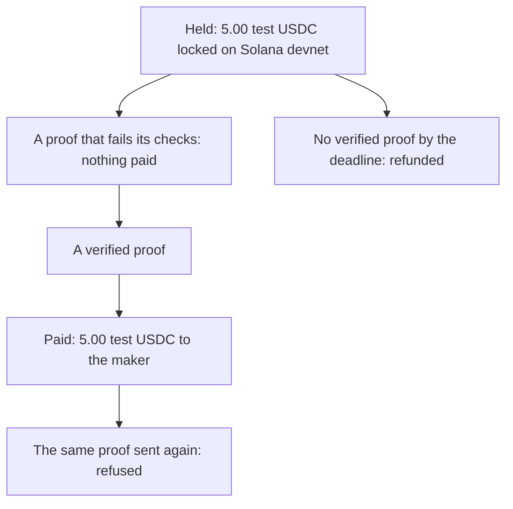

# One payment, end to end, for a finance reader

**In plain words.** This page follows one held payment from start to finish, paid in [test money](WORDS.md#test-usdc). The first proof failed its checks and got nothing, and the fixed work passed and was paid 5.00. Sending the same proof again was refused, so nothing was paid twice.

*A failed proof pays nothing; a verified one pays once; a missed deadline refunds.*

## The record, public

One order on Solana devnet, run on 9 Oct 2026 with Knos 0.3.23 in Knos's own repository
`drexthealpha/knos-witness` (its files and its history are kept in Knos: [evidence/knos-witness](../evidence/knos-witness/)).
There is no outside backer: both sides are Knos accounts.

**Nothing here was sold. Test USDC has no monetary value.**

## 1. Terms and price, before any work

- The funder holds 5.00 test USDC for the work. The terms are posted as a `knos-terms` block and hashed at funding.

- The reply names the order account and the fee before any work: the funder pays 0.40 on top
  ([funded reply](https://github.com/drexthealpha/knos-witness/issues/9#issuecomment-6075144470),
  [funding transaction](https://explorer.solana.com/tx/3UaY22WKexigMpkVhibfeMdNgBiyybWm2Z4LuLskKGbNUDXV34yYWyH42atxFjELbrqSgoVs6TwpFzSQwhfXqzgM?cluster=devnet)).

- 0.40 is the order floor of knos_pay 2.1, the build deployed when the order was funded. Upgrade proposal 8 has
  since executed: knos_pay 2.2 charges 0.30% with a 0.05 floor, which on 5.00 is 0.05.
  [MANIFEST.md](reference/MANIFEST.md) has both schedules; see also [the price book](PRICING.md).

## 2. One proof rejected, one accepted

- Rejected: the first work failed its checks, and nothing was paid
  ([the failed run](https://github.com/drexthealpha/knos-witness/actions/runs/37890511112/job/113690226126)).

- Accepted: the corrected work passed at commit `7abbc32`
  ([the passing run](https://github.com/drexthealpha/knos-witness/actions/runs/37890595056/job/113690482455)).
  GitHub signed that run; the program checked the signature and paid 5.00
  ([payment](https://explorer.solana.com/tx/2PtmKUrQHKPARZE4nr35Te559NGQSG7tSHUfwzcKCAjL7gzvQ76fNTVLMWvq8mcZLxd27tbyTe31mCk2PxEGfAqa?cluster=devnet)).

- Cheating proofs are measured apart, referee by referee, in [TAMPER.md](reference/TAMPER.md).

## 3. One record for both sides

Both sides' statements have one line, agreed, with the same sha256
([the record](https://github.com/drexthealpha/Knos/blob/main/evidence/knos-witness-acaa854d/witness.json)):

`a3791c5d92a545a16b0486a01b9d70f091e3e431074a5b6cbb47549c7a110280`

The line's "settled" step is still open: the statement does not yet record the payment.

## 4. Payment by the rule, and a retry with no second effect

- The program paid because GitHub's signature on the passing run checked out under the funded terms. No person
  approved the transfer.

- A replay of the same proof was refused and paid nothing
  ([the refusal](https://github.com/drexthealpha/knos-witness/pull/10#issuecomment-6075196710)). Each proof leaves a
  single-use marker on chain.

- Makers and agents are paid on the app's program the same way, one milestone at a time. An agent was paid
  [5 test units for verified work](https://explorer.solana.com/tx/53pd6Rfdtcj34rHUtV7UnCQyfFRVXe5Vot2ujFCXR6dcrHeziwQRyry2ekeph5iHKX9L7ALc3W4GjhVSN5LLMGw7?cluster=devnet).
  Released by the referee's verdict.

- A milestone with no verified proof by its deadline is refunded: a devnet refund of a missed stage is in
  [IDEAS.md](reference/IDEAS.md).

## 5. What an independent operator runs

- `python examples/witnessed/witness.py run --login YOU` repeats the order in your own repository with test USDC
  ([../examples/witnessed/README.md](../examples/witnessed/README.md)).

- The archive `witness.zip` carries its own verifier, which needs no Knos.

Nobody outside Knos has run it yet.
