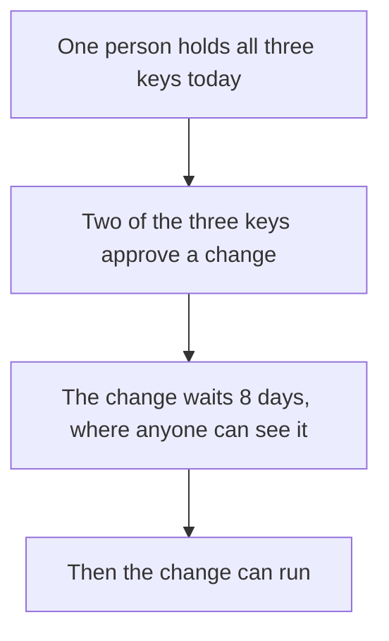

# Trust: who holds the keys, and what is tested

**In plain words.** Today one person holds every key that can change the programs. A change must wait 8 days in public before it can run. Nobody outside Knos has checked the code, and it runs only with test money.


*One person can change the programs, but not in secret.*

## Who holds the keys today

**One person holds every key today.** No one else holds a key yet. **Outside key holders today: 0.**

The [programs](WORDS.md#program) that hold the money obey two [multisigs](WORDS.md#multisig). A multisig acts
only when enough of its keys agree.

| Key | What it can do |
|---|---|
| The upgrade multisig, 2 of 3 keys | Change the code of every program it holds (both knos-pay builds, knos-oidc, knos-meter, knos-passkey, knos-hook), after the public wait |
| The guardian multisig, the same 3 keys | Pause new funding for 7 days at most, and approve or refuse a GitHub signing key |
| `FEE_OWNER` | Receive the fees, and lower one owner's fee rate until a date |
| The deploy key | Write a new build for the upgrade multisig to vote on |
| The GitHub account of the pinned workflows | Publish the workflows every order pins |

All three member keys belong to that one person. So "2 of 3" does not mean two people: one person can act alone.

One machine holds all three member keys and the deploy key. No key here can move an order's money to itself. The
upgrade multisig can change the code, and new code can do anything.

## Ask to hold a key

A first outside key holder would hold 1 key of 3. That person could vote on every upgrade and check each build in
public. One key of three cannot approve or block an upgrade alone.

To ask, make a key on your own machine (`solana-keygen new --outfile knos-member.json`) or on the site's Hold a key
page. Keep the file to yourself. Then open a [Key holder request](https://github.com/drexthealpha/Knos/issues/new?template=key_holder.md)
with your public key and a way to reach you.

The change that adds your key is public on chain, and on the upgrade multisig it waits 8 days. Afterwards
[`web/keyholders.json`](../web/keyholders.json) lists your key, and the count above becomes 1.

## One GitHub account

The pinned workflows, the key-rotation workflow, the relay and the site all live in one GitHub account. If it were
suspended or lost, funded orders could only be refunded: a refund needs no GitHub and no action by Knos.

## Who builds Knos

One person builds Knos, under a pseudonymous GitHub account. No legal name is published. Nobody else works on
it, and there is no legal entity. No legal advice has been taken ([DISCLOSURE.md](reference/DISCLOSURE.md)).

## How a change to the programs happens

Two of the three keys approve the change. Then it waits 8 days, and anyone can see it coming.

`knos status` lists every change that is waiting. So does the site's [upgrade
record](https://drexthealpha.github.io/Knos/upgrades.json).

**The wait gives notice. It is not oversight: nobody else has to agree, and nobody else can refuse.**

New code can do anything, including taking the money in open tasks. A funder cannot always leave in time.

`knos exit --before-upgrade` lists each of your holdings, and whether it can get out before a waiting change runs.

A program change now waits 8 days in public (Squads [time lock](WORDS.md#time-lock) 691,200 s, in force since
11 Oct 2026). Proposal 9 of the upgrade multisig set it. Before that the wait was 48 hours.

The first set of programs, in [`programs/`](../programs), has no upgrade key. Nobody can change it. It stays
as a record, and no new task is funded there.

## What is tested

The same person wrote the code and the tests. A test is evidence, not proof.

- **Tests.** `python -m pytest -q tests` runs the whole suite offline. The chain tests run the built programs in
  a simulator.
- **Fuzzing.** A fuzzer feeds the program's claim reader random input. The latest run tried 5,410,436
  inputs against the claim parser.
- **A second opinion on signatures.** A test compares the verifier with OpenSSL on thousands of made-up tokens.
- **Model checking.** Five Kani proofs check the payment program's fee sums: what goes in equals what comes out,
  and the fee stays within its bounds.

None of these covers everything. No model checker has been run on the verifier, the program that checks GitHub's
signatures.

One person, the author, read the verifier and the payment program line by line, as an attacker would. That is
the author's own check. It is no audit.

[Assurance](reference/ASSURANCE.md) lists each rule, the test that holds it, and what is not covered.

## What nobody has done yet

No outside firm has audited the code. Nobody outside Knos has reviewed it, and no review is commissioned.

It runs on [devnet](WORDS.md#devnet) only, with [test USDC](WORDS.md#test-usdc). Mainnet is not touched.

`knos mainnet-check` lists every gate before real money. Its last gate, an outside review, fails on purpose.

## Check a deployed program yourself

`knos status` reads the programs from the chain. It says which version runs, who can change it, and what is
waiting.

To compare the program on devnet with this source, build it the same way the release does. You need docker,
`solana-verify` and a clone on a Linux file system:

```bash
solana-verify build "$PWD" --workspace-path "$PWD/programs-v2" --library-name knos_pay --base-image solanafoundation/solana-verifiable-build:2.3.11
solana-verify get-executable-hash programs-v2/target/deploy/knos_pay.so
solana-verify get-program-hash -u devnet 5y7iWJ1VAMJjnnWbbdo2a2PsWJEwTExSNpzrvQSEnS8k
```

The two hashes must be the same. The steps for the verifier, `knos_oidc`, are in
[Assurance](reference/ASSURANCE.md#reproduce-it-yourself).

## Read more

- [Security](reference/SECURITY.md): who is trusted for what, and every known limit.
- [Governance](reference/GOVERNANCE.md): who can change what today.
- [Assurance](reference/ASSURANCE.md): the tests, the fuzzing and the proofs, and how to run them.
