# Knos before NEAR: the pull request check on Solana devnet, and the reference

Back to the [README](../../README.md#from-colosseum).

## How it works



*Money moves only when a step passes its test.*

1. **Is it wanted?** Knos [checked who would buy it](DEMAND_CHECK.md) and in which city, before any work was paid.
2. **Write the deal.** Each step of the work got a goal and a deadline, plus the test that decided it. They were sealed with a fingerprint, so nobody could change them later.
3. **Hold the money.** Backers' money waited in a program on [Solana](../WORDS.md#solana), a public ledger, not with Knos.
4. **Pass the test.** The maker sent proof. When the test passed, that step was paid. If nothing passed by the deadline, the backers got their money back. Example: [a real payment of 5 test units for checked work](https://explorer.solana.com/tx/53pd6Rfdtcj34rHUtV7UnCQyfFRVXe5Vot2ujFCXR6dcrHeziwQRyry2ekeph5iHKX9L7ALc3W4GjhVSN5LLMGw7?cluster=devnet).

The entry added Knos to Claude Code with one command: `claude mcp add --transport http knos https://knos.onrender.com/mcp`

**Open call, then:** research waiting for a market could be [crossed on Knos](https://knos.onrender.com/invite), and that page counted every crossing and pre-order by people outside Knos.

## Paid only when the test passes

The proof is checked before any money moves. A milestone names its checker in the brief. The proof can be:

- a lab result or a public evidence page, read by the milestone's checker;
- checks that GitHub signs, verified on chain;
- the same verdict signed by two of three [referees](../WORDS.md#referee);
- a verdict from [IRIS](https://github.com/drexthealpha/Knos/tree/main/iris) inside a lab's own walls. Its agent can only say no or ask a person.



*Nothing is paid on a promise. A missed deadline sends the money back.*

## Try it in ten seconds

Open [the front door](https://drexthealpha.github.io/Knos/), press **Try: HyperLogLog**, then **Prove it yourself**,
and run the check with the test USDC you choose. Nothing to install and no sign-up ([Do this, see
that](NEAR.md#do-this-see-that)).

## Why nobody can fudge the count

In the Colosseum entry the terms of a brief were locked by a [hash](../WORDS.md#hash) before any money moved. A changed target or deadline gave a different hash. So a change could not hide.

The money waited in a program on [Solana](../WORDS.md#solana), not with Knos. That program paid only when the checks passed. At the deadline it refunded the backers instead.

**Neither the maker nor Knos could move the money alone.**

Today one person can still change that program, after a public wait ([who holds the keys](../TRUST.md)).

In that entry Knos earned its fee only when work was accepted. When a backer got a refund, the fee went back too. So Knos gained when work passed, and it was not yet fully neutral ([what is enforced and what is a promise](CHARTER.md)).

## Is it real?

It runs on test money only: [test USDC](../WORDS.md#test-usdc) on NEAR testnet for the paper proof, and on Solana's practice network, [devnet](../WORDS.md#devnet), for the other tools.

There are no customers yet. Nobody has bought anything ([what is not real yet](DISCLOSURE.md)).

One person holds every key today. Any change to the programs waits in public for 8 days first ([who holds the keys](../TRUST.md)).

<!-- bench:today -->
| What | Today | Read from |
|---|---|---|
| This copy | Release 0.4.1, November 2026. A copy naming an older release, or another product, is out of date | [CHANGELOG.md](../../CHANGELOG.md); the newest: [PyPI](https://pypi.org/project/knos/) |
| Reproduced by someone else | 0 of 267 | [docs/reference/CAPABILITIES.md](CAPABILITIES.md), the rows "reproduced by someone else" |
| Exercised at the public devnet program ids | 26 of 267: GitHub token verification, funding by one comment, funding from a wallet, pay on merge, refund at the deadline, pause, work orders, an order paying up to four payees, orders checked by the buyer's black-box tests, auto-accepted orders, a holdback released after its warranty, top-ups, single-use tokens, one counted evaluation, a counted batch of evaluations, the seller's own count, a payee's passkey wallet, a passkey funder, the passkey relay, the site's Buy page, an x402 order, the upgrade gate, strict JSON in the verifier, an outcome that is not code, ES256 tokens in one transaction, the presentation grace | [docs/reference/CAPABILITIES.md](CAPABILITIES.md), the rows "exercised on devnet" |
| Deployed at the public devnet program ids, no transaction recorded | 3 of 267: GitLab token verification, the key guardian, holding pay for a payee with no wallet | [docs/reference/CAPABILITIES.md](CAPABILITIES.md), the rows "deployed on devnet" |
| Tested here only | 233 of 267, each with the test its row names | [docs/reference/CAPABILITIES.md](CAPABILITIES.md), the rows "tested locally" |
| Written, not tested | 5 of 267 | [docs/reference/CAPABILITIES.md](CAPABILITIES.md), the rows "implemented" |
| Outside funders | 0 | [docs/NUMBERS.md](../NUMBERS.md), row 1 |
| Outside repositories | 0 | [docs/NUMBERS.md](../NUMBERS.md), row 2 |
| Outside payees | 1, on tasks Knos funded itself | [docs/NUMBERS.md](../NUMBERS.md), row 3 |
| Payments between unrelated accounts | 3, on tasks Knos funded itself | [docs/NUMBERS.md](../NUMBERS.md), row 4 |
| Buyer interviews held | 0 | [docs/NUMBERS.md](../NUMBERS.md), row 5 |
| Letters of intent | 0 | [docs/NUMBERS.md](../NUMBERS.md), row 6 |
| Reproductions signed by GitHub | 0 | [docs/NUMBERS.md](../NUMBERS.md), row 7 |
| Outside programs reading the verifier | 0 | [docs/NUMBERS.md](../NUMBERS.md), row 8 |
| Shadow counts published | 0 | [docs/NUMBERS.md](../NUMBERS.md), row 9 |
| Paying customers | 0 | [docs/reference/DISCLOSURE.md](DISCLOSURE.md) |
| Revenue | 0; test USDC is not money | [docs/PRICING.md](../PRICING.md) |
| Outside security review | none | [docs/reference/ASSURANCE.md](ASSURANCE.md) |
| Key holders | one person holds every key; an upgrade waits 8 days in public | [docs/reference/GOVERNANCE.md](GOVERNANCE.md) |
| Network and money | NEAR testnet and Solana devnet, test USDC; no mainnet | [docs/reference/SECURITY.md](SECURITY.md) |
<!-- /bench:today -->

## From a terminal

```sh
knos demand "a vegan ramen food truck" --place London     # Qloo's demand check: who, where, price tier
knos idea get arxiv:<id> --out idea.json                  # a paper as one claim record
knos idea wanted idea.json                                # demand evidence and the stage plan; sends nothing
knos idea commit idea.json --units <n> --price <n>        # lock the stages on devnet, one order a stage
knos idea check idea.json <oracle>                        # is one stage met right now?
knos idea release <commitment> <stage> --sig <verdict>    # pay a met stage on the referees' signed verdicts
knos idea refund <commitment> <stage> --wallet <keypair>  # refund a missed stage; anyone may send it
```

Install with `pip install knos`. In the entry the app answered the same steps over HTTP: `POST /api/check` (the demand check), `POST /api/ready` (the Ready brief) and `POST /api/preorder` (a pre-order on devnet). Run `knos idea --help` for every option.

## Check every claim yourself

Start at [the release page](MANIFEST.md): the code, how it is built, what runs on devnet, the payments and the fees.

One payment from start to end, on 9 Oct 2026 with Knos 0.3.23, in a repository Knos owns, with test USDC (one step fixed by hand): [funded](https://explorer.solana.com/tx/3UaY22WKexigMpkVhibfeMdNgBiyybWm2Z4LuLskKGbNUDXV34yYWyH42atxFjELbrqSgoVs6TwpFzSQwhfXqzgM?cluster=devnet) · [wrong work refused](https://github.com/drexthealpha/knos-witness/actions/runs/37890511112/job/113690226126) · [paid](https://explorer.solana.com/tx/2PtmKUrQHKPARZE4nr35Te559NGQSG7tSHUfwzcKCAjL7gzvQ76fNTVLMWvq8mcZLxd27tbyTe31mCk2PxEGfAqa?cluster=devnet) (after the checks passed) · [replay paid nothing more](https://github.com/drexthealpha/knos-witness/pull/10#issuecomment-6075196710) · [the record](https://github.com/drexthealpha/Knos/blob/main/evidence/knos-witness-acaa854d/witness.json).

Rebuild knos_oidc and knos_pay, the programs that check the proof and pay, and compare: the hash devnet runs equals the verified build hash recorded for each ([PROVENANCE](PROVENANCE.md)). Read on 27 Oct 2026.

```sh
solana-verify get-program-hash -u devnet FkwZdsYCmzicJMtHLTkPK76bYNVG4WNwkWJBiVWNtF3W   # knos_oidc: a2df952d262c48edacf2f594a01321e805c28f1dc523cb6efa75f2c45f34e632
solana-verify get-program-hash -u devnet 5y7iWJ1VAMJjnnWbbdo2a2PsWJEwTExSNpzrvQSEnS8k   # knos_pay: 8b3c044024eac6e00cf10930c325465d5682c3fb7273fe2f0d59c6e01f99867c
```

## Words

Qloo, Ready brief, milestone and more, each in one plain line: [docs/WORDS.md](../WORDS.md).

## Questions

### What is Knos?

Knos takes research from a paper to a product people want.

### How does an AI agent get paid?

Knos locks a test before work starts. [Test money](../WORDS.md#test-usdc) moves only if the agent's code passes.

### Does Knos use real money?

No. Proofs run on NEAR testnet with [test dollars](../WORDS.md#test-usdc) worth nothing.

### What does Knos cost?

A proof is free. Solana devnet charges 0.30%, at least 0.05 [test dollars](../WORDS.md#test-usdc).

### Who holds the money?

On NEAR, the jobs contract holds each job's pay. It pays only the agent whose code passes.

### Can the test change once work starts?

No. The test is locked when the job is funded.

### Who keeps the count of accepted work?

Neither side alone. A program checks a [signed record](../WORDS.md#signed) of which checks ran.

### How do I try Knos?

Open [the front door](https://drexthealpha.github.io/Knos/) and ask a question about research.


## Read more

- [Get started](../START.md): check a paper's claim on NEAR first, then see the same Knos on Solana and IRIS.

- [Pricing](../PRICING.md): what Knos costs. Checking a claim is free. On NEAR testnet the jobs contract keeps 1 part in 10 of what moves; on Solana devnet the maker keeps 100% and the funder pays the payment program's fee on top, 0.30% of each payout, at least 0.05. A 1% release fee is planned, not today's fee. Nobody pays real money today.

- [Trust](../TRUST.md): who holds the keys, and what is tested.

- [An earlier run](../STORY.md): one October run on Solana, step by step, each with its evidence.

- [Every other document](../README.md): the map of the documents.

---

Contact: open an issue, or report a security problem privately: [SECURITY.md](../../SECURITY.md).

Below: tables that scripts write from the code and the chain, and the licence. Nobody types them by hand.

<!-- programs:start -->
| program | address | on devnet, as [`docs/capabilities.json`](../capabilities.json) records it |
|---|---|---|
| `knos-oidc`, the verifier | `FkwZdsYCmzicJMtHLTkPK76bYNVG4WNwkWJBiVWNtF3W` | runs `2.2` |
| `knos-pay`, the payment program | `5y7iWJ1VAMJjnnWbbdo2a2PsWJEwTExSNpzrvQSEnS8k` | runs `2.2` |
| `knos-meter`, the count | `FUMKkcE95x2kZUj1zZTCbgcYBmJ3WXPHL8pyA8J6anX` | runs `1.1` |
| `knos-passkey`, a wallet from a passkey | `FQPX9i5kQxLYKZyyPgM2fVK9am3w1LSk1Cuoer1sSY85` | runs `1.1` |
<!-- programs:end -->

<!-- authorities:start -->
Every program the app or this site uses, and who can upgrade it, read from devnet on 2026-10-26 ([`scripts/program_authorities.py`](https://github.com/drexthealpha/Knos/blob/main/scripts/program_authorities.py)):

| program | address | used for | upgrade authority |
|---|---|---|---|
| knos-pay 0.3.34: the app's live program (0.3.34) | `FaMHCjzyUexFncZrmNyFQNz3gBdsLbhTLke7QBFykJY4` | every pre-order, milestone payout and agent payout of the app | `CKCrTBN542pVhizxuSPVg8tvdnPooNxt9B7o97VuTjz2`, the Squads vault (an upgrade waits out its 8-day time lock) |
| knos-oidc 2.2: the verifier of GitHub's signed checks | `FkwZdsYCmzicJMtHLTkPK76bYNVG4WNwkWJBiVWNtF3W` | pay on merge, the site's signature line | `CKCrTBN542pVhizxuSPVg8tvdnPooNxt9B7o97VuTjz2`, the Squads vault (an upgrade waits out its 8-day time lock) |
| knos-pay 2.2: the payment program | `5y7iWJ1VAMJjnnWbbdo2a2PsWJEwTExSNpzrvQSEnS8k` | pay on merge, the site's work orders | `CKCrTBN542pVhizxuSPVg8tvdnPooNxt9B7o97VuTjz2`, the Squads vault (an upgrade waits out its 8-day time lock) |
| knos-meter: the count | `FUMKkcE95x2kZUj1zZTCbgcYBmJ3WXPHL8pyA8J6anX` | the meter on the site | `CKCrTBN542pVhizxuSPVg8tvdnPooNxt9B7o97VuTjz2`, the Squads vault (an upgrade waits out its 8-day time lock) |
| knos-passkey: a wallet from a passkey | `FQPX9i5kQxLYKZyyPgM2fVK9am3w1LSk1Cuoer1sSY85` | passkey wallets in the app | `CKCrTBN542pVhizxuSPVg8tvdnPooNxt9B7o97VuTjz2`, the Squads vault (an upgrade waits out its 8-day time lock) |
| knos-hook: the transfer hook | `AFQFtodihz5jAHpVBUk87AkH8FJsQdmHt8Z5NKLWRj1T` | the app's Token-2022 project credits | `CKCrTBN542pVhizxuSPVg8tvdnPooNxt9B7o97VuTjz2`, the Squads vault (an upgrade waits out its 8-day time lock) |
| knos-oidc, first deployment | `vpWym9azbPU5f2PH2a6n8c4RfmsyUeW2dMuWr1DSHcE` | the site's history of the first deployment | none: nobody can change it |
| knos-pay, first deployment | `9UzPFbh2A4e4sEPgngKG523FfYLnQ3qPfFVfFTTAdfDi` | the site's history of the first deployment | none: nobody can change it |
| SPL Record (Solana) | `recr1L3PCGKLbckBqMNcJhuuyU1zgo8nBhfLVsJNwr5` | the app's chain-state records | `7VaWK6qq7WLBiMQ8TTAGwrFJfAekAwra4UPKr4S5UNjB`, one key |
| SPL Memo (Solana) | `MemoSq4gqABAXKb96qnH8TysNcWxMyWCqXgDLGmfcHr` | the app's fee estimate and its notes on chain | none: not an upgradeable program |
| Token-2022 (Solana) | `TokenzQdBNbLqP5VEhdkAS6EPFLC1PHnBqCXEpPxuEb` | the app's project credits | `3URRPr96EV2wuNRgQKwQpuZitHHsVyDUen1eRSvEun9G`, one key |
| Squads multisig | `SQDS4ep65T869zMMBKyuUq6aD6EgTu8psMjkvj52pCf` | the upgrade and guardian vaults | `HM5y4mz3Bt9JY9mr1hkyhnvqxSH4H2u2451j7Hc2dtvK`, one key |
<!-- authorities:end -->

This page names no time for an upgrade, so it stays true before and after one. To see whether a change to the
programs is waiting, done or withdrawn, run `knos status`, or read the site's banner or its
upgrade record, [`web/upgrades.json`](../../web/upgrades.json).

The first set of programs ([`programs`](../../programs)) has no upgrade authority, so nobody can change it.
It stays as a record, and no new task is funded there.

<!-- capabilities:start -->
**Reproduced by someone else:** none recorded yet. **Exercised on devnet:** `verify_github`, `fund_by_comment`, `fund_from_wallet`, `pay_on_merge` and more, each named in the table. **Deployed on devnet:** `verify_gitlab`, `key_guardian`, `hold_and_bind`. Everything else is tested locally, implemented or not built: [the table with the evidence](CAPABILITIES.md) has one row for each capability, from [`docs/capabilities.json`](../capabilities.json). Only runs at the public program ids count here. Each capability's row also notes, with its transaction, any earlier trial run at separate test addresses (Knos 0.3.14).
<!-- capabilities:end -->

MIT licence, all of it. Built by drexthealpha. An early version of Knos won a hackathon, 1st of 92 teams ([the leaderboard](https://hack.sibyllabs.org/leaderboard)).
<!-- mcp-name: io.github.drexthealpha/knos -->
