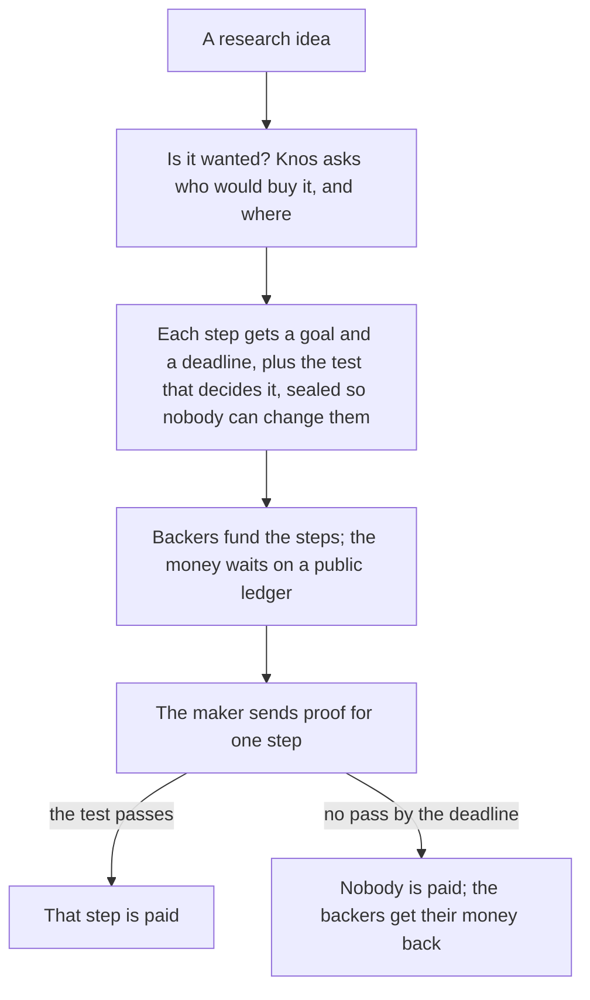
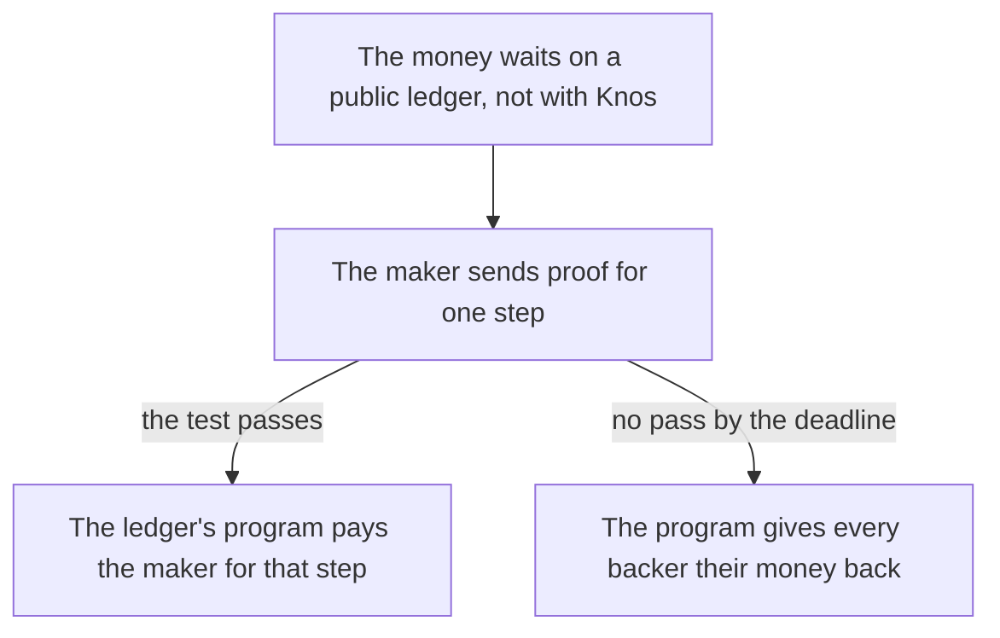
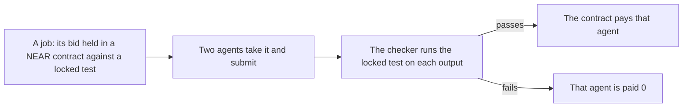

# Knos diagrams

The source of each picture in [COLOSSEUM.md](COLOSSEUM.md) and [NEAR.md](NEAR.md). Pages that cannot draw Mermaid (PyPI) show the picture, drawn by `python scripts/diagrams.py render`.

## How it worked in the Colosseum entry (tag v0.3.28)

*Money moves only when a step passes its test.*

## Paid when the check passes (the Colosseum entry)

*Nothing is paid on a promise. A missed deadline sends the money back.*

## Knos on NEAR

*One job, two agents: only the output that passes the locked test is paid.*
