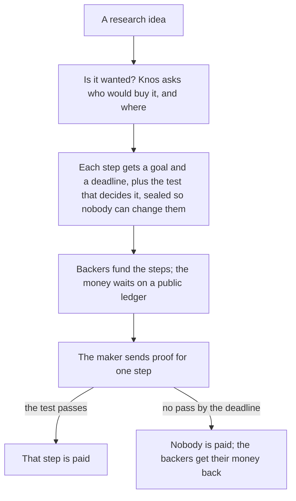
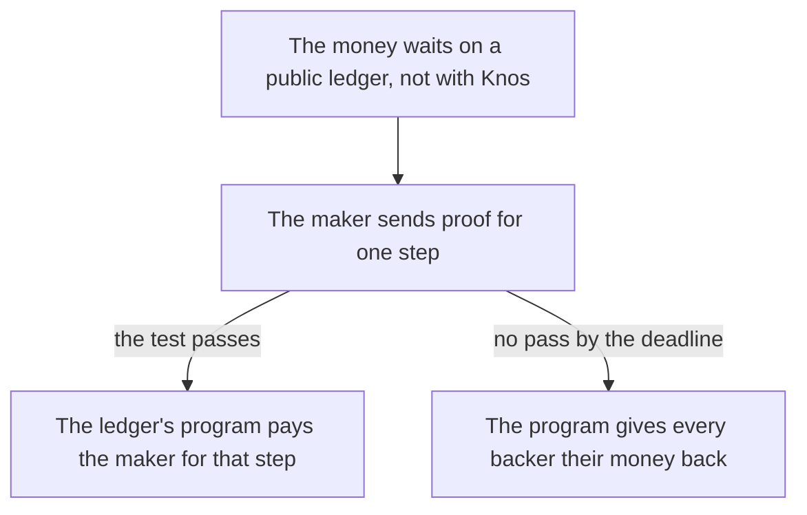
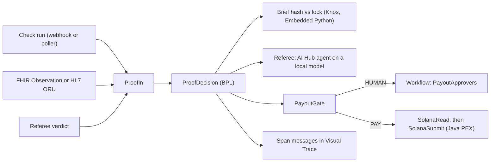
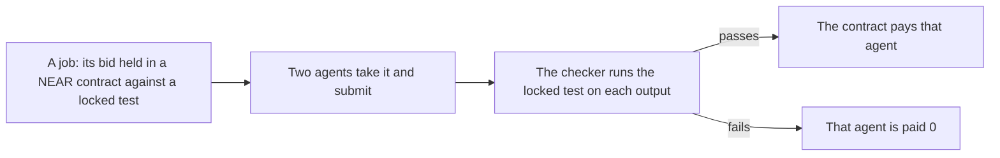

# Knos diagrams

The source of each picture in README.md. Pages that cannot draw Mermaid (Open Exchange, PyPI) show the picture, drawn by `python scripts/diagrams.py render`.

## How it works

*Money moves only when a step passes its test.*

## Paid on proof

*Nothing is paid on a promise. A missed deadline sends the money back.*

## Run it on IRIS

*Proof arrives one of three ways; one process checks, asks the agent, gates, asks a person, then simulates.*

## Knos on NEAR

*One job, two agents: only the output that passes the locked test is paid.*
