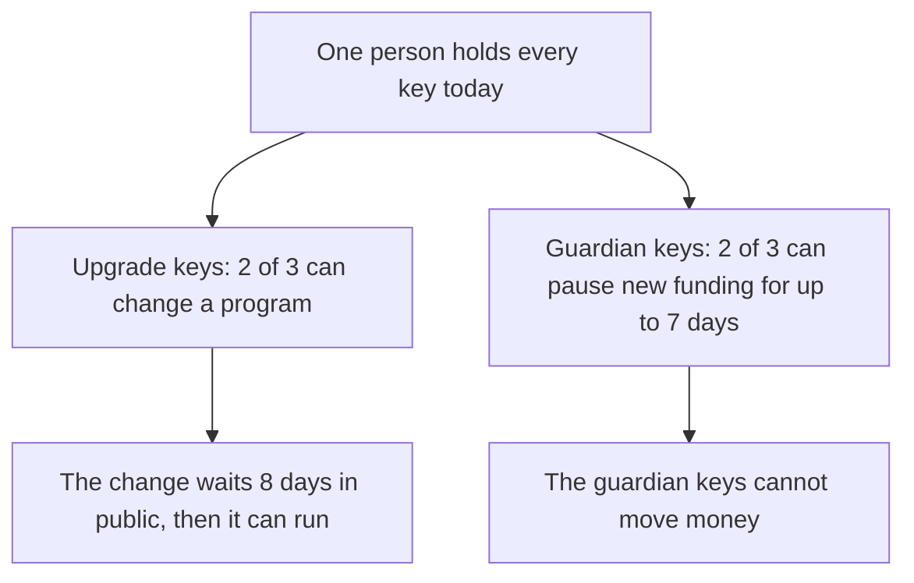

# Governance: who can change what, today

**In plain words.** One person holds every key that can change the [programs](../WORDS.md#program) (the code that holds the money). Each change is public for 8 days before it runs. Other keys can pause new funding for 7 days at most, but cannot move money.

*Who can change the programs today, and what waits in public.*

This page says who can change the programs and the keys they trust, what stands between that power and a user's
money. It describes the programs as devnet holds them, with test USDC; the pending proposals
are in [`web/upgrades.json`](../../web/upgrades.json). [SECURITY.md](SECURITY.md) is
the security model; [INVARIANTS.md](INVARIANTS.md) is what the programs guarantee while they are unchanged.

**The short version.** One person can change every program, 8 days after saying so in public. Both multisigs
(accounts that act only when enough keys agree) need 2 of the same 3 member keys, and one person holds all three. So the 8-day delay gives **notice**.

It does not give
independent oversight: nobody else has to agree, and nobody else can refuse.

**Leaving before an upgrade is possible for open orders, not for everything.** A Balance can be withdrawn at once.

An open order can be cancelled and refunded before an upgrade approved from now on can run: cancelling gives the
seller 7 days of notice, and a program change now waits 8 days in public (Squads time lock 691,200 s, in force since
11 Oct 2026).

An order held for a payee and a holdback in its warranty still cannot be left in time.
`knos exit --before-upgrade` lists every holding of yours with its way out and the hours it misses by (section 2).
Until 11 Oct 2026 the wait was 48 hours, shorter than the notice.

Two member keys created and approved the
configuration transaction that changed it (proposal 9) on 9 October 2026, after upgrade proposals 7 and 8 had run;
it has been in force since 11 Oct 2026.

**Outside key holders today: 0.** What would change it: one person opens a "Key holder request"
([TRUST.md](../TRUST.md)).

**One machine holds enough keys to do everything:** one key folder has the key that writes build buffers
and all three member keys (section 4).

## 1. Who can change what

| what | who, today | how fast | what limits it |
|---|---|---|---|
| The code of `knos_pay`, `knos_oidc`, `knos_meter`, `knos_passkey` | the upgrade multisig: 2 of 3 keys, all held by one person | 8 days after the vote that approves it | the delay, and that the proposal and its bytes are public for those 8 days. An upgrade can do anything, including taking every order's money |
| The upgrade multisig's own members, threshold and delay | the same 2 of 3 | the same 8 days | no single key can change its settings (it has no config authority): only a vote of its members can |
| Which signing keys the verifier accepts | a new key: a signed statement (attestation) from a workflow run in one of two repositories of one GitHub account, then a one-day wait, then the guardian's approval. Refreshing a key that the issuer (such as GitHub) still publishes: anyone (section 5) | a day and the guardian's vote | constants in [`pins.rs`](../../programs-v2/knos_oidc/src/pins.rs) |
| Revoking a key; pausing new funding for at most 7 days | the guardian multisig: 2 of 3 keys, all held by one person | at once (no time lock) | it has no instruction that moves money, and cannot block a refund, a withdrawal or a payment under a good key |
| The guardian multisig's own members | the same 2 of 3 | at once | no config authority |
| A contract fee rate for one repository owner | `FEE_OWNER`, one key of Knos's | at once | only lower than the standard 0.30%, and only until an expiry date: under the live `knos_pay` 2.2 (upgrade proposal 8) to no less than 0.10%. (Under the older 2.1 it set the first fee tier between 0.5% and 2.5%.) |
| An order's terms, payee, amount or deadline after funding | nobody | | the program has no such instruction; a change takes an upgrade |
| The first deployment ([`programs`](../../programs)) | nobody | | neither program has an upgrade authority |

Read it yourself: `knos status` prints both multisigs as the chain has them (members, threshold, delay, config
authority) and every pending proposal; `node scripts/governance.mjs show --check` does the same from the Squads
accounts. On devnet the Squads program itself has an upgrade authority, which is Squads' and not ours
([SECURITY.md](SECURITY.md), section 7).

## 2. What the 8 days are, and are not

- **They are notice.** From the moment of the approving vote, three things are on chain: the proposal, the buffer
  holding the new program code, and (when the release workflow made the build) the upgrade gate's record of the
  commit it was built from.
  The site shows a banner on every view. [`web/upgrades.json`](../../web/upgrades.json) and the Atom feed
  `web/upgrades.xml` list every proposal with its program, build hash, source commit, earliest execution time and
  status, so a funder can follow the feed instead of visiting the site
  ([`scripts/upgrade_feed.py`](../../scripts/upgrade_feed.py)). The feed is rewritten when the site is built, so it
  is as fresh as the last build; the banner and `knos status` read the chain directly.
- **What a funder can do inside them, and what not.** `knos exit --before-upgrade --wallet <address>` (or
  `--github-id <n>`) reads the pending proposal and every Balance and order of yours, and prints for each the
  instruction that takes the money out of `knos_pay`, who sends it, when, and whether that is before the upgrade can
  execute ([`src/knos/exit.py`](../../src/knos/exit.py); tested against the program in `tests/test_exit.py`). The
  feed and `knos status` give the hours left. The rules are the program's:

  | what you hold | the way out | before an upgrade approved now? |
  |---|---|---|
  | a Balance | `Withdraw`, your wallet signs, at once | yes |
  | an open order past its deadline | `RefundOrder`, anyone sends it, at once | yes |
  | an open order whose deadline is inside the 8 days | `RefundOrder` after the deadline | yes |
  | an open order whose deadline is later | `Cancel` moves the deadline to at most 7 days away (`NOTICE`), then `RefundOrder`; a wallet's order is cancelled by its wallet, a Balance's by a `/knos cancel` comment, which needs GitHub | yes, since 11 Oct 2026: 7 days and 2 hours of notice are shorter than 8 days (before, with 48 hours, **no**) |
  | an order held for a payee who has bound no wallet | `RefundOrder` after the 180-day hold | **no** |
  | a holdback in its warranty (up to 90 days) | `Release` to the seller when it ends; back to the funder only by a referee's revert token | **no** |

**Where an order cannot be left, and why.** The notice protects the seller who is working on the order: a funder
  who could take the money back at once could cancel after the work was done.

Until 11 Oct 2026 the timetable had two
  promises that disagreed, and the seller's won: an upgrade could execute while a funder's order was still in its
  notice. The 8-day time lock ends that for open orders; held orders and holdbacks are still slower than it.

For comparison, L2BEAT's framework for rollups asks that users have at least 7 days to exit before an unwanted
  upgrade, and 30 days at its highest stage
  ([L2BEAT, "Introducing Stages"](https://medium.com/l2beat/introducing-stages-a-framework-to-evaluate-rollups-maturity-d290bb22befe)).

- **The change that closed the gap for open orders, with no program change.** Set the upgrade multisig's time lock
  above the notice plus the presentation grace: an order cancelled when an upgrade is approved is refunded 7 days,
  2 hours and 1 second later, so the lock must be at least 612,002 s.

It is 8 days (691,200 s); about 22 hours
  above the minimum are for sending the `Cancel`, which for a Balance's order is a comment and a workflow run.

[`scripts/timelock_plan.py`](../../scripts/timelock_plan.py) reads the multisig and prints the Squads configuration
  transaction: `config_transaction_create` with one action, `SetTimeLock { new_time_lock: 691200 }`, then a
  proposal, 2 approvals, and `config_transaction_execute`, which itself waited out the 48 hours then in force.

It refuses
  while any proposal of the multisig is a draft, active, or approved and not executed, because the change makes
  every earlier proposal stale: one not yet approved can no longer be approved, and an approved upgrade waits the
  new time lock from its approval. So it was sent only after proposals 7 and 8 had executed.

Facts from the Squads v4 source: `time_lock` is the seconds between approval and execution; at most 3 × 30 days;
  `SetTimeLock` calls `invalidate_prior_transactions`
  ([state/multisig.rs](https://github.com/Squads-Protocol/v4/blob/main/programs/squads_multisig_program/src/state/multisig.rs),
  [config_transaction_execute.rs](https://github.com/Squads-Protocol/v4/blob/main/programs/squads_multisig_program/src/instructions/config_transaction_execute.rs),
  [vault_transaction_execute.rs](https://github.com/Squads-Protocol/v4/blob/main/programs/squads_multisig_program/src/instructions/vault_transaction_execute.rs),
  [Squads documentation](https://docs.squads.so/main/development/typescript/instructions/create-config-transaction)).
  Now that it is in force, `knos exit --before-upgrade` says that every open order can be cancelled and refunded
  before any upgrade approved from now on can execute.

It does not cover held orders (180 days) or holdbacks in
  warranty (up to 90 days). The cost: every fix waits 8 days, the one in section 3 included.
  **State: in force since 11 Oct 2026.** A program change now waits 8 days in public (Squads time lock 691,200 s,
  in force since 11 Oct 2026).

The change is proposal 9 of the upgrade multisig. On 9 October 2026,
  `python scripts/timelock_plan.py --rpc` found no other proposal open, and
  `node scripts/governance.mjs set-time-lock --send` sent it (one action, `SetTimeLock { new_time_lock: 691200 }`).
  It was created in
  [`42yHfmYN...`](https://explorer.solana.com/tx/42yHfmYN8pF3zxow7a4SsVWW5voEpZ5BBbnSnyx6EQXSWQYifdVUySbEPuUDpLYErr24SpEa34eExcRy5ztSECfa?cluster=devnet) and approved by two of the three member keys in
  [`MSTGH4Q9...`](https://explorer.solana.com/tx/MSTGH4Q99fy6xNWVJ8hTCjs7mJzuVD7rGNF1Ymy6JeuB3cDMThTGnsxKBBKPvv5Q741DEfKLJrecrtBibv45uyQ?cluster=devnet).

The Squads program executes a configuration transaction only once the
  time lock then in force (48 hours) has run from its approval. On 11 Oct 2026 a member executed it with
  `node scripts/governance.mjs execute upgrade 9`, in
  [`2gYPofAZDfwXi6pK2tAWkRdEDfqVcceAmf3PsmW6x4jkHafNCresgEQDS3zJg2dXZRKi1NnNMWcW6ct3eFPFV1m9`](https://explorer.solana.com/tx/2gYPofAZDfwXi6pK2tAWkRdEDfqVcceAmf3PsmW6x4jkHafNCresgEQDS3zJg2dXZRKi1NnNMWcW6ct3eFPFV1m9?cluster=devnet), and the multisig reads back
  691200 s.

Every proposal made before it is stale; an upgrade approved from now on waits 8 days.
- **They are not oversight.** The same person proposes, approves and executes.
- **Nothing is sent to anyone.** No comment is posted on repositories with open orders, and no email exists. The
  notice reaches someone who looks, or who subscribed to the feed.

## 3. The delay doing its job: a faulty build was replaced before it ran

Knos release 0.3.13 proposed new builds of `knos_oidc` (proposal 1) and `knos_pay` (proposal 2). Both were approved on
2026-10-04 07:17 UTC and could have run from 2026-10-06 07:17 UTC.

During that delay a defect was found in the proposed `knos_pay`: a pay token that had paid an order could pay a second
order funded later for the same issue at the same address ([SECURITY.md](SECURITY.md), section 15). The build never
ran, so no order was ever exposed to it.

Knos release 0.3.14 withdrew both proposals and proposed corrected builds in their place, which started a new 48
hours.

The defect was found by the author reading and testing during the delay, which is the use the delay is for. Had
nobody looked, the defective build could have been executed on schedule.

The chain is the record of this, not this page: in `web/upgrades.json` proposals 1 and 2 read
`replaced`.

## 4. Who deploys and who approves: what one key can do

Three kinds of key are involved in an upgrade. The addresses are the ones devnet holds.

| key | address | what it can do alone |
|---|---|---|
| The deploy fee payer (`payer.json` in the key folder) | not published; it is no member of either multisig | Write a build to a buffer and hand the buffer to the vault. It cannot propose, vote or execute, and it cannot sign the loader's `Upgrade`. |
| One member key | `9XmgVhQ5i9XzqUrFn85ue2bnxjxD6KBeBCk23gAowUX9`, `9vcyLKaxG2k24PFhmMC6cRCbmM3FqxCoRyHS36aG3dyk` or `Az4ftNZuvopLHwLuxHsw9Rh3QffGsnEFzCEZj1LeH4BX` (the same three on both multisigs) | Create a proposal, cast one of the two approvals, and execute a proposal the others approved once its delay has passed. Alone it cannot approve, reject or cancel. |
| The upgrade vault | `CKCrTBN542pVhizxuSPVg8tvdnPooNxt9B7o97VuTjz2` | It is the upgrade authority of all four programs and the only signer the loader's `Upgrade` takes. It has no private key: it is an address of the Squads program, which signs for it only when executing a proposal of multisig `9HcsMEo2o6zZu9t1kbFWpnyKn7hiHaZYYFwNHZSpmWqK` that 2 members approved 8 days before. |

**So the key that deploys a build buffer cannot by itself authorise the upgrade.** Where this is checked:

- `scripts/governance.test.mjs`, "the key that writes a build buffer cannot authorise the upgrade, and one member
  key cannot either": the `Upgrade` instruction's one signer is the vault; the vault address has no private key (it is
  not on the Ed25519 curve), so no key file can sign for it; the vault and the fee payer are not members; one member key has one vote of the two
  needed; two member keys have every power. It reads the multisig account as devnet holds it.
- [DRILLS.md](DRILLS.md), the four rows of the upgrade drill, run against the real Squads program on a local
  validator: an approved upgrade is refused before its time lock, then 48 hours, has run (`TimeLockNotReleased`) and a cancelled one never
  runs (`InvalidProposalStatus`).
- Not drilled: a key that is no member sending a proposal or a vote to the Squads program and being refused. The
  test above reads the member list; it does not send that transaction.

**What one compromised key can do.**

- *The deploy fee payer:* spend its own SOL, and put a buffer of any bytes in the vault's name. Nothing runs from a
  buffer until 2 members approve a proposal that names it, and `upgrade propose` refuses bytes GitHub's runner did
  not build (that check is in the script, not in the multisig).
- *One member key:* create proposals, which are public and do nothing without a second approval, and cast one vote.
- *Two member keys:* everything, 8 days later for the programs and at once for the guardian.

**The present setup does not separate these duties.** One key folder (`.knos-keys`) on one machine holds the deploy
fee payer and all three member keys, so whoever has that machine has every power above. Splitting them between two
machines of the same person would separate nothing that matters.

The separation is a second person's key.
Squads v4 gives each member its own permissions (initiate, vote, execute), so a key that deploys and
proposes can be given no vote.

## 5. Keys and procedures

**What the repository defines.** `scripts/governance.mjs` reads a key folder (`--keys`, default `.knos-keys`, never
committed): `member-1.json` to `member-3.json` for each multisig's votes, `payer.json` for fees, and the two create
keys that fix the multisigs' addresses. Every command reads the chain first and can be run again after a failure.

| procedure | command | who must act |
|---|---|---|
| propose an upgrade | `bash scripts/deploy_v2.sh --propose` (builds, waits for the gate record, proposes and approves) | 2 member keys |
| execute it after 8 days | `node scripts/governance.mjs upgrade execute <index>` | any member |
| cancel one | `node scripts/governance.mjs cancel upgrade <index>` | 2 member keys |
| approve a new signing key | `node scripts/governance.mjs guardian approve <issuer> <key hash>` | 2 guardian keys |
| revoke a key, for ever | `node scripts/governance.mjs guardian revoke <issuer> <key hash>` | 2 guardian keys |
| pause new funding, at most 7 days | `node scripts/governance.mjs guardian pause <seconds>` | 2 guardian keys |
| rehearse all of the above | `bash scripts/drill_upgrade.sh --from-devnet` ([DRILLS.md](DRILLS.md)) | drill keys, on a local validator |

**What is not written anywhere:** how the three member keys are stored, whether copies exist, what happens to
them if their holder cannot act, and a rotation schedule. There is no hardware security module and no key ceremony.

If those keys are lost, no program can be
upgraded, no new signing key can be approved, and no key can be revoked; payments under the keys that are still
alive, refunds and withdrawals go on.

**The 30-day key refresh.** Every signing key in the verifier expires 30 days after it was registered or last
attested.

- **Who normally does it.** The rotate workflow runs every day on a schedule in two repositories of the account
  drexthealpha, and the public relay sends `Refresh` at most once a day for each key the issuer still publishes.
- **Anyone can do it** (since version 2.1 of the verifier). The attestation: run the pinned workflow
  `drexthealpha/knos-oidc-rotate/.github/workflows/rotate.yml`, at the commit in `rotate_sha2` of
  [`program_ids.json`](../../programs-v2/program_ids.json), by hand (`workflow_dispatch`) from a repository of your
  own personal account, with `id-token: write`. Sending it: `Refresh` is open to anyone; `knos relay --token-file`
  carries the token with any key that holds a little SOL. Such a run refreshes keys; it never registers one.
- **Being warned.** `knos status` fails when a key has less than 7 days left, and says which.
- **When GitHub rotates its key.** A new key is admitted only on an attestation verified under a key the verifier
  already holds. So the rotation works while GitHub publishes the new key before it stops signing with the old one:
  the daily rotate run names it, anyone registers it, the guardian approves, and a day later it verifies. Drilled
  in simulation on the test builds ([DRILLS.md](DRILLS.md), "GitHub rotates its signing key mid-period"): paid one
  day after the new key was published. If GitHub signs with a key the verifier never admitted and with no other,
  every token is refused, no attestation can be verified, and only an upgrade of the verifier admits a key, 8
  days away; open orders go back to their funders at their deadlines. Not drilled on devnet.
- **If nobody does.** Keys expire one by one, 30 days after each one's last attestation. A token under an expired
  key is refused. An expired key comes back when it is attested again, as long as the attestation is verified under
  some other key that is still usable. When the last usable key of GitHub's expires, nothing can be verified and
  nothing can be attested: no order can be funded by comment or paid, and the payment program is refund-only
  ([DRILLS.md](DRILLS.md) has the funder's steps). From there the only way back is an upgrade of the verifier
  through the multisig, 8 days away, and after the verifier is frozen, a new verifier and an upgrade of the
  payment program.

## 6. The dependency on one GitHub account

The pinned workflows, the rotate workflow, the release workflow that feeds the upgrade gate, the public relay and
the site all live in repositories of one GitHub account. GitHub can suspend an account. If
it does:

| what | why it stops | what still works |
|---|---|---|
| Funding by comment, and every pay, take, cancel and revert token of an order that pinned the published workflows | a repository's job calls `drexthealpha/Knos/.github/workflows/...` at a commit, and GitHub cannot fetch a workflow from a suspended account, so no run starts and no token is signed | an order that pinned workflows in another repository (a funder may pin a copy of its own) is not affected |
| Key refresh and new keys | the pinned rotate workflow is in the same account: nobody can make the attestation, so "refresh by anyone" stops too | keys already refreshed last until their 30 days end |
| The public relay | it is a scheduled workflow in the same account | anyone relays with `knos relay`; but with no new tokens there is little to carry |
| The upgrade gate | `program.yml` runs there | an upgrade can still be proposed `--ungated`, with only the members' own rebuild as evidence |
| The site and its feed | GitHub Pages of the same account | the chain, `knos status` from an installed package, any RPC endpoint |

**So a funded order that pinned the published workflows can only be refunded. Exactly how:**

1. **An open order funded from a wallet:** the funding wallet signs `Cancel` (no token). The deadline becomes at
   most 7 days away. After it, anyone sends `RefundOrder`; the amount and the fee return to the funding wallet.
2. **An open order funded from a Balance:** `Cancel` needs a token, which cannot be made. Wait for the order's own
   deadline; then anyone sends `RefundOrder`, and the amount and the fee return to the Balance.
3. **A Balance:** its wallet signs `Withdraw` at any time, for everything not in an order.
4. **An order held for a payee who has since bound a wallet:** anyone sends `SettleOrder`; the payee is paid. A
   payee who has not bound one cannot (binding needs a workflow in the same account); after 180 days the order
   returns to the funder with `RefundOrder`.
5. **An order in its warranty:** a revert needs a token and cannot be made. After the warranty anyone sends
   `Release`, and the holdback goes to the seller.
6. **Sending any of these** needs a Solana key with a little SOL and an RPC endpoint, and nothing of Knos's or
   GitHub's: `KNOS_RELAY_KEY=<key> knos relay` makes one pass and sends every refund, settlement and release that is
   due. The package is installed from PyPI, not from GitHub. `knos exit --wallet <address>` lists what you hold and
   when each refund becomes due.

The step-by-step version for a funder, with what each step shows, is in [DRILLS.md](DRILLS.md). Work that was
accepted but not yet paid when the account was suspended is not paid: the seller's remedy is outside the program.

## 7. What is missing, in one list

- An outside key holder on either multisig ([TRUST.md](../TRUST.md)). One would hold 1 key of 3 and could
  not act alone.
- An exit window for an order held for a payee (180 days) and a holdback in its warranty (up to 90 days). The
  8-day time lock, in force since 11 Oct 2026, covers open orders only (section 2).
- A second person for any duty: review, deploy, approve, relay, respond.
- An outside review of anything.
- A written description of how the member keys are stored and recovered.
- A notice pushed to funders. The feed and the banner are pulled, not pushed.
- An organisation account for the workflows and the relay.
- A legal entity that owns any of this ([DISCLOSURE.md](DISCLOSURE.md)).
