# Knos on IRIS: the full reference

Back to the [README](../../README.md#from-the-intersystems-contest).

<!-- entry:iris -->
## Run it on IRIS

Inside InterSystems IRIS, the production checks each research step's test result before that step is paid. An AI agent reads the test result and a rule decides; above $50 a person must also say yes.
Every amount is test money.

**One story.** A hospital lab funds a startup to build the online shop for its test kits. Step one pays $120 when the
shop's checkout answers in under 300 ms, measured by the startup's own GitHub test. The test passes. The AI agent in
IRIS reads the result and says yes.

It is over $50, so the lab's approver presses Approve, and the step is paid in play
money. A failing test pays nothing.

Built and tested on the version of IRIS with AI built in (AI Hub build 154, irishealth-community 2026.3.0AI.154.0).

| What | Where |
|---|---|
| Video | [62 seconds on the InterSystems Developers YouTube channel](https://www.youtube.com/watch?v=s4YNmcEm-M8) (the first cut, replay mode); the file is a live run on 13 Nov 2026 from the online demo, 43 s: the production running in the IRIS portal, one sample decided by the AI Hub agent on NEAR AI Cloud, its trace and the same session in Visual Trace (also [on the For labs page](https://drexthealpha.github.io/Knos/labs/); the file: [iris/media/knos-iris.mp4](../../iris/media/knos-iris.mp4)) |
| Idea | every step of the AI's decision kept as a message you can open in IRIS, built here (community idea [DPI-I-689](https://ideas.intersystems.com/ideas/DPI-I-689)) |
| Code | [iris/](https://github.com/drexthealpha/Knos/tree/main/iris); the IPM package is `module.xml` at the repository root |
| Online demo | https://glowing-xylophone-x5vxgjgjgv9399xq-52773.app.github.dev/knos/: build 154 in live mode in a GitHub codespace, the AI Hub agent deciding on NEAR AI Cloud (deepseek-ai/DeepSeek-V4.1-Flash-1017), each sample at most one model call, at most 10 an hour per visitor and 100 a day, past a limit the fixed rule with a label saying why. Live until 23:00 UTC on 13 Nov, 13:00 to 23:00 UTC on 14 Nov, and from 13:00 UTC on 15 Nov to 05:00 UTC on 16 Nov, when voting ends. InterSystems Cloud Services' services are subscriptions and Hugging Face's Docker Spaces need billing, so the free codespace hosts it |

### The contest task, part by part

| The task asks for | The feature doing it | How to see it |
|---|---|---|
| An Interoperability workflow | `Knos.Iris.Production`, 22 items. Services: `ProofIn`, `BriefIn`, `GitHubCheckRunPoller` (custom inbound adapter), `HL7LabIn` (HL7 ORU files), `FHIRLabIn` (FHIR Observation files), `DeadlineWatch` (not paid at the deadline), `DailyDigest` (the day's decisions and model cost), `SpendCapWatch` (alert before the model cap), `ApproverReminder` (payouts left waiting). Processes: `ProofDecision` (BPL), `DecisionRouter` (routing rule). Operations: `BriefLock`, `Referee` (the AI Hub agent), `PayoutApprovers` (Workflow), `SolanaRead` (custom outbound adapter), `SolanaSubmit` (Java PEX), `TraceSink`, `Ens.Alert`, `ReceiptFile` (a JSON receipt per decision), `DecisionFHIR` (a FHIR R4 Task per decision), `ResultHL7Out` (the decision back to the lab as HL7), `DigestFile` | Interoperability > Production |
| An AI Hub agent | operation `Referee` running `Knos.Iris.AI.LocalReferee` on `qwen2.5:1.5b-instruct` in the compose file's `ollama` service with `KNOS_AI_MODE=local`, no key; in the online demo the same LocalReferee asks NEAR AI Cloud (deepseek-ai/DeepSeek-V4.1-Flash-1017) through AI Hub's openai provider, one call a sample and no tools (the brief and the proof are in its question); in replay mode (the default) the rules referee decides, with no model | the Verdict message of each decision |
| A decision-making task | the agent answers met, not met or insufficient; code checks that answer, then `Knos.Iris.Rule.PayoutGate` says PAY, HUMAN, REFUND_AT_DEADLINE or REJECT | the Decision message |
| A person where it matters | IRIS Workflow, role `PayoutApprovers`, for a met decision above 50 USDC | the inbox on `/knos/` or Interoperability > Workflow Inbox |
| Every step traceable | each model call, tool call, rule and approval is a `Knos.Iris.Msg.Span` in the decision's own session | Visual Trace |

### What is new, and why

- **The trace is the production's own message log.** Every step of the agent's decision is an interoperability
  message, kept in a Langfuse-style SQL table. A lab cannot send its data to an outside tracing service; IRIS already
  keeps an audited record of every message, so the trace stays inside the lab's own IRIS.
- **An agent that can only say no.** A lab cannot let a model pay anyone. So the agent has no tool that moves money: it
  may only say met, not met or insufficient. Code checks that answer, and a person approves anything large.
- **Vector Search keeps the agent honest.** The proof's two nearest criteria come from IRIS Vector Search
  (snowflake-arctic-embed-s, run in Embedded Python). A verdict that cites a criterion outside those two is capped at
  0.6 confidence and goes to a person.
- **The brief is locked by a hash.** The brief is hashed with Knos's own `knos.ready.criteria_hash`, run in Embedded
  Python from the same `src/knos` that the Knos app uses. Proof against a changed brief is refused before any model is
  asked.

### Quick start

You need Docker with about 4 GB free, and the image file `irishealth-community-2026.3.0AI.154.0-docker.tar.gz` (x64)
from the [AI Hub Early Access portal](https://evaluation.intersystems.com/Eval/early-access/AIHub) (an InterSystems
login). Four commands:

```sh
git clone https://github.com/drexthealpha/Knos && cd Knos/iris
bash scripts/load-image.sh ~/Downloads/irishealth-community-2026.3.0AI.154.0-docker.tar.gz
bash scripts/env-secrets.sh && docker compose up -d --build
bash scripts/ready.sh
```

`ready.sh` is the readiness check: it waits for IRIS and prints `READY: open http://localhost:52773/knos/ ...`. Open
that page and press **A passing test, $20**: the decision appears in a few seconds. **A passing test, $120** waits for a
person: press **Approve**. The default is replay mode: no key and no sign-in. It downloads no model.

What the commands do: `load-image.sh` runs `docker load -i <the tar>`, then retags the image to the name the Dockerfile
builds on:
`docker tag docker.iscinternal.com/docker-intersystems/intersystems/irishealth-community:2026.3.0AI.154.0 irishealth-community:2026.3.0AI.154.0`.
Neither image, nor any image built on it, is pushed to a registry. `env-secrets.sh` makes `.env` from `.env.example`
with random secrets (never commit `.env`). The first build takes about 3 minutes on 4 cores.

### Troubleshooting

| What you see | What to do |
|---|---|
| `ready.sh`: the knos-iris container is not running | in `iris/`: `docker compose up -d --build`, then `bash scripts/ready.sh` |
| `docker compose`: pull access denied for irishealth-community | the image is not loaded or not retagged: `bash scripts/load-image.sh <the tar>` |
| `docker compose`: set IRIS_PASSWORD in iris/.env | `bash scripts/env-secrets.sh` fills the three secrets |
| `ready.sh`: IRIS refused the password | `bash scripts/env-secrets.sh`, then `docker compose up -d`: the password is set at every start |
| `ready.sh` waits 5 minutes with no answer | `docker compose logs iris --tail 40`; give Docker at least 4 GB of memory |
| the page asks for a user and password | the agent is not in replay mode: sign in as `_SYSTEM` with the `IRIS_PASSWORD` line of `.env` |
| `docker compose`: `required` is not allowed | update Docker Compose to version 2.20 or later |

### The model (LLM provider) and its key

Replay mode runs with no key; live mode expects the judge's own OpenAI, Anthropic, Gemini or Bedrock key. The default needs nothing: in replay mode (`KNOS_AI_MODE=replay`) the rules referee decides, with no model.

**The live AI Hub run (live run, 12 Nov 2026).** The AI Hub agent decided the Synthea glucose sample through the
production on NEAR AI Cloud's private model deepseek-ai/DeepSeek-V4.1-Flash-1017, reached through AI Hub's `openai`
provider at `https://cloud-api.near.ai/v1`: "This FHIR R4 Observation has LOINC 2339-0 glucose with a value of
122.52 mg/dL, which is under 140 mg/dL."

Verdict met; the payout gate waited for a person, as the brief asks. Its span:
1,385 tokens, 46.2 s, session 25 (in + out not split by the span; AI Hub's reply gave no call id in build 154).

To run it yourself, keep the key out of every file: export `KNOS_LOCAL_LLM_URL=https://cloud-api.near.ai/v1`,
`KNOS_LOCAL_MODEL=deepseek-ai/DeepSeek-V4.1-Flash-1017` and `KNOS_LOCAL_LLM_KEY` (your NEAR AI key) in the shell, set
`KNOS_AI_MODE=local` in `.env`, then `docker compose up -d --build`. One model call a decision, at 800 tokens.

For the AI Hub agent on a local open model, set `KNOS_AI_MODE=local` in `.env` and start with
`docker compose --profile local up -d --build`: it pulls `qwen2.5:1.5b-instruct` (about 1 GB) into the `ollama`
service and asks it through AI Hub's `openai` provider, with no key and no account. For a cloud model set
`KNOS_AI_MODE=live`, `KNOS_LLM_PROVIDER` and its key in `.env`:

| Provider | `KNOS_LLM_PROVIDER` | Key variable in `.env` |
|---|---|---|
| Anthropic | `anthropic` | `ANTHROPIC_API_KEY` |
| OpenAI | `openai` | `OPENAI_API_KEY` |
| Google Gemini | `gemini` | `GEMINI_API_KEY` |
| AWS Bedrock | `bedrock` | `AWS_ACCESS_KEY_ID`, `AWS_SECRET_ACCESS_KEY`, `AWS_REGION` |

A spend cap is checked before any paid call: at most `KNOS_LLM_MAX_CALLS` calls (default 30) and `KNOS_LLM_MAX_USD`
dollars (default 2.00).

### See that it works

1. `bash scripts/ready.sh` prints `READY: open http://localhost:52773/knos/ and press a sample button`.
2. On that page: **A passing test, $20** is paid in play money, **A failing test, $20** is not paid, and **A passing
   test, $120** waits under "Waiting for a person" until you press **Approve**.
3. From a terminal: `bash scripts/smoke.sh` sends one decision on public data and prints
   `decision: {"decision":"met","gate":"PAY",...}` and a Visual Trace link. `AMOUNT_USDC=80 bash scripts/smoke.sh`
   sends one above 50 USDC: it waits for a person in the inbox on `/knos/` (or Interoperability > Workflow Inbox).
   After **Approve**, its Visual Trace link shows the proof, the agent's verdict, the rule, the approval and the devnet
   simulation, in order.
4. Each decision also leaves files for the lab's own systems: `docker exec knos-iris ls /home/irisowner/knos/outbox/receipts /home/irisowner/knos/outbox/fhir /home/irisowner/knos/outbox/hl7`
   lists, for each decision, a receipt, a task record and a lab result in the formats hospital systems read (JSON, FHIR R4 Task, HL7 ORU).

Every test in one command, with no key: `bash scripts/test-all.sh` (the build, the decisions, one trace through all six
parts, the bonus checks and the page).

### What it decides

An InterSystems IRIS for Health production decides whether submitted proof meets a hash-locked Knos Ready brief: a
GitHub check run, a lab result (a FHIR Observation or an HL7 ORU^R01) or a Knos referee verdict. The three public
inputs `scripts/smoke.sh` uses are in `data/public/SOURCES.md`: a Synthea FHIR Observation, an HL7 ORU^R01 lab message
and a real GitHub check run.

### How it works

- **Proof comes in through custom adapters.** A check run arrives by webhook at `/api/knos/webhook` (signed with
  `KNOS_WEBHOOK_SECRET`), by `/api/knos/proof`, or as a file the inbound adapter `Knos.Iris.Adapter.CheckRunInbound`
  picks up. A lab result arrives as a FHIR Observation, or as an HL7 ORU^R01 file in `inbox/oru/`.
- **The agent answers a decision contract.** `Knos.Iris.AI.Verdict` checks every answer. The rules referee, which
  reads only structured fields, can only make an answer stricter, and the trace says so.
- **Rule, Workflow, then the chain.** `Knos.Iris.Rule.PayoutGate` turns the decision into PAY, HUMAN,
  REFUND_AT_DEADLINE or REJECT. HUMAN goes to a person. PAY runs a devnet simulation through the Java PEX operation.



*Proof arrives one of three ways; one process checks, asks the agent, gates, asks a person, then simulates.*

### Requirements

Measured in a 4-core, 16 GB GitHub Codespace with `mem_limit: 3g`: build 160 s from the loaded image, health 7 to 9 s
after the container starts, peak 1,660 MiB in `docker stats`. On a 7.8 GB laptop the container peaked at 1,188 MiB.
FHIR is off by default (`KNOS_FHIR=0`); `KNOS_FHIR=1` loads R4 and needs about 2 GB more.

### The image used

`irishealth-community:2026.3.0AI.154.0` (InterSystems IRIS for Health, AI Hub build 154,
`IRIS for UNIX (Ubuntu Server LTS for x86-64 Containers) 2026.3.0AI (Build 154U)`), from the InterSystems file
`irishealth-community-2026.3.0AI.154.0-docker.tar.gz` (x64). `iris/Dockerfile` builds on it in stages: a builder stage
runs `iris.script`, the final stage copies in only the databases the install changed.

### LLM provider and key

`KNOS_AI_MODE=replay` (the default) asks no model and says "rules referee (no model key set)". `KNOS_AI_MODE=local` needs no key either: measured on 5 Nov 2026 on 4 cores, 7 to 18 s a decision, about 670
tokens. `KNOS_AI_MODE=live` uses the provider and key from the table above.

The online demo makes paid calls on NEAR AI Cloud: its health answer (/api/knosdemo/health) says how many and what
they cost (llm_calls, llm_usd), counted under the same $8 stop as the NEAR entry. Outside that counter, one paid call: the live AI Hub run of 12 Nov (session 25, 1,385 tokens, below).

| | Rules referee | AI Hub agent |
|---|---|---|
| Decides from | structured fields only (a check run's name and conclusion, an Observation's code and value) | the brief and the proof, in its question |
| Needs | nothing | the local model (no key), or needs a model key in live mode |
| Low confidence | | capped at 0.6 when the cited criterion is not in the top 2 by Vector Search, which sends the case to a person |
| Trace | one span per decision | one span per model or tool call |

### Start

With IPM on any IRIS for Health instance: `zpm "install knos-iris"` or, from a clone,
`zpm "load <clone>/iris -v"` in a namespace with interoperability on. `module.xml` asks for IRIS 2026.3 or later with
interoperability enabled.

### Check that it works

```sh
set -a; . ./.env; set +a
curl -s -u "_SYSTEM:$IRIS_PASSWORD" localhost:52773/api/knos/health
```

The health route answers `{"production":"Running","agent":"local","fhir":"off","java":"ok","vector":"ok",...}`.

### Walkthrough of the three inputs

- **Check run.** Point a GitHub webhook (check runs) at `/api/knos/webhook`, or drop a file in
  `/home/irisowner/knos/inbox/checkruns/` for `Knos.Iris.Adapter.CheckRunInbound`. Unsigned webhooks get 401.
- **Lab result.** POST a FHIR Observation (`"kind":"observation"`) to `/api/knos/proof`, or drop an HL7 ORU^R01 named
  `<briefId>.hl7` in `inbox/oru/`. OBX-3 and OBX-5 become the Observation's code and value.
- **Referee verdict.** POST a signed Knos referee verdict (`"kind":"verdict"`, as in `fixtures/verdicts/passed.json`).

### The Workflow approval

A met decision above `KNOS_PAYOUT_THRESHOLD_USDC` (default 50) goes to the role `PayoutApprovers`. Approve or Reject in
the inbox on `/knos/` or in Interoperability > Workflow Inbox. With no answer, the milestone stays held for two days.
Each AI Hub feature the agent uses answers live at `GET /api/knos/aihub/<feature>`: `skill`, `policy`, `mcp`, `rag`,
`stats` and `workflow`.

### Solana devnet

On PAY, IRIS builds Knos's payout instruction and the Java PEX operation simulates it on devnet
(`simulateTransaction`): a simulation, not a payment. **IRIS never releases money alone.** The custom outbound adapter
`Knos.Iris.Adapter.SolanaRpcOutbound` does the reads.

### The trace

Each decision's session in Visual Trace holds the Proof, the agent's Verdict, the Span messages and the Decision.
`GET /api/knos/traces/<session>` returns them as JSON; the table `Knos_Iris_Data.Span` has the same rows;
`iris/docs/trace-schema.md` maps them to Langfuse's trace fields.

| Langfuse | Here |
|---|---|
| Trace, observations, parent links | the session, `Knos.Iris.Msg.Span` messages with `ParentId` |
| Generation with model, tokens, cost | the `llm` span, from AI Hub's usage |
| Trace viewer | Visual Trace |
| Query and export | `Knos_Iris_Data.Span` in SQL, and `GET /api/knos/traces/<session>` |
| Data location | inside the lab's own IRIS |
| Prompt management | none here; prompts live in the code |

Try it: `bash scripts/smoke.sh` prints a `visual trace:` link whose number is the session, then
`SELECT Name, Kind, Model, Tokens, Ms FROM Knos_Iris_Data.Span WHERE SessionId = <session>` gives every step.

### Where each part lives

| Part | Where it lives | How to see it |
|---|---|---|
| Java PEX | `iris/java/src/main/java/knos/iris/pex/SolanaSubmitOperation.java`, item SolanaSubmit | its messages in Visual Trace; the video |
| Workflow | item PayoutApprovers, `iris/src/Knos/Iris/BP/ProofDecision.cls` | Workflow Inbox; the video |
| Custom adapters | `iris/src/Knos/Iris/Adapter/CheckRunInbound.cls`, `iris/src/Knos/Iris/Adapter/SolanaRpcOutbound.cls` | items GitHubCheckRunPoller, SolanaRead; the video |
| Embedded Python | `iris/src/Knos/Iris/Py/Ready.cls`, `iris/src/Knos/Iris/Py/Embed.cls`, `iris/python/knos_iris/` | the brief hash; the video |
| Vector Search | `iris/src/Knos/Iris/Data/Criterion.cls` (`VECTOR(DOUBLE,384)`) | the health route's `vector`; the video |
| Docker | `iris/Dockerfile`, `iris/docker-compose.yml` | `docker compose up`; the video |
| IPM | `module.xml` | `zpm "load <clone>/iris"` |
| LLM trace as interop messages | `iris/src/Knos/Iris/Msg/Span.cls` | Visual Trace |

### Platform findings

Four reproduce on a clean build 154 container, each with its own `run.sh`:

- [`iris/bugs/1`](../../iris/bugs/1): Embedded Python returns a Python int above 2^63 - 1 to ObjectScript as -1, with no error. Filed: [python-bugreports#30](https://github.com/intersystems-community/python-bugreports/issues/30).
- [`iris/bugs/2`](../../iris/bugs/2): AI Hub's `%AI.ToolMgr.ExecuteTool` runs a tool when a required argument is missing or of
  the wrong type. Filed: [ai-hub-eap-bugreports#20](https://github.com/intersystems-community/ai-hub-eap-bugreports/issues/20).
- [`iris/bugs/3`](../../iris/bugs/3): AI Hub's `%AI.RAG.VectorStore.IRIS` makes its table in SQLUser whatever its `Schema`
  says. Filed: [ai-hub-eap-bugreports#21](https://github.com/intersystems-community/ai-hub-eap-bugreports/issues/21).
- [`iris/bugs/4`](../../iris/bugs/4): Embedded Python's `iris.sql.exec` with an int past 64 bits fails with a `SystemError`
  that names neither the parameter nor its value. Filed: [python-bugreports#31](https://github.com/intersystems-community/python-bugreports/issues/31).

### Problems I hit, and how I fixed them

- **My 8 GB laptop stalled for two days.** IRIS, Docker and the build would not fit, so every IRIS build and test moved
  to one GitHub Codespace, and the compose file caps IRIS at 3 GB.
- **The small model looked the brief up by the wrong key and gave up.** With tools it fetched the wrong record, so the
  local agent now gets the brief and the proof in its question, and code checks its answer.
- **The IPM install failed with ERROR #5289** because a ToolSet compiled before its tools. A `DependsOn` fixed the
  compile order; the install then passed on build 154.
- **The first build with FHIR ran past 1,800 s.** FHIR is now off by default and loads only R4 when asked.
- **A merge at start took 17 minutes at full CPU.** The memory settings are now set once, the same at build and at
  run, so a start merges nothing.
- **A fresh codespace broke every non-root build step** ("libc.so.6: Permission denied"). Its `/tmp` default ACL was
  the cause; `scripts/codespace-setup.sh` drops it.

### Tests

`python iris/tests/test_iris_decision.py` runs the core decisions against a running instance: a passing check run, a
failing one, an altered brief, injection text in the proof and an ORU whose value misses. `python
iris/tests/test_iris_one_trace.py` sends one check run through the whole production and checks that its one session
holds every part.

`python iris/tests/test_iris_docs.py readme` checks that every file this section names exists.

### Architecture

The diagram under "How it works" above is the production; `iris/src/Knos/Iris/Production.cls` lists every item.

### Known limitations

- PAY is a devnet simulation of the payout, not a payment; nothing in iris/ sends money.
- The link from IRIS's decision to the referee panel's 2 of 3 signatures is not built yet.
- Solana devnet only, with test money.

### How it fits Knos

This folder is the IRIS side of the one Knos product: the proof check that runs inside a lab's own data system. The Knos code is imported, not forked: the image runs the repository's `src/knos`.

### Team

Zulqarnain Abubakar, Developer Community profile: https://community.intersystems.com/user/zulqarnain-abubakar

### License

MIT, the repository's own [LICENSE](../../LICENSE).


### Who Knos is for

- A lab could use Knos when a discovery it made stalls before anyone turns it into a product. https://hms.harvard.edu/news/new-direction-academic-science-aims-bridge-valley-death
- A hospital lab could use Knos when it must show that a new test meets its performance specifications before it reports patient results. https://www.cms.hhs.gov/clia/downloads/6064bk.pdf
- A startup could use Knos when it is about to build a product nobody needs, the reason founders most often give for a failed startup. https://www.digitalocean.com/resources/articles/top-reasons-startups-fail-and-how-to-avoid-them
- A company could use Knos when an AI coding agent sends pull requests that do not pass the project's own checks. https://arxiv.org/abs/2601.15195
- A funder could use Knos when it releases money only as research milestones are met and needs evidence that each one was. https://arpa-h.gov/news-and-events/arpa-h-101-lifecycle-arpa-h-program

### Production items

- `ProofIn` (`Knos.Iris.BS.ProofIn`)
- `BriefIn` (`Knos.Iris.BS.BriefIn`)
- `GitHubCheckRunPoller` (`Knos.Iris.BS.CheckRunPoller`)
- `HL7LabIn` (`Knos.Iris.BS.LabFile`)
- `ProofDecision` (`Knos.Iris.BP.ProofDecision`)
- `BriefLock` (`Knos.Iris.BO.BriefLock`)
- `Referee` (`Knos.Iris.BO.Referee`)
- `PayoutApprovers` (`EnsLib.Workflow.Operation`)
- `SolanaRead` (`Knos.Iris.BO.SolanaRead`)
- `SolanaSubmit` (`EnsLib.PEX.BusinessOperation`)
- `TraceSink` (`Knos.Iris.BO.TraceSink`)
- `Ens.Alert` (`Knos.Iris.BO.Alert`)
- `FHIRLabIn` (`Knos.Iris.BS.FhirFile`)
- `DeadlineWatch` (`Knos.Iris.BS.DeadlineWatch`)
- `DailyDigest` (`Knos.Iris.BS.DailyDigest`)
- `SpendCapWatch` (`Knos.Iris.BS.SpendCapWatch`)
- `ApproverReminder` (`Knos.Iris.BS.ApproverReminder`)
- `DecisionRouter` (`EnsLib.MsgRouter.RoutingEngine`)
- `ReceiptFile` (`Knos.Iris.BO.ReceiptFile`)
- `DecisionFHIR` (`Knos.Iris.BO.FhirTask`)
- `ResultHL7Out` (`EnsLib.HL7.Operation.FileOperation`)
- `DigestFile` (`EnsLib.File.PassthroughOperation`)

## Bonuses

| Bonus | Official points | Proof |
|---|---|---|
| B1 Questionnaire | 1 | answered 7 Nov (private form) |
| B2 Production Extension (PEX) | 3 | [iris/java/src/main/java/knos/iris/pex/SolanaSubmitOperation.java L20](https://github.com/drexthealpha/Knos/blob/main/iris/java/src/main/java/knos/iris/pex/SolanaSubmitOperation.java#L20) |
| B3 Workflow Engine | 2 | [iris/src/Knos/Iris/Production.cls L19](https://github.com/drexthealpha/Knos/blob/main/iris/src/Knos/Iris/Production.cls#L19) |
| B4 Custom Adapter | 2 | [iris/src/Knos/Iris/Adapter/CheckRunInbound.cls L5](https://github.com/drexthealpha/Knos/blob/main/iris/src/Knos/Iris/Adapter/CheckRunInbound.cls#L5) |
| B5 Find a bug in AI Hub | 2 (max 3) | https://github.com/intersystems-community/ai-hub-eap-bugreports/issues/20 ; https://github.com/intersystems-community/ai-hub-eap-bugreports/issues/21 |
| B6 Embedded Python | 3 | [iris/src/Knos/Iris/Py/Ready.cls L4](https://github.com/drexthealpha/Knos/blob/main/iris/src/Knos/Iris/Py/Ready.cls#L4) |
| B7 IRIS Vector Search usage | 2 | [iris/src/Knos/Iris/Data/Criterion.cls L7](https://github.com/drexthealpha/Knos/blob/main/iris/src/Knos/Iris/Data/Criterion.cls#L7) |
| B8 Docker container usage | 2 | [iris/docker-compose.yml L4](https://github.com/drexthealpha/Knos/blob/main/iris/docker-compose.yml#L4) |
| B9 ZPM Package deployment | 2 | `zpm "install knos-iris"` ([the package](https://openexchange.intersystems.com/package/Knos); [its install on build 154, 12 Nov](../../iris/docs/zpm-install-knos-iris-2026-11-12.log): every phase SUCCESS; that image has no JDK, so the optional Java PEX jar was not built, and the production logged two runtime-lock lines while it started) |
| B10 Online Demo | 2 | https://glowing-xylophone-x5vxgjgjgv9399xq-52773.app.github.dev/knos/, live 13:00 to 23:00 UTC on 14 Nov, and from 13:00 UTC on 15 Nov to 05:00 UTC on 16 Nov, when voting ends (GitHub shows a notice first: press Continue) |
| B11 Implement InterSystems Community Idea | 4 | https://ideas.intersystems.com/ideas/DPI-I-689 |
| B12 Find a bug in Embedded Python | 2 (max 3) | https://github.com/intersystems-community/python-bugreports/issues/30 ; https://github.com/intersystems-community/python-bugreports/issues/31 |
| B13 First Article on Developer Community | 2 | https://community.intersystems.com/post/what-one-ai-decision-costs-iris-tokens-and-dollars-traced-call |
| B14 Second Article on DC | 1 | https://community.intersystems.com/post/ai-can-only-say-no-inside-intersystems-iris |
| B15 Video | 3 | [Knos on the InterSystems Developers YouTube channel](https://www.youtube.com/watch?v=s4YNmcEm-M8) ; [the file, 43 s, a live run on 13 Nov 2026](https://raw.githubusercontent.com/drexthealpha/Knos/main/iris/media/knos-iris.mp4) |

[Watch the 43-second video](https://drexthealpha.github.io/Knos/labs/) · [An AI that can only say no, inside InterSystems IRIS](https://community.intersystems.com/post/ai-can-only-say-no-inside-intersystems-iris) · [What one AI decision costs in IRIS: tokens and dollars, traced per call](https://community.intersystems.com/post/what-one-ai-decision-costs-iris-tokens-and-dollars-traced-call) · [Install steps below](#run-it-on-iris) · [Try it live in your browser](https://drexthealpha.github.io/Knos/#near)
<!-- /entry:iris -->
