# Knos on NEAR: the full reference

Back to the [README](../../README.md#from-near-hackathon).

<!-- entry:near -->
## NEAR HACKATHON: the diff

The tag `pre-hackathon` (31 Oct 2026) is the commit before the first line of `near/`; the tag `hackathon-submission` is the submitted commit. Everything built in the window, file by file: https://github.com/drexthealpha/Knos/compare/pre-hackathon...hackathon-submission. Only that NEAR work is the entry ([Disclosure](#disclosure)); the steps to try it are under [Do this, see that](#do-this-see-that).

## Every claim and how to check it

Each claim's locked test is a file of `near/agents/job/`; its sha256 is the criteria hash every job for the claim is
opened with on NEAR testnet, before any agent starts. Run a test on agent A's code with
`d=$(mktemp -d) && cp near/agents/job/<test> $d/ && cp <agent A's code> $d/solution.py && (cd $d && python3 <test>)`.

| Claim (paper) | Locked test, sha256 | Agent A's code | You should see |
|---|---|---|---|
| HyperLogLog counts 30,000 visitors within 10% in 1.5 kilobytes ([Flajolet and others, 2007](https://doi.org/10.46298/dmtcs.3545)) | `test_hll.py`, `55ef830e...` | `SOLUTION` in `near/agents/pass_agent.py` | `Passed: 30,000 visitors counted within ...` |
| Jump consistent hash moves about 1 key in 11 ([Lamping and Veach, 2014](https://arxiv.org/abs/1406.2294)) | `test_jump.py`, `ffa9d064...` | `near/agents/solutions/jump_a.py` | `Passed: 9.2% of 100,000 keys moved ...` |
| An xor filter: under 0.5% false positives in 10 bits per key ([Graf and Lemire, 2020](https://doi.org/10.1145/3376122)) | `test_xor.py`, `ffd0f557...` | `near/agents/solutions/xor_a.py` | `Passed: 0.38% false positives on 200,000 other keys ...` |
| A Morris counter counts 100,000 within 10% in 12 bits ([Nelson and Yu, 2020](https://arxiv.org/abs/2010.02116)) | `test_morris.py`, `b91647f1...` | `near/agents/solutions/morris_a.py` | `Passed: 20 of 20 counts of 100,000 events within 10% ...` |

Agent B's code (`fail_agent.py`, `*_b.py`) takes the usual shortcut and prints `Failed: ...` for each. Every verdict
says what the test checked and what it did not (the claim's page), and the AI reviewer can only turn
a pass into a fail (`final_verdict` in `apps/wanted/knos_wanted/near_live.py`): DeepSeek V4.1 Flash on NEAR AI Cloud.

## Knos on NEAR

**Why does good research take 17 years to reach people?** "It is frequently stated that it takes an average of 17
years for research evidence to reach clinical practice" ([Morris, Wooding and Grant, 2011](https://doi.org/10.1258/jrsm.2011.110180)).
Knos's answer: checking that a result really works is slow and costly, so nobody builds on it until it has been checked.

**What checking costs.** Today, checking one paper by hand costs $330 to $763
([Colliard and others, 2023](https://labordynamicsinstitute.github.io/crress-book/sessions/6/perignon)). Knos: under a
minute, for the test USDC the buyer puts behind the claim.

Each order takes its own proof job on NEAR, with the test USDC you choose, and pays for its own first proof. Proving that order again is free and public.

**Who it is for.** An R&D lead at a big company holding a paper, who needs to know whether its claim holds before
building on it. On one screen they paste the link, ask "Will it work?", order the proof and download the verified code.

**What NEAR does here.** The proof is a job whose test is locked by its sha256 in the NEAR jobs contract before any
agent starts. The contract pays only the agent whose code passes, and refuses any agent step over its spending cap.

The claim's record on NEAR settles from that job once the answer is in, and the test USDC the buyer put behind the claim moves on
NEAR testnet. Proving the same order again reuses its verified result, free, instead of paying agents again; each new order runs its own job.

The sample paper is HyperLogLog ([Flajolet, Fusy, Gandouet and Meunier, 2007](https://doi.org/10.46298/dmtcs.3545)). Its
abstract says, word for word: "For instance, the new algorithm makes it possible to estimate cardinalities well beyond
10^9 with a typical accuracy of 2% while using a memory of only 1.5 kilobytes."

Its locked test is `near/agents/job/test_hll.py`: count 30,000 visitors within 10% in at most 1,536 bytes. It runs in
under 1 s. Agent A packs 2,048 registers of 5 bits, as the paper's 1.5 kilobytes do, and passes; agent B keeps every
visitor and fails on memory.



*One job, two agents: only the output that passes the locked test is paid.*

### Do this, see that

On the public pages (no install, no sign-in, no wallet, test money only):

1. Open https://drexthealpha.github.io/Knos/ - see "Why does research take 17 years to reach people? Checking it
   is costly", "Ask anything about research", the box, the button "Ask", "Try: HyperLogLog" and "By hand:
   $330 to $763 (Colliard, 2023). Knos: a minute."
2. Click "Try: HyperLogLog" (or ask a question of your own) - see on the same screen "Yes, the claim holds", the claim,
   its locked test and sha256, its last proof on NEAR and "Prove it yourself". Click that - the Prove page opens and reads the paper: "Prove this claim now", the price ("Price:
   the test USDC you choose (1 to 100), paid only after the answer. Proving this order again: free."), the box "Your
   price, in test USDC:" holding 10 and the button "Prove it with 10 test USDC".
3. Type an amount (1 to 100) or keep 10, and click "Prove it with N test USDC" (N the amount) - see a clock, "1. The test is locked", "2. Two agents ran the paper's result against the locked test" with "Agent A: Passed: 30,000 visitors counted within 1.2%, in 1,364 bytes" and "Agent B: Failed: it keeps
   529,075 bytes", then "3. The spending cap blocked an over-budget step" with a link to NEAR's refusal.
4. About 5 s to 2 min after ordering (about 5 s when a job is ready for the claim; 1 to 2 min when its agents run on order) - see "4. Answer: Yes, the claim holds", the paper's "2% typical error, 1.5 kilobytes of
   memory" beside "1.2% error on 30,000 visitors, 1,364 bytes of memory", and "5. You got" with "Download the verified
   code (visitor_counter.py)". Then "Try it now": click "Count them with your code" - see that code count 100,000
   visitors on the server: how many it counted, how far off and in how many bytes.
5. Then "6. Paying and recording on NEAR", about 10 to 45 s on the test network (up to 2 min measured with three orders at once), and "Receipt for proof job-...: paid and
   recorded on NEAR testnet N s after you pressed": "You put behind the claim 10.00 test USDC behind this proof: 9.00 test USDC to the agent, 1.00 test USDC to Knos", "Agent A's share
   10.00 test USDC in all: 9.00 test USDC from your price (90%) plus the 1.00 the job itself paid for passing its locked test" and "Knos's fee 1.00 test USDC, 10%", each transfer with its link, "The claim's record on NEAR: updated to holds." and "What each step
   cost", every step's network fee with its record.
6. Click "Prove the same claim again" - see "Free: Yes, in" a few seconds, from the stored verified result, with
   against the first proof's seconds from your press to its receipt and its test USDC, "no test USDC moved" and a link to the first proof.
7. Below the run - see "Live from NEAR testnet, in Knos's own test dollars:" proofs paid, settled and lost, read from NEAR's public record
   (in full by a GitHub Action scheduled every 10 minutes, which GitHub may run later, plus the server's own confirmed payments since; the page says how old the full read is): each paid proof is one fee from the buyer's test account to Knos's (until 11 Nov a reused result was also charged one), and the dollars settled are those fees plus agent A's shares.
8. Open https://drexthealpha.github.io/Knos/claims/ - see each claim with the test USDC behind it and its two markets,
   "Does it hold?" and "100 behind it in 7 days?". Open a claim and click "Check the test against NEAR" - see
   "VERIFIED"; click "Change one byte and check again" - see "NOT VERIFIED".

The same run, recorded from the public pages, front door first: [near/web/knos-near.mp4](../../near/web/knos-near.mp4) (58.6 s, no still over 4 s by ffmpeg freezedetect; its sound is a chord pad made by ffmpeg for this video, no outside music; each wait cut over 2 s is marked on screen; it ends on the agent call's answer, run during the recording).

Screenshots: [first screen](../../near/web/knos-near-1-first.png), [the claim](../../near/web/knos-near-2-claim.png) and
[what you got](../../near/web/knos-near-3-got.png).

### One call for agents

An agent can run the whole flow with one HTTP call: look up the paper, prove the claim, pay, update the record.

`curl -X POST https://knos.onrender.com/api/near/claim/flow -H "Content-Type: application/json" -d '{"url": "https://doi.org/10.46298/dmtcs.3545", "amount": 10}'`

- see a JSON answer with `"verdict"` (`"holds": true`, the paper's number and the measured one), `"code"` (the link to the
  verified code), `"cap"` (the refused over-budget step), `"paid": true`, `"settled": true` (false, with `"why_not_settled"`, if a step failed) and `"receipt"` (the payments and each
  step's fee). It runs on testnet: the agent call allows four calls every 10 minutes from one address; the page's own proofs have their own limit, six every 10 minutes. The page has 20 live proofs a day and the agent call 10 of its own, which page proofs never use; after those the call answers with the last verified proof, marked `"reused": true`.

### Locally

With Python 3.10+, from the repository's root, no key and nothing sent:

1. Run the locked test on agent A's code:
   `mkdir ta && cp near/agents/job/test_hll.py ta/ && python -c "import sys; sys.path.insert(0, 'near/agents'); import pass_agent; open('ta/solution.py', 'w').write(pass_agent.SOLUTION)" && cd ta && python test_hll.py`
   - see, in about 1 s, "Passed: 30,000 visitors counted within 1.2%, in 1,364 bytes (the paper: 1.5 kilobytes)."
2. From the root again, the same on agent B's code:
   `mkdir tb && cp near/agents/job/test_hll.py tb/ && python -c "import sys; sys.path.insert(0, 'near/agents'); import fail_agent; open('tb/solution.py', 'w').write(fail_agent.SOLUTION)" && cd tb && python test_hll.py`
   - see "Failed: it keeps 529,075 bytes, over the paper's 1.5 kilobytes (1,536 bytes)." and exit code 1.

With a NEAR testnet account of your own, near-cli-rs, Rust and cargo-near on Linux or WSL (these send testnet
transactions):

3. Run `python near/scripts/try_testnet.py <you>.testnet` - see your own copy of both contracts release on a signed token
   and refund after the deadline ([Try it on testnet](#try-it-on-testnet)).
4. Run `bash near/scripts/verify.sh` - see the contract's sandbox tests and attacks pass ([Tests](#tests-on-near)).

### Safety, price and what is hard to copy

**Safety.** The signing keys live only in the hosted server's secret store, never in the page or the repository. The
paper link is the only data a buyer sends. Every push runs the full test suite on GitHub
([tests.yml](https://github.com/drexthealpha/Knos/actions/workflows/tests.yml)), and the page shows its latest finished run, read from GitHub. Knos has no token.

**Private AI on NEAR AI Cloud.** Two model calls an order, both to deepseek-ai/DeepSeek-V4.1-Flash-1017 served from
NEAR AI's attested TEEs (fallback moonshotai/kimi-k2.6), at most 800 tokens out. Agent A writes its code with the first;
agent B stays the fixed shortcut that must fail.

After the locked test passes, the second call reviews that code before anyone is paid. It may only reject a pass, which
then pays nobody; it can never pass a fail.

Before the page says "private", Knos verifies the model's attestation as NEAR AI's docs describe: the Intel TDX quote with
dcap-qvl, the report data binding the signer and a fresh nonce, MRCONFIGID and the RTMR3 event log. It then checks each
answer's signature against that signer. NVIDIA GPU evidence is not checked. Each answer shows its model and call id.

Answers are cached by the sha256 of their input. The credit is $10 that cannot be topped up: 10 calls an hour per
visitor, 200 a day, and at $8 spent the fixed program and the locked test alone decide, and the verdict says so.

[`/api/near/ai`](https://knos.onrender.com/api/near/ai) shows the dollars spent and the attestation check. A scheduled
job saves the ledger on the gh-pages branch (`near-ai-ledger.json`), so a deploy cannot reset it. If agent A's
model-written code fails the locked test, the order says so and shows the last verified proof, marked reused.

**Price.** No fixed price. Each order takes its own proof job on NEAR, with the test USDC you choose, and pays for its own first proof. Proving that order again is free and public.

Of what moves, the agent whose work passed gets 90% and Knos 10%; NEAR's market contract refuses any other split. A failed proof pays nobody. Nobody has paid real money for one yet.

**Hard to copy.** Every verified result is kept on NEAR and reused, so proving an order again is free and takes seconds. The 2 Nov 2026 census scored 12,010 companies to find the 38 that both reinvest and build frontier technology: the buyers to approach first (none has bought yet).

**Outside contributors.** Two GitHub accounts outside the team have done paid work for Knos. `jaystay-bot` wrote
[#32](https://github.com/drexthealpha/Knos/pull/32), [#33](https://github.com/drexthealpha/Knos/pull/33) and
[#34](https://github.com/drexthealpha/Knos/pull/34), merged on 3 Oct 2026 and paid 48.75 test USDC in all.

`xiasan1992` wrote [#40](https://github.com/drexthealpha/Knos/pull/40),
[#41](https://github.com/drexthealpha/Knos/pull/41) and [#43](https://github.com/drexthealpha/Knos/pull/43), merged on 4
Oct 2026; their 37.00 test USDC in bounties waits for them until they link a wallet.

### Accounts and records on NEAR testnet

| Account | What it does | Record |
|---|---|---|
| `jobs.knos-swarm-1105.testnet` | the jobs contract: holds a job's bid against its test's sha256, pays only a passing agent | [explorer](https://testnet.nearblocks.io/address/jobs.knos-swarm-1105.testnet) |
| `market.knos-swarm-1105.testnet` | each claim's record: it settles Yes or No only from the proof's job, never by vote | [explorer](https://testnet.nearblocks.io/address/market.knos-swarm-1105.testnet) |
| `agent-a2.knos-swarm-1105.testnet`, `agent-b2.knos-swarm-1105.testnet` (agent-a and agent-b before 12 Nov) | the two agents, each with a key that can only call the jobs contract | [A](https://testnet.nearblocks.io/address/agent-a2.knos-swarm-1105.testnet), [B](https://testnet.nearblocks.io/address/agent-b2.knos-swarm-1105.testnet) |
| `live.knos-swarm-1105.testnet` | the hosted app's capped account: posts each job, opens its record and pays as the buyer's test account (test money, 20 runs a day) | [explorer](https://testnet.nearblocks.io/address/live.knos-swarm-1105.testnet) |
| `knos-usdc-1102.testnet` | the test dollar (NEP-141, 6 decimals) | [explorer](https://testnet.nearblocks.io/address/knos-usdc-1102.testnet) |
| `knos-payer-1102.testnet` | Knos's own test account, where Knos's fee from each first proof arrives and is kept | [explorer](https://testnet.nearblocks.io/address/knos-payer-1102.testnet) |

The agent is paid by a plain NEP-141 transfer. Paying it through x402 is blocked: the testnet facilitator asks for an
API key on its verify and settle calls, and Knos has none yet.

**Libraries.** They are listed under [Disclosure](#disclosure). The hosted runner adds Python's standard library and
`cryptography`, and the page loads GSAP 3.12.5 from cdnjs.

**AI-written code.** Most of the code was written with Claude Code; the founder set each task and reviewed each change.
The product page's words are written by qwen2.5:1.5b-instruct, never by hand: when its answers break the limits, the page
says so and shows no text.

**What was built in the window.** Everything under `near/` and the hosted runner `apps/wanted/knos_wanted/near_live.py`:
the diff from the tag `pre-hackathon` (31 Oct 2026) is
https://github.com/drexthealpha/Knos/compare/pre-hackathon...hackathon-submission (`near/` did not exist at the
first tag; `hackathon-submission` is the submitted commit).

**Built before, on another chain (Q-002).** Knos existed before this window on Solana devnet: the programs in
`programs-v2/` and the Python package `knos` in `src/knos/` that drives them. Only the NEAR work above is the entry.
The NEAR contract can pay a milestone out on Solana devnet through NEAR Chain Signatures
([Paid on Solana by Chain Signatures](#paid-on-solana-by-chain-signatures)).

**Check a PR, built for Colosseum.** The [pull request checker](https://drexthealpha.github.io/Knos/check/) and its pay
step on Knos's programs on Solana devnet were built 14 Sep to 12 Oct 2026 for Colosseum (tag `v0.3.28`); they are not
part of this NEAR entry. The NEAR work is the diff from `pre-hackathon` to `hackathon-submission`:
https://github.com/drexthealpha/Knos/compare/pre-hackathon...hackathon-submission

**Own older code and libraries (Q-005).** The hosted runner reuses the older app server in `apps/wanted/` (routes, rate
limits) and its Render deploy. The libraries are listed under [Disclosure](#disclosure). Most of the code was written with Claude Code.

**Tracks it fits.** Agent Economy (`agents`): agents with their own sub-accounts whose keys can only call the jobs
contract, under a spend cap. AI Swarms (`swarms`): two agents on one job, paid by the result of a locked test.

**The test is locked before money is held and checked before money moves: nobody is paid on a claim.** (Demand is checked first, by Qloo, on the [site](https://drexthealpha.github.io/Knos/).)

**A company pays a lab or a developer only when GitHub's signed run proves the milestone.** The money waits in a NEAR contract; after the deadline with no proof, the company gets it back. The payout is paid on NEAR, or on Solana through NEAR Chain Signatures: the contract checks the transfer and has the MPC network sign it.

Spending limits cap what an agent may spend. The contract releases test tokens only for work that is proven done.

| What | How |
|---|---|
| **Held until it passes** | A funder sends a test token (NEP-141) with `ft_transfer_call`; the contract holds it against a criteria hash and a deadline. |
| **Proof is a signed CI run** | A GitHub Actions OIDC token, checked in the contract: RS256 in pure Rust, issuer, audience = this contract, repository, workflow, commit and a one-time `jti`. Paid on a real one: [run 41651312325](https://github.com/drexthealpha/Knos/actions/runs/41651312325), release [`82N9tRK8…`](https://testnet.nearblocks.io/txns/82N9tRK8BvB4FpA9yUJb6L6q5FTwT3J1MCzQzN2fWWqj). |
| **Refund** | After the deadline, the money goes back to the funder. Fee: 0. |
| **Keys** | GitHub's signing keys are set by 2 of 3 owners (`scripts/github_keys.py`). |
| **Network** | NEAR testnet only. Test money. |

### Run one now

Open [the Prove page](https://drexthealpha.github.io/Knos/prove/), keep the sample link and click
**Will it work?**, then **Prove it with 10 test USDC**.

You see the answer beside the paper's own number, the
verified code to download, the receipt and the claim's record updated: about 25 s for the sample, up to 2 min for a
claim that runs on order with three orders at once.

Agent A's code is written by a private model on NEAR AI Cloud; when that code fails the locked test, the order says so
and shows the last verified proof, and a job readied in the background then uses agent A's fixed program, which the
page names. Agent B is a fixed shortcut that must fail.

To answer in seconds, Knos keeps a job ready: posted against its
locked test, with both agents' code already run and submitted. The spending cap step runs live when you order: NEAR
refuses agent B's over-budget spend there and then. Your payment and the record's update follow.

It runs on Knos's own capped test account (`live.knos-swarm-1105.testnet`, test tokens only): 20 runs a day, six every
10 minutes from one address. Once they are used, "Will it work?" says so before any order, with the time the next can start, and the agent call returns the last verified proof, marked `reused`, with `why_not_settled` naming the limit.

### Work in the window

Every change since the work began: [pre-hackathon...main](https://github.com/drexthealpha/Knos/compare/pre-hackathon...main)
(the tag `pre-hackathon` is the commit before the first line of `near/`).

No Rust is needed to check or deploy the contract: `near/wasm/` holds the built files and `near/wasm/SHA256SUMS` their
hashes. `cd near/wasm && sha256sum -c SHA256SUMS` prints `knos_near.wasm: OK`, `knos_mock_usdc.wasm: OK`, `knos_market.wasm: OK` and `knos_market_usdc.wasm: OK`
(`a5fc5861…`, 280,651 bytes, is the jobs contract deployed at `jobs.knos-swarm-1105.testnet`). Building them again and
every test: `bash near/scripts/verify.sh` (Rust with `wasm32-unknown-unknown` and `cargo-near` 0.22.0).

### Try it on testnet

Your own copy of the contract, then a release and a refund. About 4 minutes after step 2. You need Python 3.10+ with `cryptography`, and [near-cli-rs](https://github.com/near/near-cli-rs/releases) 0.30.1.

1. Make a testnet account: `near account create-account sponsor-by-faucet-service <you>.testnet autogenerate-new-keypair save-to-legacy-keychain network-config testnet create`. You see "New account <you.testnet> created successfully." and its transaction.
2. Run `python near/scripts/try_testnet.py <you>.testnet`. You see six sub-accounts made and the two contracts deployed from `near/wasm/` (sha256 in `near/wasm/SHA256SUMS`).
3. The script sets a test signing key by 2 of 3 owners, funds `m1` and releases it on a signed token. You see "release m1 on a signed token: done" with its transaction.
4. It sends the same token again. You see it refused.
5. It funds `m2` with a 1-minute deadline, waits, and refunds it. You see "m1: Released" and "m2: Refunded".

The page in `web/` runs the same flow from a browser (`python near/web/serve.py`, checked by `web/test-flow.mjs`), but on the maintainer's test accounts (`knos-*-1102.testnet`, `knos-pay2-1102`), whose keys only that machine holds; it does not use your account yet. `web/story/` takes a milestone apart as you scroll.

### A job two agents try

Post a job with a locked test and a bid; two agents take it; the checker runs the locked test on each output, and only
the agent whose output passes is paid. You need Python 3.10+ with `cryptography` and near-cli-rs 0.30.1; it runs on the
maintainer's test accounts, whose keys only that machine holds (as the page in `web/` does).

1. Run `NEAR_CLI=<near> python near/web/serve.py` and open `http://127.0.0.1:8790/`. You see "Paid only when the test passes" and a **Post a job** button.
2. Click **Post a job**. You see "Paid: Agent A 1000, Agent B 0 test units." and the job's six transactions.
3. Click **Try both** under Guardrails. You see two lines starting "refused", each with its transaction: a payment over agent B's cap, and a release with no passing proof.
4. Open `http://127.0.0.1:8790/embed.html` from another page or origin and click **Pay with any wallet**. You see a NEAR Intents 1Click quote for paying 1 USDC from Base (dry: nothing is spent), then a second click pays the bid on testnet.

The rules are in [`near/agents/RULES.md`](../../near/agents/RULES.md): the job's test is locked by its sha256 at funding, each agent is a
sub-account of `knos-swarm-1105.testnet` that signs with a function-call key allowed only `take`, `submit` and `spend` on
the jobs contract (its full-access key deleted), and the checker's key is set by 2 of the 3 owners.

`web/test-job.mjs`
walks these four steps in a fresh browser. One run, 5 Nov 2026:

| Step | Transaction |
|---|---|
| Job posted: 1000 test units against the locked test `0b0f037d…` | [`7VS43unm…`](https://testnet.nearblocks.io/txns/7VS43unmH6GMv36GNBivvcNB8Bxv2CRKFvHKiLcbu7qu) |
| Agent A takes it, submits its output | [`GzghavUR…`](https://testnet.nearblocks.io/txns/GzghavURW39UivrETnWFxeunAwEv5Cpm5tKUmhejBQyT), [`oXq8gV4u…`](https://testnet.nearblocks.io/txns/oXq8gV4u6desS1GuJdK1ZCiTKo4QNAumEQTnTC69A8v) |
| Agent B takes it, submits its output | [`FmSfyLQ4…`](https://testnet.nearblocks.io/txns/FmSfyLQ4tu2kc4C9rWgjEP1kAo5788EufnVUWeLsJfNt), [`9CYdyki2…`](https://testnet.nearblocks.io/txns/9CYdyki2gTVnfr31Ufjirs6j99jdjYU8Zk4yseKsef9z) |
| The checker: A 5 of 5 cases pass; B fails; the bid paid to A, 25.4 s after the check began | [`5caS1jXH…`](https://testnet.nearblocks.io/txns/5caS1jXHAj7FbUZRMQog7nqgaBk4baDBkvBEYAQjbnpH) |
| Agent B pays 2 on a cap of 1: "over the spend cap: 0 spent, 2 asked, cap 1" | [`FdJPJf7R…`](https://testnet.nearblocks.io/txns/FdJPJf7RLdErvMBdeUkeUWdhqw4VGNEKtw5aVD4VnK4y) |
| Agent B takes an open job's bid with a token it signed itself: "the token's signature does not verify" | [`E5GUcVks…`](https://testnet.nearblocks.io/txns/E5GUcVks55r9Rn4b1HJBJagDB1bFbL8YMj41UFHFeHan) |
| The embedded button pays a bid on testnet after its 1Click quote | [`32suEFMY…`](https://testnet.nearblocks.io/txns/32suEFMYv7JEzfGLH9vNdpHs81BmVfHzbW7oMPMShxKX) |

Agent A was paid 1000; agent B was paid 0. NEAR Intents has no testnet, so the 1Click call is a dry quote only, with 0
spent on mainnet. The checker runs an agent's output in a subprocess with a 20 s limit and no environment; it is a
test-money demo, not a sandbox for hostile code.

### The claim market

Each claim has a yes/no market in test tokens: will its locked check pass? The contract is
[`near/market/src/lib.rs`](../../near/market/src/lib.rs), deployed at `market.knos-swarm-1105.testnet` (wasm `wasm/knos_market.wasm`).

- **Price, no order book.** With few traders on testnet an order book sits empty, so the price comes from an automated
  market maker, Hanson's logarithmic market scoring rule (LMSR). Knos seeds each market with liquidity
  b = 100 test tokens, so there is always a live price. An order book can be added once volume exists.
- **The formula** (token units, 6 decimals; q_yes and q_no are the shares sold on each side):
  - cost: C(q_yes, q_no) = b · ln(e^(q_yes/b) + e^(q_no/b))
  - price of Yes: e^(q_yes/b) / (e^(q_yes/b) + e^(q_no/b)), shown in cents ("Yes 62c"); No is 100c minus Yes
  - a buy of Yes for c tokens: q_yes' = b · ln(e^(c/b) · (e^(q_yes/b) + e^(q_no/b)) − e^(q_no/b)); the buyer gets
    q_yes' − q_yes shares (rounded down), each paying 1 token if Yes wins
  - Knos's worst-case loss per market is its seed, b · ln 2, about 69.31 test tokens.
- **Settled only by the locked check, never by vote.** Each market follows one milestone of `knos-pay-1103.testnet`:
  its criteria hash is locked at funding and only the named GitHub Actions workflow's own OIDC token can release it.
  `resolve` reads that milestone: Released settles Yes, Refunded (the deadline passed with no passing run) settles No.
  `vote` and `set_test` are refused, always. `redeem` pays each winning share.
- **The first claim**: [`near/claims/Split.lean`](../../near/claims/Split.lean), "splitting a bid between two helpers never pays out
  more than the bid". Its check is [`lean-claim.yml`](../../.github/workflows/lean-claim.yml): the proof must compile
  with Lean 4.15.0, then the run's token releases the milestone whose criteria hash is the file's sha256.

### Tests on NEAR

Every push that changes `near/` runs them on GitHub: [the `near-tests` runs](https://github.com/drexthealpha/Knos/actions/workflows/near-tests.yml).
Open the newest run, then its `verify` job: the step `near/scripts/verify.sh` ends with the line below. With Rust
(the `wasm32-unknown-unknown` target and `cargo-near` 0.22.0) the same on your machine:

```bash
bash near/scripts/verify.sh
```

It prints `208/208 tests passed (146 of them attacks)`, the contract's unit tests and then the sandbox flow, and fails when that print is not this line.

Each attack changes one thing and must be refused with the contract's own reason. The thing changed is one of these: the token's issuer, audience, expiry, repository, workflow, commit, header, form or signature; the funding message; the key set.

Or it is a second payment, an early refund or a release after the refund; for a job, a token for another output, job, test or payee, a checker key against a GitHub token and back, an agent that never took the job, a spend over the cap.

`verify.sh` builds both contracts to wasm and runs them on a local near-sandbox node: fund, release, replay, forgery and refund.

Measured: the release receipt burns 7.33 Tgas (11.68 Tgas for the whole transaction) in the latest verify.sh run (5 Nov 2026, a fresh clone); the replayed and the forged token are refused; after the deadline the payer gets the money back and a later release is refused.

### On testnet

| What | Where |
|---|---|
| Contract | [`knos-pay-1103.testnet`](https://testnet.nearblocks.io/address/knos-pay-1103.testnet), first deployed in tx [`6Uoen72K…`](https://testnet.nearblocks.io/txns/6Uoen72KUZnDy1PCknZx5iEQNzfWY2hGgyGmgTdpjAfp); this build since 3 Nov 2026, tx [`AcFJP4Ch…`](https://testnet.nearblocks.io/txns/AcFJP4ChbxF4Vuwx6qAdHNuugbHgcVNuVcprnzpx1Mfk), code hash `4ZwgX56fbcChxPwP6nu5oJJ8vWYtB2Az9y4jF2K6KcfR` |
| Test token | [`knos-usdc-1102.testnet`](https://testnet.nearblocks.io/address/knos-usdc-1102.testnet) (NEP-141, this repo's `mock-usdc`), tx [`D4PoD9do…`](https://testnet.nearblocks.io/txns/D4PoD9doUA5Lo7wxWRSQEvnpFPcmHXuqitqnXgYoa8sG) |
| Owners | `knos-own1-1102`, `knos-own2-1102`, `knos-own3-1102` (.testnet): any 2 set GitHub's signing keys |
| Wasm | `wasm/knos_near.wasm`, 280,651 bytes, sha256 `a5fc586102b9c1b8e68011c8e263563f2b87de113413ff04d5dcfb84321ac50e`, code hash `CAwSqmYHJ7FnW88ivkm9zxczyKstJrGSkmU1pXzyMQ3X`: the jobs contract [`jobs.knos-swarm-1105.testnet`](https://testnet.nearblocks.io/address/jobs.knos-swarm-1105.testnet), deployed in [`GGLvdmu5…`](https://testnet.nearblocks.io/txns/GGLvdmu5ZQvKQVZYT19AYPJRL91GkkozDVkHCNZPPXWt). `knos-pay-1103` runs the build before the jobs: 223,557 bytes, sha256 `3503799e…` (the code hash above) |

Read the rules from the chain:

```bash
near contract call-function as-read-only knos-pay-1103.testnet get_rules json-args '{}' network-config testnet now
```

### Paid on Solana by Chain Signatures

`sign_payout` takes the unsigned Solana message for a released milestone. The contract accepts only one SPL `TransferChecked` of exactly the milestone's amount, in the mint and to the token account locked at funding, then asks `v1.signer-prod.testnet` (path `knos-solana-1`, Ed25519) to sign it. A relayer adds the signature and broadcasts; no Solana key is held anywhere.

The payout moves tokens held since funding. At funding the funder moves the amount from its own Solana token account into one owned by the contract's derived address; the payout is the transfer of exactly those tokens, and nothing is minted on the way.

A milestone released for a Solana payee with no payout signature by its deadline is refunded like an unreleased one, so it never stays locked; once its payout is signed, it is not.

`scripts/solana_payout.py run` does both on [`knos-pay-1103.testnet`](https://testnet.nearblocks.io/address/knos-pay-1103.testnet) (code sha256 `3503799e…`), derived Solana address `DUxGyghGoZNZu85zVJXHLAgsrA3rBt3eVDSGmhk8bzBi`, on 3 Nov 2026:

| Step | Transaction |
|---|---|
| The funder's 1,000,000 test units moved into the derived address's account, held there | [`5zf4swfJ…`](https://explorer.solana.com/tx/5zf4swfJNBMv7JBvMpvQC7nHxL6SU93GRLZ1Vj7DRv8GqZWztYwywnPqxFUT3sYKHRCjZ8aJgy1stLvWa9Wdj8oo?cluster=devnet) |
| Milestone funded for the Solana payee | [`EWepDj2u…`](https://testnet.nearblocks.io/txns/EWepDj2uQ3gESJrrgyKMmbZgjj9iHr9raCwa8RSSpMAD) |
| Released on a token | [`EVaDjqNV…`](https://testnet.nearblocks.io/txns/EVaDjqNVUBqVypESpGCFwsbDv2eFBJxd8JZjNmP25wTb) |
| Transfer of the held units checked, signed by the MPC network | [`4eJPkBn5…`](https://testnet.nearblocks.io/txns/4eJPkBn5jiAoGGBayYKVmreHcL5nqFCLhnRD1Rw4kKUR) |
| The 1,000,000 held units paid on Solana devnet (held account: 1,000,000 before, 0 after) | [`e4e19KWt…`](https://explorer.solana.com/tx/e4e19KWtALEZ5mBHiBjpH5YKuzyHf4bVJyCqDYfcE1UY3smbhkbADxEogho2Sy9DhhqPdWyJCxgTEjMSrjrtMrJ?cluster=devnet) |
| A second milestone released, never signed: refund before the deadline refused | [`Ce2p5iEP…`](https://testnet.nearblocks.io/txns/Ce2p5iEPxLCAVRKLxTNC37uMb1kLFamLMquFWKhPSsoZ) |
| The same milestone refunded after its deadline: the payer's 1,000,000 test units back | [`A67yep8D…`](https://testnet.nearblocks.io/txns/A67yep8D8g55KxLjySFUqsDLn7J9AdLFEqvidpaHFmVB) |

Not built: when a released Solana milestone is refunded on NEAR, the tokens already held by the derived address stay there; a signed transfer back to the funder is not written yet.

### The payee needs no NEAR for gas

`relayer/relay.py` is a NEP-366 relayer that pays only for calls to one Knos contract (`knos-pay2-1102.testnet` in the test). `scripts/test_gasless.py` has the payee sign a release as a delegate action; the relayer sends it ([`4XpFZwBM…`](https://testnet.nearblocks.io/txns/4XpFZwBMGtkPWzCdkwLZkDtB95EPiAWUz7orAPRsyAJG)) and the payee's NEAR balance is the same to the yoctoNEAR.

Every other call the test sends is refused, the token contract's `ft_transfer` among them, and the test prints each with the relayer's reason (the relayer also writes them to its local `relay.log`, not kept in the repository).

### An agent that checks who it pays

`agent/guard.py` answers allow, warn or block for a receiver, from chain: no such account or on the shared blocklist (`agent/blocklist.json`, each entry with its evidence) is a block; a contract, an account under 7 days old or code changed in the last day is a warning that a person resolves.

`scripts/test_agent_guard.py` gives the agent a key that can call only `release`, `refund` and `sign_payout` here, then a task with an injected instruction to pay two other accounts: both are refused, and the chain refuses the key on the token contract.

### A locked eval

`eval/attempts.json` holds 60 attempts, 30 honest and 30 cheating, each with a green CI run; its sha256 (`eval/attempts.sha256`) was committed before the first run. `cargo test locked_eval -- --nocapture` sends each through the contract, prints the counts with 95% Wilson intervals, and asserts them: every cheating attempt refused, every honest one paid, and plain CI pass/fail paying every cheat.

Read it for what it is. Each cheat is one of the four things the contract checks (a run from another branch or a pull request, another repository, a replayed token, altered criteria), and each carries a green CI run by construction, so the result shows that those checks run on every attempt.

It does not measure cheats the contract does not look for: tests edited and merged to main are outside what it can see.

### Attacks on testnet

36 attacks and 4 controls, each a real transaction on the contract above. The first 37 rows were sent by `scripts/attack_testnet.py`, with tokens signed by an RSA-2048 test key that two owners set as kid `knos-test`, standing in for GitHub's key, so each row changes one thing.

The last 3 were sent by `.github/workflows/near-release.yml` ([run 41651312325](https://github.com/drexthealpha/Knos/actions/runs/41651312325)) with that run's own GitHub token, kid `38826b17-6a30-5f9b-b169-8beb8202f723`.

| Attack | Expected | Actual | Reason | Testnet tx |
|---|---|---|---|---|
| one owner alone sets a key | not applied | done | proposed knos-test: waiting for a second owner | [`13QkRje9…`](https://testnet.nearblocks.io/txns/13QkRje9gXLXmVcquyaMTpvCT6C1p6XLbJ3AC3iUyUt5) |
| the same owner twice | not applied | done | proposed knos-test: waiting for a second owner | [`5Hq9vePk…`](https://testnet.nearblocks.io/txns/5Hq9vePkiaqrwVL7n6GH8Lcusk9TT654SJkrPryp8afz) |
| a second owner, same key (control) | key set | done | key knos-test set by 2 owners | [`8buBe2cH…`](https://testnet.nearblocks.io/txns/8buBe2cHnNnN6VKm1QBdVUmLh6sQw3AzQc8CxzsovkkV) |
| a key change by a non-owner | refused | refused | only an owner changes the key set | [`FZWCRz4N…`](https://testnet.nearblocks.io/txns/FZWCRz4NxD9RfAkr4jwmUWx15v2VTmuXZG6TxLQhp6Sm) |
| a 1024-bit key | refused | refused | n must be a 2048-bit RSA modulus | [`C4dSb9TZ…`](https://testnet.nearblocks.io/txns/C4dSb9TZh526xBkRSdkAdsHJXMzegTgKTsBRdXDKyWDn) |
| an honest release (control) | paid | done | a11030449-1: Released | [`J9wcy43C…`](https://testnet.nearblocks.io/txns/J9wcy43Cmrm2hFtTzar9AtVuZVvG7AN8SB7FFptnahjn) |
| the same token again (replay) | refused | refused | this token was already used | [`5N969ghk…`](https://testnet.nearblocks.io/txns/5N969ghkXCb7FuLZH2cfGF12V2M3sXNF7wpjc2p54pe) |
| a second payment of a paid milestone | refused | refused | the milestone is not funded and open | [`NyiJNrBJ…`](https://testnet.nearblocks.io/txns/NyiJNrBJ5M6gQyFoNKUG5X69mZaa8hVzLgWdiv4kfPk) |
| a token from another repository | refused | refused | the token comes from another repository | [`DdPbefRQ…`](https://testnet.nearblocks.io/txns/DdPbefRQCu7BUkktvp4k8dmf2Cm5QPTxcn2jHqSpqGvh) |
| a token from another workflow | refused | refused | the token comes from another workflow | [`88r79JUm…`](https://testnet.nearblocks.io/txns/88r79JUmEFA5dFkNwWCqhTqtAbgZJcFxH2LnLmX7HmvE) |
| a workflow on another branch | refused | refused | the token comes from another workflow | [`GLcpLbnx…`](https://testnet.nearblocks.io/txns/GLcpLbnxWHaPeVaQpbxKG32BduVW5FaRtVAJzJFggj67) |
| altered criteria | refused | refused | the criteria are not the ones locked at funding | [`35b6Bq2H…`](https://testnet.nearblocks.io/txns/35b6Bq2HeyX9MZntAHZqndzPfy7ZpjhSoC3KErU9Jr7u) |
| a forged token (unknown key) | refused | refused | the token's key is not in the key set | [`DiSbnkxN…`](https://testnet.nearblocks.io/txns/DiSbnkxNEFG8nCqcjChGmunEy7ccH5Jvs1upQugL8yLN) |
| a re-signed token (known kid, other key) | refused | refused | the token's signature does not verify | [`CNuKxmNH…`](https://testnet.nearblocks.io/txns/CNuKxmNHrHHvgBGJXpJWxKAS2BvTY3gk3Vwv4dcEDZDc) |
| claims changed after signing | refused | refused | the token's signature does not verify | [`7ts4yPyb…`](https://testnet.nearblocks.io/txns/7ts4yPybtMHBeJSXD2BsuUhXnjKHESroG3T8VmwpDonA) |
| a truncated signature | refused | refused | the token's signature does not verify | [`DRHNBrGL…`](https://testnet.nearblocks.io/txns/DRHNBrGLVwk964VePrupUEvKFrA6vGTVnBkhdcja5uDg) |
| an expired token | refused | refused | the token has expired | [`C5pBDNVL…`](https://testnet.nearblocks.io/txns/C5pBDNVL7wMDPQm39jdqBSgiNDmupUcNCFLUnjgBiKWu) |
| another audience | refused | refused | the token's audience is not this contract | [`95MRk185…`](https://testnet.nearblocks.io/txns/95MRk185B74knL43BqeqKK7LPyKms3qdf6SqNeHUL6k9) |
| another issuer | refused | refused | the token is not GitHub's | [`8VQA6SVP…`](https://testnet.nearblocks.io/txns/8VQA6SVPkwU3bTzmzw1znVXeXBiRpEy7kkFr7P1o2jmm) |
| alg HS256 | refused | refused | the token is not RS256 | [`bb6ZiMAS…`](https://testnet.nearblocks.io/txns/bb6ZiMASMGwNtWvfA1LEwj4XW8mdfBgVke9hTezHwmJ) |
| alg none, no signature | refused | refused | the token is not RS256 | [`oi7eSCkt…`](https://testnet.nearblocks.io/txns/oi7eSCktX4rwNffGKUQjvjonctNfPi6xPuhkp2B1kDx) |
| a token naming no commit | refused | refused | the token names no commit | [`36pEPxJe…`](https://testnet.nearblocks.io/txns/36pEPxJeuj3mHcWQffm51YwGbMJvjXRY5ERmtn3AR529) |
| not a JWT | refused | refused | the token is not header.payload.signature | [`CfpTUhNN…`](https://testnet.nearblocks.io/txns/CfpTUhNN5cin5rnzQFpfmZkN2VfjV3fSWfQyECaZvx3m) |
| a milestone that does not exist | refused | refused | no such milestone | [`3qJyZWBi…`](https://testnet.nearblocks.io/txns/3qJyZWBi2okDjdH78ULmuqUKAwwA9TNHnRiE9dvai7Fx) |
| an early refund | refused | refused | the deadline has not passed | [`CdrfBixS…`](https://testnet.nearblocks.io/txns/CdrfBixSdTQx5C7GbtYuenG7RS3fjCwi7iKjF5Vt13JF) |
| the private callback called from outside | refused | refused | Method on_paid is private | [`7L5b2MNi…`](https://testnet.nearblocks.io/txns/7L5b2MNik5tmKUuNv2cTvzkjYbq8uPXGYtAD8LG2A5FP) |
| funding the same id twice | refused | refused | a milestone with this id exists | [`FbZib4EA…`](https://testnet.nearblocks.io/txns/FbZib4EA1tyibRnRwAjdM6Qfw3X8weDuKPFX3L4U27Fs) |
| funding with a past deadline | refused | refused | the deadline is in the past | [`DNm46bgg…`](https://testnet.nearblocks.io/txns/DNm46bggsBRbTTsekByBXbZNpghesGrmqJ93kwAyFzeQ) |
| funding without a criteria hash | refused | refused | criteria_hash must be 64 hex | [`DVwYdi1S…`](https://testnet.nearblocks.io/txns/DVwYdi1SUjWrFYytpWZincAmkLJNQuzZ4sqb6ZkpaR4x) |
| funding for an unknown chain | refused | refused | payee_chain | [`3ENxYzgY…`](https://testnet.nearblocks.io/txns/3ENxYzgY9Df4YWkivvuEvmLhytEit9PjBLowSyXMxp4j) |
| a workflow outside the repository | refused | refused | repository and workflow | [`51m36aiT…`](https://testnet.nearblocks.io/txns/51m36aiTxVytwLRuRkG7yhtNrJz7BGxqFT4yGbS9eECW) |
| funding in another token | refused | refused | only the configured USDC funds a milestone | [`9RNJwFWj…`](https://testnet.nearblocks.io/txns/9RNJwFWjBytYYyDqcFFrMsXFWvRs6t1SLPiWAUpJibPw) |
| a token under a removed key | refused | refused | the token's key is not in the key set | [`14NEB4zZ…`](https://testnet.nearblocks.io/txns/14NEB4zZZ753EMj8jLcaBdQiWKHjugDPigSDxUNzq3Qm) |
| a release after the deadline | refused | refused | the deadline has passed: only a refund is possible | [`AjXQma9b…`](https://testnet.nearblocks.io/txns/AjXQma9bfPMKcx58cuqK5ReYZpa8HD9RsWyt8EYCsQ4r) |
| a refund after the deadline, sent by anyone (control) | refunded | done | a11030449-9: Refunded | [`EYVQLExx…`](https://testnet.nearblocks.io/txns/EYVQLExxFvyXTXkk5iri7vaZNt7g82hExRvM8GKRqN5G) |
| a release after the refund | refused | refused | the milestone is not funded and open | [`HRE3ykMo…`](https://testnet.nearblocks.io/txns/HRE3ykMo1rK6vTY1LxGWjRY87D47eWPqUd8vZDjDndfi) |
| a second refund | refused | refused | the milestone is not funded and open | [`AvcimeGt…`](https://testnet.nearblocks.io/txns/AvcimeGtYKotYE6nFUtLXqhb3NAXvBUjtTAV68DrA1ai) |
| a real GitHub token from this workflow (control) | paid | done | n1-milestone-11031410: Released, 1,000,000 test units to the payee, 12.13 Tgas | [`82N9tRK8…`](https://testnet.nearblocks.io/txns/82N9tRK8BvB4FpA9yUJb6L6q5FTwT3J1MCzQzN2fWWqj) |
| the same real token on a second milestone of this workflow | refused | refused | this token was already used | [`HcZ8nBuQ…`](https://testnet.nearblocks.io/txns/HcZ8nBuQYuYU5LKRVceSfXVdqBnLrj1shyddj3EQBsM2) |
| the same real token on a milestone funded for another workflow | refused | refused | the token comes from another workflow | [`2H16uPeH…`](https://testnet.nearblocks.io/txns/2H16uPeHibucBssbaEexq9TPyxqWx9hTjHKMRRfmJbfe) |

### Layout

- `contract/`: the contract (`lib.rs`), RS256 (`rsa.rs`), token parsing (`jwt.rs`), the Solana payout check (`solana.rs`), unit tests (`tests.rs`, `tests/`).
- `mock-usdc/`: a NEP-141 test token for the sandbox.
- `sandbox/`: the sandbox test.
- `relayer/`: the gas relayer. `agent/`: the receiver guard. `agents/`: the two agents, the checker, the job's locked test and its rules.
- `web/`: the page and its server (`serve.py`, `jobs_api.py`), the pay button (`pay.js`); `web/story/`: the scroll story. `wasm/`: the built contracts.

Changes since the start of this work: [near-pre...main](https://github.com/drexthealpha/Knos/compare/near-pre...main).

### Disclosure

Who wrote it: Claude Code (Anthropic's coding agent) wrote most of the code in this folder. The founder set each task and reviewed each change before it was merged. Commits carry the founder's account.

No starter template: the first commit of this folder (6413e89) adds each crate as written, with no generated scaffold in the history. The test token in `mock-usdc/` uses the `FungibleToken` implementation from `near-contract-standards`, as its own documentation shows.

The contract's checks are this repository's own code (`contract/src/rsa.rs`, `jwt.rs`, `solana.rs`), with no crypto crate among the contract's dependencies (hashing uses the NEAR runtime's own sha256).

Libraries, at the versions in each `Cargo.toml`:

| Where | Library | Version |
|---|---|---|
| `contract/`, `mock-usdc/` | `near-sdk` | 5.30.0 |
| `contract/`, `mock-usdc/` | `near-contract-standards` | 5.30.0 |
| `contract/`, `sandbox/` | `base64` | 0.22 |
| `contract/` | `serde` | 1 |
| `contract/`, `sandbox/` | `serde_json` | 1 |
| `sandbox/` (tests only) | `near-sandbox` | 0.4.0 |
| `sandbox/` (tests only) | `near-api`, `near-api-types` | 0.8.0 |
| `sandbox/` (tests only) | `tokio` | 1 |
| `sandbox/` (tests only, to sign test tokens) | `rsa` | 0.9 |
| `sandbox/` (tests only) | `sha2` | 0.10 |
| `sandbox/` (tests only) | `rand` | 0.8 |
| `scripts/`, `relayer/`, `agent/` (Python) | `cryptography`, `certifi`; the rest is the standard library | as installed |

Tools: Rust with the `wasm32-unknown-unknown` target and `cargo-near` 0.22.0 (`scripts/codespace-setup.sh`); the testnet steps use [near-cli-rs](https://github.com/near/near-cli-rs). Services: NEAR testnet, NEAR Chain Signatures on testnet, Solana devnet and GitHub Actions' OIDC tokens.
<!-- /entry:near -->
