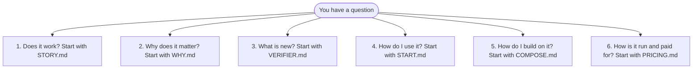

# Every document, under six questions

**In plain words.** This page lists every Knos document once, under six questions. The seven pages to read first are on [the front map](../README.md). When a word is new to you, look it up in [the word list](../WORDS.md).

*Pick your question; each one has a first page to read.*

The documents in this folder are listed below, with the seven front pages too.

`tests/test_docs_map.py` fails when a file in this folder is missing from this page.

## 1. Does it work?

| document | what it answers |
|---|---|
| [STORY.md](../STORY.md) | one crossing on one page, step by step, each with its evidence |
| [MANIFEST.md](MANIFEST.md) | this release on one page: source, the build live at each public id, every capability's stage, the limits |
| [CAPABILITIES.md](CAPABILITIES.md) | every capability, the stage it has reached, and the file or transaction that shows it |
| [BENCH.md](BENCH.md) | every measured number, with the command that reproduces it |
| [TAMPER.md](TAMPER.md) | which cheating submissions each referee refuses, and how much correct work each accepts |
| [KNOS_RECORD.md](KNOS_RECORD.md) | every check, cheat caught and payout as one hash-chained public file, anchored on devnet, and how to verify it |
| [REFEREE_FROST.md](REFEREE_FROST.md) | the referee panel as one FROST key (2 of 3 hosts sign), and m of n referees on chain |
| [REFEREE.md](REFEREE.md) | the referee: Works (sealed tests, a locked referee, the cheat library, re-runs), Wanted and Makeable, and the free maintainer mode |
| [LOAD.md](LOAD.md) | many orders open at once, in the local simulator |
| [DRILLS.md](DRILLS.md) | the safety paths, tested on the same program files that run on devnet |
| [drills_recovery.md](drills_recovery.md) | what a funder does in three failures, with a key of their own |
| [INVARIANTS.md](INVARIANTS.md) | what holds about money and concurrency, each with its test |
| [ASSURANCE.md](ASSURANCE.md) | the tests, the fuzzing and the proofs; no outside firm has reviewed anything |
| [UNWRAPS.md](UNWRAPS.md) | every place a program can panic, and why it cannot be reached |
| [PROVENANCE.md](PROVENANCE.md) | how each deployed program traces back to the source code it was built from |
| [FAUCET.md](FAUCET.md) | how a stranger gets test USDC and funds a first task, the faucet's rules, and its key |
| [REPRODUCE.md](REPRODUCE.md) | how someone else runs it and files a signed report |
| [REPRODUCED.md](REPRODUCED.md) | knos.yml: a research repository's claims re-run on a second machine and held-out data; contested results stay private |
| [NUMBERS.md](../NUMBERS.md) | nine numbers about use by anyone outside, zeros included |
| [TRANSACTION.md](../TRANSACTION.md) | one held payment told end to end for a finance reader: the terms, a refused proof, a verified one, a refused replay |

## 2. Why does it matter?

| document | what it answers |
|---|---|
| [WHY.md](WHY.md) | why a signed run and not a description |
| [INDEX.md](INDEX.md) | the Agent PR Index: how often "tests pass" agrees with the checks, by agent and week |
| [INDEX_METHOD.md](../INDEX_METHOD.md) | the frozen count method, version 1, and a draft version 2 that also re-checks the pull requests counted as clean |
| [SHADOW.md](SHADOW.md) | a neutral count beside an invoice a buyer already receives |

## 3. What is new?

| document | what it answers |
|---|---|
| [VERIFIER.md](VERIFIER.md) | a Solana program that checks the signed identity tokens of GitHub, GitLab, Google and others |
| [OIDC.md](OIDC.md) | the `knos-oidc` program, instruction by instruction |
| [METER.md](METER.md) | what is counted, the two ledgers, and the statement both sides rebuild |
| [RECEIPT.md](RECEIPT.md) | the acceptance receipt and its schema |
| [TERMS.md](TERMS.md) | terms a contract can cite by hash |
| [DISPUTES.md](DISPUTES.md) | who can do what in a dispute, at each state, with nobody from Knos |
| [OUTCOMES.md](OUTCOMES.md) | outcomes other than a merged pull request |
| [X402.md](X402.md) | pay on signed acceptance over x402, and x402 `upto` on devnet |

## 4. How do I use it?

| document | what it answers |
|---|---|
| [START.md](../START.md) | get started in five minutes: check demand, a Ready brief, money held, paid on proof |
| [WORDS.md](../WORDS.md) | every technical word in one plain line |
| [INSTALL.md](INSTALL.md) | every way to install the command, the check and the workflows |
| [PLAYGROUND.md](PLAYGROUND.md) | fund a test order with one comment, with a GitHub account and nothing else |
| [COMPANIES.md](COMPANIES.md) | the panels for buyers and suppliers: statements, bank files, approvals, netting, enforcement, vendors |
| [SUPPLIER.md](SUPPLIER.md) | for the supplier: the rules before the work, every refusal in plain words, appeals |
| [AGENTS.md](AGENTS.md) | an agent finds work, takes it, submits it and is paid |
| [DEMAND_CHECK.md](DEMAND_CHECK.md) | the demand check on Qloo's MCP server: a maker's demand report, a buyer agent, pre-orders held on devnet |
| [REFUSE.md](REFUSE.md) | what Knos will not fund: the refuse list every Ready check applies |
| [MCP_STORE.md](MCP_STORE.md) | Knos in AI assistants: the read-only app-store MCP, its tools, limits and privacy |
| [OUTSIDE_TRUTH.md](OUTSIDE_TRUTH.md) | Open signals scored against 200 past SBIR awards with known outcomes: no better than chance |
| [qloo_lift_ranked_plan.md](qloo_lift_ranked_plan.md) | The rules of the ranked test on a public dataset of crowdfunded product launches, committed before it ran |
| [taste_truth_plan.md](taste_truth_plan.md) | The rules of the MovieLens taste test, committed before it ran |
| [where_truth_plan.md](where_truth_plan.md) | The rules of the where-demand test, committed before it ran |
| [forecast_plan.md](forecast_plan.md) | How the forecast ledger is graded, committed before /forecasts/ was published |
| [forecast_plan_v2.md](forecast_plan_v2.md) | The second forecast plan: county establishment counts (QCEW), fixed before any outcome |
| [evidence_plan.md](evidence_plan.md) | Knos's own claims, each tested against a real outcome with a control, fixed before any run |
| [impact_prereg_plan.md](impact_prereg_plan.md) | The launch-city test against the model alone, fixed before any call or prediction |
| [QLOO-COVERAGE.md](QLOO-COVERAGE.md) | every Qloo parameter, type and endpoint the docs list, and where a person sets it on each interface |
| [IDEAS.md](IDEAS.md) | an idea in from anyone or any research source, every field; demand, then pull commitments released in stages |

## 5. How do I build on it?

| document | what it answers |
|---|---|
| [COMPOSE.md](COMPOSE.md) | the verifier, the payment program and the record, from another program |
| [MCP_SERVER.md](MCP_SERVER.md) | knos mcp's resources, prompts, output schema, tasks and skills, and the person's confirmation before each post |
| [ES256.md](ES256.md) | a second kind of signed token (ES256), checked in one transaction; live on devnet since 9 Oct 2026 |
| [ZK.md](ZK.md) | the score proof's toy setup, why it is devnet only, and what a real setup needs |
| [PLATFORM.md](PLATFORM.md) | the programs on today's Solana: sBPF v3 builds, a GitHub token verified in one transaction, v1 transactions, finality, and the upgrade steps |
| [CONFORMANCE.md](CONFORMANCE.md) | the formats, with test vectors and a runner |
| [RELAY.md](RELAY.md) | the relay: anyone can run one |
| [A2A.md](A2A.md) | Knos as an A2A agent: its Agent Card and the skills other agents can call |

## 6. How is it run and paid for?

| document | what it answers |
|---|---|
| [PRICING.md](../PRICING.md) | what it costs: demand checks and Ready briefs are free, the fee when held money is released |
| [TRUST.md](../TRUST.md) | who holds the keys today, how to ask for one, and what is tested |
| [GOVERNANCE.md](GOVERNANCE.md) | who can change what today, and what waits in public |
| [MONEY.md](MONEY.md) | the one fee config, graduation held money and pre-orders, contributor splits, x402, the revenue data |
| [CHARTER.md](CHARTER.md) | the rights Knos gives you: each enforced by a named test, or marked a promise |
| [SECURITY.md](SECURITY.md) | who is trusted for what, every limit, and what does not exist for a review |
| [ATTESTOR.md](ATTESTOR.md) | what the forge's signature proves and does not, and five ways to narrow the gap; two exist |
| [PRIVACY.md](PRIVACY.md) | what goes in public, and what does not |
| [DISCLOSURE.md](DISCLOSURE.md) | what was built when, who answers if the count is wrong, and the law examined |

## What is in this repository

| folder | what it holds |
|---|---|
| [`programs-v2`](../../programs-v2) | The programs: knos_pay, knos_oidc, knos_meter, knos_passkey and knos_zk. The transfer hook is in [`programs-hook`](../../programs-hook). Each file's first lines say what it does. |
| [`programs`](../../programs) | The first deployment, exactly as deployed. |
| [`.github/workflows`](../../.github/workflows) | The workflows a repository calls, published at one pinned commit of the `workflows-<sha12>` tags of `drexthealpha/Knos` (`drexthealpha/knos-workflows` before the 0.3.34 branch). |
| [`src/knos`](../../src/knos) | What the workflows run: the referee, the relay, receipts, statements, the Stop hook, the MCP server. |
| [`crates`](../../crates), [`idl`](../../idl), [`sdk/settle`](../../sdk/settle), [`examples`](../../examples), [`conformance`](../../conformance) | What another team builds on. |
| [`web`](../../web) | The site. It reads GitHub and Solana in the browser; there is no Knos server. |
| [`terms`](../../terms) | The terms registry: each set of terms, by hash. |

## The crossing in full

An idea or a paper gets a demand check, then a Ready brief, then money held on devnet, then a payment on verified proof.

- Each milestone of a Ready brief has a target, a checker and a deadline, locked by its criteria hash ([IDEAS.md](IDEAS.md)).
- With no verified proof by the deadline, the amount and the fee go back, and that needs no token.
- A proof checked by code that runs the work apart from it is harder to cheat: of 63 cheating submissions, plain CI passed 56 and that check passed none ([TAMPER.md](TAMPER.md)).

## History

Knos 0.1 (1–7 Sep 2026) was shared memory for coding agents, built on Sibyl Labs' memory engine. 0.2 and 0.3.0 to 0.3.9 (30 Sep to 2 Oct) tried
coordination and budgets before the measurement showed where the problem was ([the tag `archive/labs` of
drexthealpha/Knos](https://github.com/drexthealpha/Knos/tree/archive/labs)). 0.3.10 to 0.3.15 are the two deployments, work orders, the count and the
console.

Later releases moved to one product: carrying research to a product on verified proof. [DISCLOSURE.md](DISCLOSURE.md) says what was built when and what came from elsewhere; [the
changelog](../../CHANGELOG.md) has every release.
