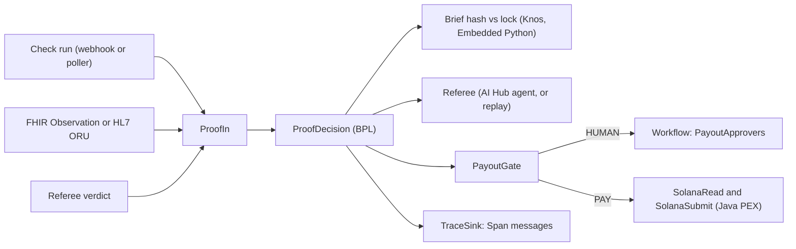

# Knos Referee on IRIS

**Proof checked inside IRIS for Health.** Knos carries research across the valley of death: see who wants it and where, then get paid only on proof.

## 1. What it decides

An InterSystems IRIS for Health production decides whether submitted proof meets a hash-locked Knos Ready brief: a
GitHub check run, a lab result (a FHIR Observation or an HL7 ORU^R01) or a Knos referee verdict. An AI Hub agent weighs
the proof; a deterministic gate and, above a threshold, a person in IRIS Workflow decide what happens next; only then
does Solana devnet see a transaction. Every step of a decision is an interoperability message in Visual Trace.

Try it:
1. `bash scripts/load-image.sh <the build 154 tar>` (section 4).
2. `cp .env.example .env` (replay mode needs no key; section 5 for live).
3. `docker compose up -d --build`.
4. `curl -s -u _SYSTEM:SYS localhost:52773/api/knos/health`.
5. `bash scripts/smoke.sh`: it locks a brief, sends a passing check run and prints the decision and its Visual Trace URL.
6. Open the URL it prints (user `_SYSTEM`, password `SYS`).

## 2. How it works

- **Hash-locked criteria.** The brief is locked with Knos's own `knos.ready.criteria_hash`, run in Embedded Python from
  the same `src/knos` the Knos web app, MCP server and CLI use. Proof against a brief whose hash changed is rejected
  before any model is asked.
- **An agent that can only say no.** The referee has no tool that moves money. Its answer is a decision contract
  (met, not_met or insufficient, with the evidence per milestone), checked by code.
- **Rule, Workflow, then the chain.** A deterministic gate (`Knos.Iris.Rule.PayoutGate`) turns the decision into PAY,
  HUMAN, REFUND_AT_DEADLINE or REJECT; HUMAN goes to a person in IRIS Workflow; the chain still needs Knos's signed
  token or the referee panel's signature to release anything.
- **Every LLM step as an interop message** (an [InterSystems community idea](https://ideas.intersystems.com/ideas/DPI-I-689)). Each referee call, tool call, rule and approval is a
  `Knos.Iris.Msg.Span` in the decision's own session, kept in a Langfuse-style SQL view.

## 3. Requirements

Docker Desktop with its default VM (about 3.9 GB on a 7.8 GB PC), the build 154 image tar from InterSystems, and (for live
mode) one model key. Measured on a 7.8 GB Windows laptop: the container's peak in `docker stats` was 1,188 MiB at run, the
Docker VM's (vmmem) 2,526 MiB through the build and the run; compose caps it at 2 GB (`mem_limit`), `merge.cpf` caps IRIS's buffers and the
Java gateway runs with `-Xmx192m`. FHIR is off by default (`KNOS_FHIR=0`): HealthShare Foundation then loads no FHIR
package, the step that took an uncapped build past 1,800 s. `KNOS_FHIR=1` loads R4 only and needs about 2 GB more.

## 4. The image used

`irishealth-community:2026.3.0AI.154.0` (InterSystems IRIS for Health, AI Hub build 154,
`IRIS for UNIX (Ubuntu Server LTS for x86-64 Containers) 2026.3.0AI (Build 154U)`), from the InterSystems file
`irishealth-community-2026.3.0AI.154.0-docker.tar.gz` (x64).

```sh
bash scripts/load-image.sh ~/Downloads/irishealth-community-2026.3.0AI.154.0-docker.tar.gz
```

The script runs `docker load -i`, reads the loaded name (`docker.iscinternal.com/docker-intersystems/intersystems/irishealth-community:2026.3.0AI.154.0`)
and retags it `irishealth-community:2026.3.0AI.154.0`, the name the Dockerfile builds on. Neither image, nor any built
on it, is ever pushed to a registry.

## 5. LLM provider and key

| Provider | `KNOS_LLM_PROVIDER` | Key variable | Default model (`KNOS_LLM_MODEL` changes it) |
|---|---|---|---|
| Anthropic | `anthropic` | `ANTHROPIC_API_KEY` | `claude-opus-5-5` |
| OpenAI | `openai` | `OPENAI_API_KEY` | `gpt-6-astra` |
| Google Gemini | `gemini` | `GEMINI_API_KEY` | `gemini-4-argon` |
| AWS Bedrock | `bedrock` | `AWS_ACCESS_KEY_ID`, `AWS_SECRET_ACCESS_KEY`, `AWS_REGION` | `anthropic.claude-opus-5-5` |
| Stub (tests) | `stub` | none | `stub-referee` |

Set `KNOS_AI_MODE=live` and the key in `.env`. With `KNOS_AI_MODE=replay` (the default) no key is needed: a recorded live
answer is used when `fixtures/replay` holds one for the brief and proof, else the rules referee, which reads only
structured fields, and every such answer says "rules referee (no model key set)". The health route says which mode ran.
Never commit `.env`.

A hard spend cap is checked before any model call, so a key added here cannot be burned: at most `KNOS_LLM_MAX_CALLS`
calls (default 30) and `KNOS_LLM_MAX_USD` dollars (default 2.00), counted in `^Knos.LLM("calls")` and `^Knos.LLM("usd")`.
Once either is reached, live mode refuses in one plain sentence; with no key for the provider it refuses the same way.

| | Rules referee | AI Hub agent |
|---|---|---|
| Decides from | structured fields only (a check run's name and conclusion, an Observation's code and value) | the same, through its tools (GetBrief, GetCheckRun, GetObservation, GetVerdict, SearchCriteria) |
| Needs | nothing | needs a model key |
| Names and codes | exact (`test` is not `unit-tests`, `2345` is not LOINC `2345-7`) | the same contract, checked by `Knos.Iris.AI.Verdict` |
| Low confidence | | capped at 0.6 when the cited criterion is not in the top 2 by Vector Search, which sends the case to a person |
| Trace | one span per decision | one span per tool call (`Knos.Iris.AI.TraceAudit`) |

## 6. Start

```sh
cd iris && cp .env.example .env && docker compose up -d --build
```

The `Dockerfile` builds in stages, the way the InterSystems community builds IRIS images
([iris-docker-multi-stage-script](https://github.com/grongierisc/iris-docker-multi-stage-script)). A builder stage runs
`iris.script`; the final stage starts again from the base image and copies in only the databases the install changed
(`scripts/copy-data.py`). Sources come in with `RUN --mount=type=bind`, and the KNOS namespace is its own cached step, so a
change to `src/` recompiles Knos without installing the namespace again. The production is stopped cleanly at the end of
the build, so a new container starts it with no journal recovery.

With IPM on any IRIS for Health instance, from a clone of the repository: `zpm "load <clone>/iris -v"`. It copies Knos's
`src/knos` and `knos_iris` into `mgr/python`, installs `requirements.txt`, compiles the Java PEX jar with the instance's
own JDK and starts the production in the current namespace, with FHIR off.

## 7. Check that it works

```sh
curl -s -u _SYSTEM:SYS localhost:52773/api/knos/health
bash scripts/smoke.sh
```

The health route answers `{"production":"Running","agent":"replay","fhir":"off","java":"ok","vector":"ok",...}`.
`smoke.sh` prints `decision: {"decision":"met","gate":"PAY",...}` and a Visual Trace URL.

## 8. Walkthrough of the three inputs

- **Check run.** POST it to `/api/knos/proof` (`"kind":"checkrun"`), or drop the webhook body in
  `/home/irisowner/knos/inbox/checkruns/`, where the custom inbound adapter `Knos.Iris.Adapter.CheckRunInbound` picks it up.
- **Lab result.** POST a FHIR Observation (`"kind":"observation"`), or drop an HL7 ORU^R01 named `<briefId>.hl7` in
  `inbox/oru/`. The ORU's OBX-3, OBX-5/6, OBX-14 and OBX-16 become an Observation's code, value, time and performer.
- **Referee verdict.** POST a Knos `verdict.json` (`"kind":"verdict"`); Knos's `verdict_gate.strict` reads it, and its
  `spec_hash` must be the brief's criteria hash.

## 9. The Workflow approval

A met decision above `KNOS_PAYOUT_THRESHOLD_USDC` (default 50), a human-verified milestone or an insufficient answer goes
to the role `PayoutApprovers`. Open Interoperability > Workflow Inbox (user `_SYSTEM`) and choose Approve or Reject.
The milestone stays held for two days without an answer.

## 10. Solana devnet

Live: the reads (`getSlot`, accounts, `simulateTransaction`, signature statuses) through the custom outbound adapter
`Knos.Iris.Adapter.SolanaRpcOutbound`, and the Java PEX operation that sends or simulates a transaction Knos's code
built. The money rule is Knos's own: the payment program pays the author of a pull request only on a GitHub-signed token
it verifies on chain, and anyone may relay it; a lab or referee milestone is released by the referee panel's 2 of 3
signature. **IRIS never releases money alone.** Its decision is one input to those existing paths, and a refund past a
deadline needs no token at all. No program was changed for this.

## 11. The trace

Each decision's session in Visual Trace holds the Proof, the referee's Verdict, the Span messages (referee, rule,
Workflow) and the Decision. `GET /api/knos/traces/<session>` returns them as JSON; `Knos_Iris_Data.Span` is the flat
table (trace, span, parent, type, name, model, tokens, cost, latency, score, start); `docs/trace-schema.md` maps it to
Langfuse's trace and observation fields.

### Idea DPI-I-689, point by point

[DPI-I-689](https://ideas.intersystems.com/ideas/DPI-I-689) asks whether IRIS Interoperability can do the trace job
Langfuse does for LLM pipelines, and whether it is the better choice where IRIS Vector Search is used.

- **Interoperability as the trace.** Every referee call, tool call, rule and Workflow step of a decision is a
  `Knos.Iris.Msg.Span` message in the decision's own session, so the trace is the production's own message log.
- **Against Langfuse.** The table below holds each Langfuse capability next to what this production does, and says
  where it does less.
- **With Vector Search.** The search that grounds the agent writes its own span: the proof's two nearest criteria and
  their cosine. A verdict that cites a criterion outside those two is capped at 0.6 confidence and goes to a person.

| Langfuse | Here |
|---|---|
| Trace, observations, parent links | the session, `Knos.Iris.Msg.Span` messages with `ParentId` (`docs/trace-schema.md`) |
| Generation with model, tokens, cost | the `llm` span: model, tokens, cost from AI Hub's usage; running totals in `^Knos.LLM` |
| Trace viewer | Visual Trace, with the Proof, Verdict, Span and Decision messages in order |
| Query and export | `Knos_Iris_Data.Span`, plain SQL, and `GET /api/knos/traces/<session>` as JSON |
| Scores | each span's `Score`; the Workflow approver's answer is a span too |
| Data location | inside the lab's own IRIS: no trace leaves it |
| Retention and audit | the production's own message store and the IRIS journal, kept like any interface message |
| Prompt management, prompt playground | none here; prompts live in the code |
| Evaluation datasets and runs | the recorded replay fixtures in `fixtures/replay` only |

## 12. Where each part lives

| Part | Where it lives | How to see it |
|---|---|---|
| Java PEX | `java/src/main/java/knos/iris/pex/SolanaSubmitOperation.java`, item SolanaSubmit | its messages in Visual Trace |
| Workflow | item PayoutApprovers (`EnsLib.Workflow.Operation`), `BP/ProofDecision.cls` | Workflow Inbox |
| Custom adapters | `Adapter/CheckRunInbound.cls`, `Adapter/SolanaRpcOutbound.cls` | items GitHubCheckRunPoller, SolanaRead |
| Embedded Python | `Py/*.cls`, `python/knos_iris/` | `Knos.Iris.Py.Ready.Hash` equals Knos's hash outside IRIS |
| Vector Search | `Data/Criterion.cls` (`VECTOR(DOUBLE,384)`), `BO/BriefLock.cls` | the health route's `vector` |
| Docker | `Dockerfile`, `docker-compose.yml` | section 6 |
| ZPM | `module.xml` | section 6 |
| LLM trace as interop messages | `Msg/Span.cls`, `AI/TraceAudit.cls`, `Trace.cls` | section 11 |

## 13. Platform findings

Issues are filed only after they reproduce on a clean build 154 container, each from its folder in `repro/` with its
build string, the minimal class and the expected and actual results. So far none has: on build 154 an LLM provider is
created on a fresh instance with no registry rebuild, `iris.sql.exec` with `FETCH FIRST n ROWS ONLY` returns its rows,
and keyword arguments to `iris.sql.exec` raise a plain TypeError. Each folder says what was tried.

## 14. Tests

`python tests/test_iris_decision.py` runs the core decision cases against a running instance: a passing check run, a
failing one, an altered brief, injection text in the proof, an ORU whose value misses the target.

## 15. Architecture


*Proof comes in three ways; one process checks the hash, asks the referee, gates, asks a person when needed, then Solana.*

## 16. Known limitations

- On this build the AI Hub agent runs only with a provider key; without one the production runs in replay mode.
- The vector search embeds with a deterministic 384-number hashed embedding (`knos_iris.bridge.embed`), so it needs
  no model download.
- Solana devnet only, with test money.

## 17. How it fits Knos

This folder is part of the one Knos product: Knos checks demand, writes the Ready brief, holds the money on Solana and
pays only on verified proof; here the proof is checked inside IRIS for Health. The Knos code is imported, not forked.

## 18. Team

Zulqarnain Abubakar, Developer Community profile: https://community.intersystems.com/user/zulqarnain-abubakar

## 19. License

MIT, the repository's own.
