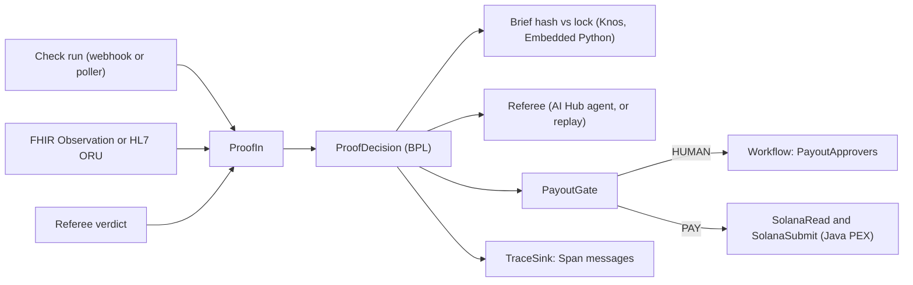

# Knos Referee on IRIS

**A lab pays for a research milestone only when IRIS finds the proof met.** An AI Hub agent on a local open model (no key) weighs a GitHub check run or a lab result; a rule and, above 50 USDC, a person in IRIS Workflow decide; then Solana devnet simulates the payout.

| | |
|---|---|
| The contest task | The agent is one step of an interoperability workflow: proof arrives through custom adapters and the agent answers a decision contract that code checks; every model and tool call is a message in Visual Trace. |
| Idea | [DPI-I-689](https://ideas.intersystems.com/ideas/DPI-I-689): LLM tracing as interoperability messages, built here |
| What is new | LLM tracing as interop messages with a Langfuse-style SQL view; Vector Search (snowflake-arctic-embed-s in Embedded Python) caps a verdict that cites a criterion outside the proof's 2 nearest. |
| Open Exchange | pending |
| Online demo | from 7 Nov 2026, user `demo`, password `demo` (read only); one command starts it on any Ubuntu 24.04 VM: `curl -fsSL https://raw.githubusercontent.com/drexthealpha/Knos/main/iris/cloud-start.sh | sudo bash -s -- <image tar>` |
| Video | the walk through one decision, its trace and its approval: link from 7 Nov |
| Articles | pending |
| Code | this folder; the IPM package is `module.xml` at the repository root |

## 1. What it decides

An InterSystems IRIS for Health production decides whether submitted proof meets a hash-locked Knos Ready brief: a
GitHub check run, a lab result (a FHIR Observation or an HL7 ORU^R01) or a Knos referee verdict. An AI Hub agent weighs
the proof; a deterministic gate and, above a threshold, a person in IRIS Workflow decide what happens next; only then
does Solana devnet see a transaction. Every step of a decision is an interoperability message in Visual Trace.

Try it (Linux or WSL with Docker; both containers peaked at 1,686 MiB and 1,310 MiB on 5 Nov 2026):

0. Download `irishealth-community-2026.3.0AI.154.0-docker.tar.gz` (x64) from the [AI Hub Early Access portal](https://evaluation.intersystems.com/Eval/early-access/AIHub) (an InterSystems login).
1. `git clone https://github.com/drexthealpha/Knos`
2. `cd Knos/iris`
3. `bash start.sh ~/Downloads/irishealth-community-2026.3.0AI.154.0-docker.tar.gz`: it loads the image, makes `.env` with random secrets, starts IRIS and the local model (no key; the first start pulls about 1 GB), and runs three decisions on public data (`data/public/SOURCES.md`): a Synthea FHIR Observation, an HL7 ORU^R01 lab message and a real GitHub check run.
4. Open `http://localhost:52773/knos/` and sign in as `_SYSTEM` with the `IRIS_PASSWORD` line of `.env`: each decision, its trace, the six AI Hub features working on it, and the approver's inbox.

Then `AMOUNT_USDC=80 bash scripts/smoke.sh`: above 50 USDC the met decision waits for a person; approve it in the inbox on `/knos/`. The decision's Visual Trace link opens the portal (same user; the image's `SYS` is refused).

IRIS's own log prints three lines at every start that come from the image, not from Knos code: `<CLASS DOES NOT EXIST>GetCacheDirs+24^STU *%SYSTEM.Process`, `<METHOD DOES NOT EXIST>Sharding+2^STU *Sharding,SYS.ICM` and `System appears to have failed over from node buildkitsandbox`.

Every test in one command, in replay mode: `bash scripts/test-all.sh` (build, health, the decisions, one trace through all six parts, the bonus checks, the page).

## 2. How it works

- **Hash-locked criteria.** The brief is locked with Knos's own `knos.ready.criteria_hash`, run in Embedded Python from
  the same `src/knos` the Knos web app, MCP server and CLI use. Proof against a brief whose hash changed is rejected
  before any model is asked.
- **An agent that can only say no.** The referee has no tool that moves money. Its answer is a decision contract
  (met, not_met or insufficient, with the evidence per milestone), checked by code.
- **Rule, Workflow, then the chain.** A deterministic gate (`Knos.Iris.Rule.PayoutGate`) turns the decision into PAY,
  HUMAN, REFUND_AT_DEADLINE or REJECT; HUMAN goes to a person in IRIS Workflow. PAY runs a devnet simulation of the
  payout, not a payment: the chain still needs Knos's signed token to release anything.
- **Every LLM step as an interop message** (an [InterSystems community idea](https://ideas.intersystems.com/ideas/DPI-I-689)). Each referee call, tool call, rule and approval is a
  `Knos.Iris.Msg.Span` in the decision's own session, kept in a Langfuse-style SQL view.

## 3. Requirements

Measured in a 4-core, 16 GB GitHub Codespace with `mem_limit: 3g`: build 160 s from the loaded image, health 7 to 9 s after the container starts, peak 1,660 MiB in `docker stats`. `scripts/codespace-setup.sh` prepares one. On a laptop: Docker Desktop with its default VM (about 3.9 GB on a 7.8 GB PC), the build 154 image tar from InterSystems, and (for live
mode) one model key. Measured on a 7.8 GB Windows laptop: the container's peak in `docker stats` was 1,188 MiB at run, the
Docker VM's (vmmem) 2,526 MiB through the build and the run; compose caps it at 3 GB (`mem_limit`), `merge.cpf` caps IRIS's buffers and the
Java gateway runs with `-Xmx192m`. FHIR is off by default (`KNOS_FHIR=0`): HealthShare Foundation then loads no FHIR
package, the step that took an uncapped build past 1,800 s. `KNOS_FHIR=1` loads R4 only and needs about 2 GB more.

## 4. The image used

`irishealth-community:2026.3.0AI.154.0` (InterSystems IRIS for Health, AI Hub build 154,
`IRIS for UNIX (Ubuntu Server LTS for x86-64 Containers) 2026.3.0AI (Build 154U)`), from the InterSystems file
`irishealth-community-2026.3.0AI.154.0-docker.tar.gz` (x64).

```sh
bash scripts/load-image.sh ~/Downloads/irishealth-community-2026.3.0AI.154.0-docker.tar.gz
```

The script runs `docker load -i`, reads the loaded name (`docker.iscinternal.com/docker-intersystems/intersystems/irishealth-community:2026.3.0AI.154.0`)
and retags it `irishealth-community:2026.3.0AI.154.0`, the name the Dockerfile builds on. Neither image, nor any built
on it, is ever pushed to a registry.

## 5. LLM provider and key

| Provider | `KNOS_LLM_PROVIDER` | Key variable | Default model (`KNOS_LLM_MODEL` changes it) |
|---|---|---|---|
| Anthropic | `anthropic` | `ANTHROPIC_API_KEY` | `claude-fable-5-1` |
| OpenAI | `openai` | `OPENAI_API_KEY` | `gpt-6-astra` |
| Google Gemini | `gemini` | `GEMINI_API_KEY` | `gemini-4-argon` |
| AWS Bedrock | `bedrock` | `AWS_ACCESS_KEY_ID`, `AWS_SECRET_ACCESS_KEY`, `AWS_REGION` | `anthropic.claude-opus-5-5` |
| Stub (tests) | `stub` | none | `stub-referee` |

`KNOS_AI_MODE=local` (the default in `.env.example`) needs no key and no account: the AI Hub agent
(`Knos.Iris.AI.LocalReferee`) asks `qwen2.5:1.5b-instruct` in the compose file's `ollama` service, through AI Hub's
`openai` provider at `base_url` `http://ollama:11434/v1` with `api_key` `none` (the ObjectScript guide's Ollama row). The
brief and the proof are in the question, with no tools: asked to fetch them with tools, the small model looked the brief up
by the wrong key and gave up. Each answer is checked by `Knos.Iris.AI.Verdict`, and the rules referee can only make it
stricter: where it reads not met or insufficient and the model said more, its answer stands and the trace says
"made stricter by the rules referee". Measured on 5 Nov 2026 (4 cores): 7 to 18 s a decision, about 670 tokens, 3 runs of
`tests/test_iris_decision.py` 9 of 9 each; the model decided 8 (the altered brief is refused before any referee is asked) and the rules referee made 5 of those stricter.

`KNOS_AI_MODE=live` asks the provider below with its key in `.env`. `KNOS_AI_MODE=replay` asks no model: the rules
referee, which reads only structured fields, decides and says "rules referee (no model key set)". No live call to a
paid provider has been made for this project. The health route says which mode runs. Never commit `.env`.

A hard spend cap is checked before any model call, so a key added here cannot be burned: at most `KNOS_LLM_MAX_CALLS`
calls (default 30) and `KNOS_LLM_MAX_USD` dollars (default 2.00), counted in `^Knos.LLM("calls")` and `^Knos.LLM("usd")`.
Once either is reached, live mode refuses in one plain sentence; with no key for the provider it refuses the same way.

| | Rules referee | AI Hub agent |
|---|---|---|
| Decides from | structured fields only (a check run's name and conclusion, an Observation's code and value) | the same, through its tools (GetBrief, GetCheckRun, GetObservation, GetVerdict, SearchCriteria) |
| Needs | nothing | needs a model key |
| Names and codes | exact (`test` is not `unit-tests`, `2345` is not LOINC `2345-7`) | the same contract, checked by `Knos.Iris.AI.Verdict` |
| Low confidence | | capped at 0.6 when the cited criterion is not in the top 2 by Vector Search, which sends the case to a person |
| Trace | one span per decision | one span per tool call (`Knos.Iris.AI.TraceAudit`) |

## 6. Start

```sh
cd iris && cp .env.example .env && bash scripts/env-secrets.sh && docker compose up -d --build
```

The `Dockerfile` builds in stages, the way the InterSystems community builds IRIS images
([iris-docker-multi-stage-script](https://github.com/grongierisc/iris-docker-multi-stage-script)). A builder stage runs
`iris.script`; the final stage starts again from the base image and copies in only the databases the install changed
(`scripts/copy-data.py`). Sources come in with `RUN --mount=type=bind`, and the KNOS namespace is its own cached step, so a
change to `src/` recompiles Knos without installing the namespace again. The production is stopped cleanly at the end of
the build, so a new container starts it with no journal recovery.

With IPM on any IRIS for Health instance, from a clone of the repository: `zpm "load <clone>/iris -v"` in a namespace
with interoperability on. It installs from `iris/` alone: it copies the Knos modules IRIS imports (`python/knos/`,
listed with their source commit in `python/VENDORED.txt`) and `python/knos_iris/` into `mgr/python`, compiles the Java
PEX jar with the instance's own JDK and starts the production in that namespace, with FHIR off.

## 7. Check that it works

```sh
set -a; . ./.env; set +a
curl -s -u "_SYSTEM:$IRIS_PASSWORD" localhost:52773/api/knos/health
bash scripts/smoke.sh
```

The health route answers `{"production":"Running","agent":"replay","fhir":"off","java":"ok","vector":"ok",...}`.
`smoke.sh` prints `decision: {"decision":"met","gate":"PAY",...}` and a Visual Trace URL.

## 8. Walkthrough of the three inputs

- **Check run.** Point a GitHub webhook (check runs) at `/api/knos/webhook` with the secret `KNOS_WEBHOOK_SECRET`, or POST it
  to `/api/knos/proof` (`"kind":"checkrun"`) with the same `X-Hub-Signature-256` over the body; unsigned, it is refused
  with 401. A file can also be dropped in
  `/home/irisowner/knos/inbox/checkruns/`, where the custom inbound adapter `Knos.Iris.Adapter.CheckRunInbound` picks it up.
- **Lab result.** POST a FHIR Observation (`"kind":"observation"`), or drop an HL7 ORU^R01 named `<briefId>.hl7` in
  `inbox/oru/`. The ORU's OBX-3, OBX-5/6, OBX-14 and OBX-16 become an Observation's code, value, time and performer.
- **Referee verdict.** POST a Knos referee verdict (`"kind":"verdict"`, as in `fixtures/verdicts/passed.json`) with its
  `signature`: `sha256=` and the HMAC-SHA256 of the verdict without that key (keys sorted, no spaces) under
  `KNOS_VERDICT_SECRET`. A verdict that does not verify is rejected before any referee reads it; Knos's
  `verdict_gate.strict` reads the rest, and its `spec_hash` must be the brief's criteria hash.

## 9. The Workflow approval

A met decision above `KNOS_PAYOUT_THRESHOLD_USDC` (default 50), a human-verified milestone or an insufficient answer goes
to the role `PayoutApprovers`. Open Interoperability > Workflow Inbox (user `_SYSTEM`) and choose Approve or Reject.
The milestone stays held for two days without an answer.

Each AI Hub feature the referee uses runs live at `GET /api/knos/aihub/<feature>` (same user), answering JSON:
`skill` (the folder `skills/knos-proof`, loaded with `%AI.Agent.Skill` and attached with `UseSkill`), `policy`
(`Knos.Iris.AI.ToolPolicy`, a `%AI.Policy.Authorization`: one tool call allowed, one refused), `mcp` (the referee's
tools as `Knos.Iris.AI.MCP`, a `%AI.MCP.Service` at `/mcp/knos` for IRIS's gateway `iris-mcp-server`), `rag` (a `%AI.RAG.KnowledgeBase` over the locked
criteria, searched), `stats` (`%AI.Agent.Session.GetStats` after one local model turn) and `workflow` (the tasks waiting).

## 10. Solana devnet

Live: the reads (`getSlot`, accounts, `simulateTransaction`, signature statuses) through the custom outbound adapter
`Knos.Iris.Adapter.SolanaRpcOutbound`. On PAY, IRIS builds Knos's payout instruction and the Java PEX operation
simulates it on devnet (`simulateTransaction`, with a throwaway fee payer): a simulation, not a payment, so no money
moves from IRIS. The money rule is Knos's own: the payment program pays the author of a pull request only on a
GitHub-signed token it verifies on chain, and anyone may relay it. A lab or referee milestone is released by the referee
panel's 2 of 3 signature; the link from IRIS's decision to that panel is not built in iris/ yet.
**IRIS never releases money alone.** Its decision is one input to those existing paths, and a refund past a
deadline needs no token at all. No program was changed for this.

## 11. The trace

Each decision's session in Visual Trace holds the Proof, the referee's Verdict, the Span messages (referee, rule,
Workflow) and the Decision. `GET /api/knos/traces/<session>` returns them as JSON; `Knos_Iris_Data.Span` is the flat
table (trace, span, parent, type, name, model, tokens, cost, latency, score, start); `docs/trace-schema.md` maps it to
Langfuse's trace and observation fields.

### Idea DPI-I-689, point by point

[DPI-I-689](https://ideas.intersystems.com/ideas/DPI-I-689) asks whether IRIS Interoperability can do the trace job
Langfuse does for LLM pipelines, and whether it is the better choice where IRIS Vector Search is used.

- **Interoperability as the trace.** Every referee call, tool call, rule and Workflow step of a decision is a
  `Knos.Iris.Msg.Span` message in the decision's own session, so the trace is the production's own message log.
- **Against Langfuse.** The table below holds each Langfuse capability next to what this production does, and says
  where it does less.
- **With Vector Search.** The search that grounds the agent writes its own span: the proof's two nearest criteria and
  their cosine. A verdict that cites a criterion outside those two is capped at 0.6 confidence and goes to a person.

| Langfuse | Here |
|---|---|
| Trace, observations, parent links | the session, `Knos.Iris.Msg.Span` messages with `ParentId` (`docs/trace-schema.md`) |
| Generation with model, tokens, cost | the `llm` span: model, tokens, cost from AI Hub's usage; running totals in `^Knos.LLM` |
| Trace viewer | Visual Trace, with the Proof, Verdict, Span and Decision messages in order |
| Query and export | `Knos_Iris_Data.Span`, plain SQL, and `GET /api/knos/traces/<session>` as JSON |
| Scores | each span's `Score`; the Workflow approver's answer is a span too |
| Data location | inside the lab's own IRIS: no trace leaves it |
| Retention and audit | the production's own message store and the IRIS journal, kept like any interface message |
| Prompt management, prompt playground | none here; prompts live in the code |
| Evaluation datasets and runs | none; the decision tests' inputs in `fixtures/` (briefs, check runs, observations, verdicts) only |

## 12. Where each part lives

| Part | Where it lives | How to see it |
|---|---|---|
| Java PEX | `java/src/main/java/knos/iris/pex/SolanaSubmitOperation.java`, item SolanaSubmit | its messages in Visual Trace |
| Workflow | item PayoutApprovers (`EnsLib.Workflow.Operation`), `BP/ProofDecision.cls` | Workflow Inbox |
| Custom adapters | `Adapter/CheckRunInbound.cls`, `Adapter/SolanaRpcOutbound.cls` | items GitHubCheckRunPoller, SolanaRead |
| Embedded Python | `Py/*.cls`, `python/knos_iris/` | `Knos.Iris.Py.Ready.Hash` equals Knos's hash outside IRIS |
| Vector Search | `Data/Criterion.cls` (`VECTOR(DOUBLE,384)`), `BO/BriefLock.cls` | the health route's `vector` |
| Docker | `Dockerfile`, `docker-compose.yml` | section 6 |
| ZPM | `module.xml` | section 6 |
| LLM trace as interop messages | `Msg/Span.cls`, `AI/TraceAudit.cls`, `Trace.cls` | section 11 |

## 13. Platform findings

Four reproduce on a clean build 154 container, each with its own `run.sh` in `bugs/`:
- [`bugs/1`](bugs/1): Embedded Python returns a Python int above 2^63 - 1 to ObjectScript as -1, with no error.
- [`bugs/2`](bugs/2): AI Hub's `%AI.ToolMgr.ExecuteTool` runs a tool when a required argument is missing or of the
  wrong type, although the schema it advertises marks the argument as required.
- [`bugs/3`](bugs/3): AI Hub's `%AI.RAG.VectorStore.IRIS` makes its table in SQLUser whatever its `Schema` says.
- [`bugs/4`](bugs/4): Embedded Python's `iris.sql.exec` with an int parameter past 64 bits fails with a `SystemError`
  that names neither the parameter nor its value.

Earlier suspects, each in its folder in `repro/` with its build string and what was tried, did not reproduce: on build 154 an LLM provider is
created on a fresh instance with no registry rebuild, `iris.sql.exec` with `FETCH FIRST n ROWS ONLY` returns its rows,
and keyword arguments to `iris.sql.exec` raise a plain TypeError. Each folder says what was tried.

## 14. Tests

`python tests/test_iris_decision.py` runs the core decision cases against a running instance: a passing check run, a
failing one, an altered brief, injection text in the proof, an ORU whose value misses the target; each session's trace
must hold the Proof, Verdict, Span and Decision messages. `python tests/test_iris_one_trace.py` sends one check-run file
through CheckRunInbound for a brief over the threshold, approves it in Workflow, and checks that its one session holds
CheckRunInbound, Embedded Python, Vector Search, Workflow, Java PEX and SolanaRpcOutbound.
`python tests/test_iris_vendored.py` needs no instance: the copied Knos modules equal `src/knos`. `python
tests/test_iris_docs.py readme` checks that every section and every file this README names exists.

## 15. Architecture


*Proof comes in three ways; one process checks the hash, asks the referee, gates, asks a person when needed, then Solana.*

## 16. Known limitations

- The AI Hub agent runs on the local open model by default (`KNOS_AI_MODE=local`, no key; section 5). A cloud model
  needs its provider key in `.env`; with neither, the production runs in replay mode.
- The vector search embeds with snowflake-arctic-embed-s (33M parameters, 384 numbers, 128 MB in the image as ONNX). Without it,
  `knos_iris.bridge` falls back to a hashed embedding: on 40 labelled proof pairs the top-2 hit rate is 1.000 against 0.925
  (`tests/test_embed_quality.py`).
- PAY is a devnet simulation of the payout (`simulateTransaction`), not a payment; nothing in iris/ sends money.
- The link from IRIS's decision to the referee panel (one of its 2 of 3 signatures) is not built yet.
- Solana devnet only, with test money.

## 17. How it fits Knos

Knos carries any research across the valley of death (idea or paper -> demand -> Ready brief -> money held -> paid on verified proof), toward Schmidhuber's vision and Kardashev II/III, connecting 8 billion people to the world's money.

This folder is part of the one Knos product: Knos checks demand, writes the Ready brief, holds the money on Solana and
pays only on verified proof; here the proof is checked inside IRIS for Health. The Knos code is imported, not forked:
the image runs the repository's `src/knos`, and the IPM install's ten copied files must equal it byte for byte
(`tests/test_iris_vendored.py`).

## 18. Team

Zulqarnain Abubakar, Developer Community profile: https://community.intersystems.com/user/zulqarnain-abubakar

## 19. License

MIT, the repository's own.

## 20. Bonuses

The 15 technology bonuses of [the contest post](https://community.intersystems.com/post/technology-bonuses-intersystems-programming-contest-ai-agents-interoperability-workflows), each with the file that shows it, or the founder's step where only the founder can do it.

| # | Bonus | Points | Shown by |
|---|---|---|---|
| 1 | Questionnaire | 1 | founder step |
| 2 | Production Extension (PEX), Java | 3 | `java/src/main/java/knos/iris/pex/SolanaSubmitOperation.java`, item SolanaSubmit |
| 3 | Workflow Engine | 2 | `src/Knos/Iris/BP/ProofDecision.cls`, role PayoutApprovers |
| 4 | Custom Adapter | 2 | `src/Knos/Iris/Adapter/CheckRunInbound.cls` (inbound), `src/Knos/Iris/Adapter/SolanaRpcOutbound.cls` (outbound) |
| 5 | Find a bug in AI Hub | 2 (3 for two) | two bugs, each with run.sh and what it printed: [`bugs/2`](bugs/2) (ExecuteTool runs arguments its schema refuses), [`bugs/3`](bugs/3) (VectorStore.IRIS ignores Schema); filing them is a founder step |
| 6 | Embedded Python | 3 | `src/Knos/Iris/Py/Ready.cls`, `src/Knos/Iris/Py/Embed.cls`, `python/knos_iris/referee.py` |
| 7 | IRIS Vector Search | 2 | `src/Knos/Iris/Data/Criterion.cls` (`VECTOR(DOUBLE,384)`) |
| 8 | Docker container | 2 | `Dockerfile`, `docker-compose.yml` |
| 9 | ZPM package | 2 | `module.xml` at the repository root; publishing it on Open Exchange is a founder step |
| 10 | Online Demo | 2 | `scripts/demo-vm.sh`; running it on a VM is a founder step |
| 11 | Community Idea | 4 | [DPI-I-689](https://ideas.intersystems.com/ideas/DPI-I-689): `src/Knos/Iris/Msg/Span.cls`, `docs/trace-schema.md`, section 11 |
| 12 | Find a bug in Embedded Python | 2 (3 for two) | two bugs: [`bugs/1`](bugs/1) (an int past 64 bits arrives as -1), [`bugs/4`](bugs/4) (iris.sql.exec with such an int fails with SystemError); filing them is a founder step |
| 13 | First article on Developer Community | 2 | founder step |
| 14 | Second article | 1 | founder step |
| 15 | Video on YouTube | 3 | founder step |
