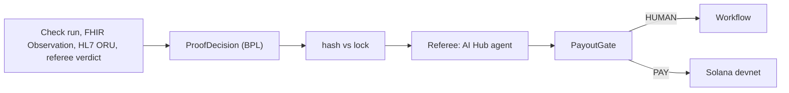

# An AI agent that can only say no: deciding payouts on proof with AI Hub and IRIS Interoperability

## The problem

Research is paid for before anyone knows whether it worked. Knos turns a request into a Ready brief: each milestone has
a measurable target, a named verifier and a deadline, and the brief is locked by its hash. Money is held on Solana and
paid only on proof. The hard part is deciding, at scale and without trusting a model's word, whether a piece of proof
meets the milestone as written.

## The production

Every input becomes a `Knos.Iris.Msg.Proof`. One BPL process checks the brief's hash, asks the referee, applies a rule,
asks a person when the rule says so, and only then reaches Solana.

## Why the hash, the rule and Workflow sit around the agent

The model is assumed compromised: a proof can carry text written to steer it. So the agent decides one narrow thing and
has no tool that moves money. Before it is asked, Embedded Python runs Knos's own `knos.ready.criteria_hash` on the
brief as presented; a brief changed after it was locked is rejected with no model call. After it answers, a
deterministic gate decides PAY, HUMAN, REFUND_AT_DEADLINE or REJECT. Above a threshold, or for a human-verified
milestone, a person approves in the Workflow Inbox. And the chain has its own rule: Knos's payment program pays only on
a GitHub-signed token, or the referee panel's signature.

## The decision contract, and the missing structured output

The agent answers `{"criteria_hash","decision":"met|not_met|insufficient","milestones":[{"key","met","evidence","reason"}],"confidence"}`.
AI Hub on build 154 has no structured-output parameter, so `Knos.Iris.AI.Verdict.Parse` checks the reply and asks once
more; a second miss is `insufficient`, which sends the milestone to a person.

## Policies

`%AI.Policy.Authorization` keeps tools behind a policy. The referee has no payout tool at all, which is the stronger
guarantee: there is nothing to authorize.

## Replay and live

`KNOS_AI_MODE=replay` needs no key: a recorded live answer when one exists for the brief and proof, else a rules referee
that reads only structured fields (a check run's name and conclusion, an Observation's code and value). Injection text in
a proof changes nothing there. `live` asks the provider in `.env`. The health route says which mode ran.

## How to run it

Load the build 154 image with `iris/scripts/load-image.sh`, `cp .env.example .env`, `docker compose up -d --build`, then
`bash scripts/smoke.sh`.

## What I would change

A structured-output setting in AI Hub would remove the parse-and-retry step. And a lab's own signature on its
Observation would let a lab milestone go straight to PAY instead of a person.
